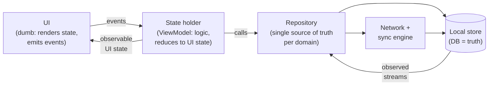

# Mobile 02 — Client Architecture Patterns

> **Sources:** Android Architecture Guides (UDF/state-holder canon) · weeeBox framework · consolidates what every case study (08–30) assumes in its §2.
> **Role in the track:** this is the *default skeleton* the [standard anatomy](01-framework.md#4-the-standard-client-anatomy) sketches — here's the why behind each layer, and the probes that test whether you own it or recite it.

## What you'll master

- **Unidirectional data flow (UDF)** as the one non-negotiable — and why MVC/MVP/MVVM/MVI arguments are mostly noise around it.
- The layer contract: **UI renders state, state-holders own logic, repositories own truth** — and what breaks when a layer is skipped.
- **The screen as a function of synced state** — the single sentence that makes process death, deep links, and push all the same solved problem.
- Where architecture is graded in the interview: not the acronym, but **what happens on rotation, process death, and a second data source**.

## 1. The one non-negotiable: unidirectional data flow

- **State flows down, events flow up.** The UI never mutates state it renders; it emits intent ("retry tapped") and re-renders whatever state arrives. This kills the classic mobile bug class — two views disagreeing about truth — because there's exactly one place truth lives per screen.
- **MVVM vs MVI vs whatever:** say it plainly — *"the pattern names differ on how state is reduced (many observables vs one immutable state object + reducer); I default to a single immutable UI-state stream per screen because it makes state restoration and testing trivial, and I don't spend interview minutes on taxonomy."* Staff signal: refusing the acronym war while nailing the invariant.
- **The UI state is a value, not a view hierarchy:** a data class (`Loading / Content(items, refreshing) / Error(retryable)`) — renderable, serializable, assertable in tests without an emulator.

## 2. The repository layer — where truth is decided

- **One repository per domain, and it owns the merge:** network responses and DB rows meet *here*, nowhere else. The UI never sees "cached vs fresh" — it sees the repository's stream of current truth ([09 §3](09-news-feed.md)'s cache-then-network lives here).
- **The local store is the source of truth; the network is a synchronization mechanism** — the track's spine sentence. Reads come from the DB (observable queries push updates to every screen at once); writes go to the DB *and* an outbox; the sync engine reconciles ([04](04-data-caching-sync.md) owns the details).
- **Why not "just fetch in the ViewModel"?** Two screens fetching independently disagree, retry independently, and race. The repository is the dedup point, the cache policy point, and the single seam you mock in tests. Skipping it is fine for a to-do app and disqualifying for a chat app — and *saying when it's fine* ([framework §7](01-framework.md)'s YAGNI rung) beats maximal layering.

## 3. Process death is the architecture test

- **The interview's favorite trapdoor:** "user backgrounds the app, OS kills it, they return." Rotation-level state (`ViewModel`) is gone; only two things survive — the **local store** and the small **saved-state handle** (screen route + IDs, ~KBs).
- **The rule:** every screen must be constructible from `(route, IDs) + local store`. Scroll position and half-typed text ride the saved-state handle; *content* re-hydrates from the DB. This is why [24](24-hotel-reservation.md)'s funnel is DB rows and [29](29-ecommerce-checkout.md)'s attempt is a persisted row — the pattern generalizes: **durable state in the store, navigational state in the handle, nothing load-bearing in memory.**
- Deep links and push taps get correctness for free: they're just another way to arrive at `(route, IDs)` ([22 §5](22-push-notification-system.md)).

> **Staff-level insight:** say *"the screen is a function of synced state, not of navigation history"* once, then demonstrate it — process death, deep link, push tap, and multi-device sync all become the same code path. Interviewers grade the unification, not the vocabulary.

## 4. Scaling the architecture — modules, DI, and teams

- **Modularisation is this pattern applied at org scale:** feature modules own their UI+ViewModel+repository verticals behind `api/impl` seams; the app shell composes them — [28](28-modularisation.md) is the full treatment, and Conway's law is the point, not the accident.
- **DI is the composition mechanism, not a framework debate:** constructor injection everywhere; the graph wires repositories to their stores once, at the shell. Test doubles slot in at the repository seam — which is why the seam exists.
- **SDKs delete the top layers:** a library ([16](16-image-loading-library.md), [19](19-pagination-library.md), [20](20-analytics-sdk.md)) is this anatomy minus UI — public API where the ViewModel was, same discipline underneath. The SDK-vendor lens: *"an SDK is a repository layer shipped to strangers."*

## When NOT

- **Trivial/short-lived screens** (settings toggle, about page): a state holder reading a store directly is fine; ceremony without churn is cost.
- **Games / canvas-heavy apps:** frame-loop architectures, not UDF screens.
- **Don't retrofit mid-crisis:** architecture migrations ride the strangler pattern module-by-module ([28 §5](28-modularisation.md)), never big-bang.

---

## Interview Cheat-Sheet

**30-second version:** UDF: state down, events up, one immutable UI-state stream per screen · repository per domain owns the merge; local store is truth, network is sync · every screen rebuildable from route + IDs + store (process death, deep links, push = one path) · modules/DI scale it to teams; SDKs are the same anatomy minus UI.

| Probe | Answer |
|---|---|
| "MVVM or MVI?" | "Same invariant — UDF with a single state stream; I won't spend our minutes on taxonomy" |
| "OS kills the app mid-flow?" | Durable state is in the store, route+IDs in the saved-state handle — the screen re-derives; nothing load-bearing lived in memory |
| "Why a repository at all?" | Dedup point, cache policy point, test seam — two ViewModels fetching independently is how views end up disagreeing |
| "Where does business logic live?" | State holders for screen logic, repositories/domain layer for cross-screen rules — never in the view, never twice |

**Say-verbatim:**
- *"State flows down, events flow up — everything else is implementation detail."*
- *"The local store is the source of truth; the network is a synchronization mechanism."*
- *"The screen is a function of synced state, not navigation history."*
