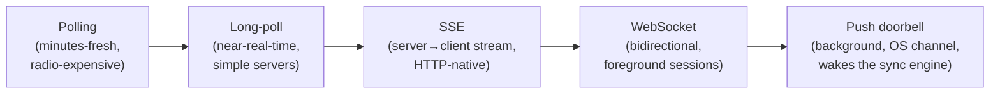

# Mobile 03 — Networking & Real-Time on Mobile

> **Sources:** weeeBox framework (protocol ladder) · Deep Dives [13 — Realtime Updates](../Deep%20Dives/13-realtime-updates.md) (the server half) · platform radio/battery docs.
> **Role in the track:** the radio is the scarcest, flakiest resource the client owns. This note is the physics + the two ladders (request protocols, real-time delivery) every case study climbs.

## What you'll master

- **Radio physics**: the state machine that makes one byte cost seconds of battery — and "batch or die" as its consequence.
- The **protocol decision** (REST/gRPC/GraphQL) as a mobile-shaped trade, not a fashion choice.
- **Transport discipline**: timeouts, retries with backoff + jitter, and why retry policy is inseparable from idempotency ([29](29-ecommerce-checkout.md)).
- The **real-time ladder** — polling → long-poll → SSE → WebSocket → push doorbell — and the one-sentence placement rule.

## 1. The physics: the radio is a state machine with a tail

Cellular radios promote from idle → low-power → full-power to send *anything*, then **linger at high power for 5–10 s** (the tail) before demoting. Consequences you must design around, not lament:

- **One byte costs the same as ten thousand** — the promotion + tail dominates. Therefore: **batch or die** — coalesce writes ([20 §4](20-analytics-sdk.md)'s N/T/background triggers), piggyback on existing wakes, prefetch on the wakes you already paid for ([25 §4](25-tiktok-short-video.md)).
- **Periodic anything is a battery bug**: a 30 s heartbeat keeps the radio permanently warm. Real-time needs either a *held connection* (WebSocket, one radio session) or *the platform's shared channel* (push — FCM/APNs hold ONE connection for the whole device; that's the whole reason the doorbell exists, [22](22-push-notification-system.md)).
- **Latency is bimodal, not average**: p50 on Wi-Fi means nothing; design for p95 on congested LTE — timeouts and UX (optimistic UI, [08](08-chat-app.md)) come from the tail, not the mean.

## 2. Request protocols — the mobile-shaped choice

| Protocol | Mobile-relevant strengths | Costs | Default when |
|---|---|---|---|
| **REST + JSON** | Ubiquitous, debuggable, cache-friendly (ETags) | Verbose payloads, N+1 screens | Default for public/product APIs |
| **gRPC / protobuf** | Small payloads, streaming, codegen contracts | Binary debugging, gateway needs | Chatty internal APIs, bandwidth-sensitive |
| **GraphQL** | One round trip per *screen*, client-shaped queries | Server complexity, cache semantics, runaway queries | Screen-shaped reads across many entities (feeds) |

The Staff answer names the *deciding force*: round trips. On a 200 ms RTT radio, a screen needing 4 sequential calls is a 1 s screen — so the real decision is **"design server endpoints screen-shaped"** (BFF pattern), whichever protocol carries them. Then: HTTP/2+ multiplexing (one connection, no head-of-line at the request layer), QUIC/HTTP-3 where loss is high, TLS session resumption, and connection reuse as defaults you *mention*, not debate.

## 3. Transport discipline — the rules that prevent self-inflicted outages

- **Timeouts are per-operation, not global**: interactive reads short (seconds + honest UI), uploads long, money calls generous-but-bounded with resolution paths ([29 §4](29-ecommerce-checkout.md)).
- **Retries: backoff + jitter, budgeted, idempotent-only.** Exponential backoff with jitter (a fleet of clients retrying in sync is a DDoS you wrote yourself — [DD-22](../Deep%20Dives/22-rate-limiting.md)'s thundering herd); a retry *budget* per operation; and never auto-retry non-idempotent calls at the transport layer — retry decisions for money belong to the state machine that owns the idempotency key.
- **Offline is a state, not an error**: detect (but don't trust) reachability signals; queue writes ([08](08-chat-app.md)'s outbox); let reads serve stale-from-store with honest labels. The network layer's job is *reporting truthfully*, the repository's job is deciding what to do.
- **The server contract carries versions**: shipped clients live for years — every payload change is additive, every enum has an unknown-value path, and capabilities negotiate at connect ([08 §6](08-chat-app.md)'s protocol versioning).

## 4. The real-time ladder — pick the lowest rung that meets latency

The placement rule, verbatim: *"**WebSocket while the app is foreground and the surface is live** (chat screen, trading quotes, trip tracking); **push as the background doorbell**; polling only as a backstop. And whatever wakes the client, the data flows through the same delta-sync path"* ([08 §4](08-chat-app.md) — reconnect = push-wake = cold start, one path to harden). Foreground sockets: heartbeat at the *server's* interval, resume-by-cursor on reconnect, and treat the socket as a **latency optimization over sync, never the source of truth** — missed socket frames must cost nothing ([15 §3](15-stock-trading-app.md)'s quotes plane is the worked example, conflation included).

> **Staff-level insight:** the ladder is a cost ladder, not a capability ladder — each rung holds radio/server resources longer. Climbing only as far as the product's latency budget requires is the demonstration of judgment; "WebSockets everywhere" is the junior tell.

## When NOT

- **True streaming media** is its own stack ([11](11-youtube.md)/[26](26-spotify-music.md): HTTP range + ABR, not sockets).
- **Same-building IoT/LAN**: different physics (mDNS, BLE, local sockets) — say it's out of the cellular model.
- **"Real-time" that's actually minutes-fresh** (dashboards): polling on the app's existing wake cadence is honest and cheap — don't buy a socket for it.

---

## Interview Cheat-Sheet

**30-second version:** radio = promote + 5–10 s tail → one byte costs like ten thousand → batch or die, piggyback wakes · protocol chosen by round trips → screen-shaped endpoints (BFF) · timeouts per-operation; retries = backoff + jitter + budget + idempotent-only · real-time ladder: lowest rung that meets the latency budget — socket foreground, doorbell background, everything drains through one delta-sync path.

| Probe | Answer |
|---|---|
| "Why is polling every 30 s bad?" | The radio tail keeps the chip at high power permanently — it's not the bytes, it's the state machine; batch onto existing wakes or hold one socket |
| "WebSocket or push?" | Both, by app state: socket for live foreground surfaces, push as the background doorbell — and both just trigger the same cursor sync |
| "Your retries took down the backend?" | Sync'd retries are a client-built DDoS: exponential backoff *with jitter*, retry budgets, and 429/Retry-After respected — [DD-22](../Deep%20Dives/22-rate-limiting.md) from the client seat |
| "GraphQL?" | When screens aggregate many entities, one round trip per screen wins on a 200 ms radio — but the deciding force is round trips, and a screen-shaped REST BFF gets the same win |

**Say-verbatim:**
- *"Batch or die — the radio tail makes one byte cost like ten thousand."*
- *"I pick the lowest rung of the real-time ladder that meets the latency budget — each rung up holds resources longer."*
- *"The socket is a latency optimization over sync, never the source of truth — a missed frame must cost nothing."*
