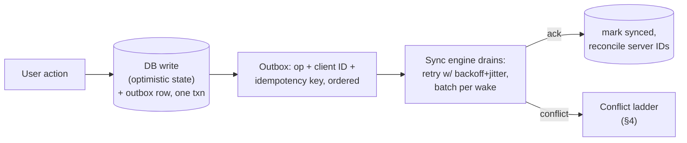

# Mobile 04 — Data, Caching & Offline-First Sync

> **Sources:** weeeBox caching exercise · offline-first literature · consolidates the sync spine used by [08](08-chat-app.md), [09](09-news-feed.md), [23](23-google-drive.md), [24](24-hotel-reservation.md), [26](26-spotify-music.md), [27](27-collaborative-editor.md).
> **Role in the track:** offline/sync is crux #1 of the [seven cruxes](01-framework.md#6-the-seven-recurring-cruxes) — the one that appears in *every* app case study. This note is the engine room.

## What you'll master

- The **three-tier cache** (memory / disk / DB) and which invalidation scheme each tier earns.
- The **write path**: persisted outbox + idempotent replay — the track's single most reused primitive.
- **Delta-sync-by-cursor** as the one download path, and why "one path" is the design decision.
- The **conflict-resolution ladder**: LWW → field merge → operational (CRDT) → conflicted copy — and how to pick a rung per data type.
- **Staleness tiers** — turning "is the cache fresh?" from anxiety into a budget.

## 1. The three tiers — and what each is for

| Tier | Holds | Keyed by | Evicts by | Invalidate by |
|---|---|---|---|---|
| **Memory** | Decoded/derived objects (bitmaps, parsed models) | Identity + variant (url+size, [16](16-image-loading-library.md)) | LRU under size budget (~1/8 heap for images) + trim callbacks | Generation bump — never chase entries |
| **Disk cache** | Re-fetchable bytes (images, media segments) | Content URL / content hash | LRU under byte budget, two pools if pinned content exists ([26 §5](26-spotify-music.md)) | TTL loose — bytes are immutable-ish; key carries the version |
| **Local DB** | *Truth*: domain entities, outbox, sync cursors | Entity IDs | Never evicted implicitly — pruned by policy (windowing, [09 §3](09-news-feed.md)) | Not invalidated — *synced* |

The sentence that organizes the room: **caches hold things you can afford to lose; the DB holds things you can't.** Losing a cache costs a refetch; losing the outbox loses user data — so budgets and eviction live in tiers 1–2, and tier 3 gets transactions, migrations, and backup exclusion decisions instead.

## 2. The write path — one primitive, reused forever

- **Optimistic write + persisted outbox in one transaction** — the UI updates instantly from the DB; the outbox survives process death; the sync engine replays with client-minted IDs so replay is idempotent ([08](08-chat-app.md)'s messages = [09](09-news-feed.md)'s likes = [23](23-google-drive.md)'s file ops = [20](20-analytics-sdk.md)'s events). Extract it once as a platform primitive — that's a Staff line with an org payoff.
- **Two queue temperaments, one skeleton:** fire-and-forget queues (likes, analytics) retry blindly — duplicates are cheap and deduped server-side. **Money queues resolve before retrying** ([29](29-ecommerce-checkout.md)) — same persistence, opposite reflex. Naming the split *is* the answer to "do you put payments in the outbox?"
- **Ordering** matters per-entity, not globally: sequence the queue per conversation/document ([23 §4](23-google-drive.md)'s ordered op queue), let independent entities drain in parallel.

## 3. The read path — delta-sync-by-cursor, one path

- **The engine:** `GET /changes?cursor=X` → apply upserts/tombstones to DB in a transaction → persist new cursor. Server-owned opaque cursor ([09 §2](09-news-feed.md)); tombstones for deletes (or deletion is invisible); batches sized for radio wakes.
- **One path, many triggers:** cold start, foreground return, push doorbell, socket reconnect, pull-to-refresh — *all* call the same sync ([08 §4](08-chat-app.md)). The alternative — bespoke fetch paths per trigger — is the rot that produces "worked on refresh, broke on push."
- **Full-vs-delta honesty:** first launch and cursor-too-old (server pruned history) fall back to windowed snapshot + fresh cursor. Design the fallback on day one; it *will* run.

## 4. The conflict ladder — pick the cheapest rung per data type

| Rung | Mechanism | Right for | The catch |
|---|---|---|---|
| 1 | **Last-write-wins** (server timestamp) | Preferences, toggles, presence | Silently drops a writer — never for content |
| 2 | **Field-level merge** (versioned fields) | Profile/forms — disjoint edits merge | Same-field conflicts still need a rung up |
| 3 | **Operational / CRDT** | Collaborative content ([27](27-collaborative-editor.md)) | Engine complexity — buy (Yjs/Automerge), don't build |
| 4 | **Conflicted copy** (both survive, user decides) | Files/documents ([23 §5](23-google-drive.md)) | UX debt — but honest when merge semantics don't exist |

The Staff move is the *mapping sentence*: *"per data type, I pick the cheapest rung whose data-loss story the product can live with — LWW for settings, merge for profiles, CRDT for the doc body, conflicted copy for opaque files."* One app uses all four rungs simultaneously; a single global answer is the junior tell.

## 5. Staleness tiers — freshness as a budget

Every read surface gets an explicit tier, not a vibe ([24 §2](24-hotel-reservation.md) is the worked funnel): **browse may lie by minutes** (cached, free) → **detail hedges** ("as of 9:41", cheap revalidation) → **action surfaces revalidate** (entering checkout re-checks) → **money/trading surfaces refuse staleness** (fail closed, [15](15-stock-trading-app.md)). Then TTLs, generation bumps, and pull-to-refresh are *implementations of a tier*, chosen per surface. Announcing *"staleness is a budget — I spend it where it's cheap"* reframes every cache question that follows.

> **Staff-level insight:** offline-first is not a feature, it's an ordering: **DB first, network as sync**. Retrofitting it inverts every read and write path in the app — which is why it's the architecture decision to get right on day one even when v1 ships online-only.

## When NOT

- **Ephemeral-by-design** (live quotes, [15](15-stock-trading-app.md)): render-from-socket with a stale banner beats pretending a cache of moving prices is truth.
- **Legally can't-persist** (DRM frames, some PII): the tier is memory-only, and that's a compliance statement, not a performance one.
- **Tiny utility apps:** a `stale-while-revalidate` HTTP cache may be the whole story — full sync engines are earned, not default.

---

## Interview Cheat-Sheet

**30-second version:** three tiers — caches hold what you can lose, DB holds what you can't · writes: optimistic DB write + persisted idempotent outbox, one txn; fire-and-forget retries blindly, money resolves first · reads: delta-sync-by-cursor, one path for every trigger, snapshot fallback designed day-one · conflicts: cheapest of LWW / field-merge / CRDT / conflicted-copy per data type · staleness is a budget, tiered per surface down to zero at money.

| Probe | Answer |
|---|---|
| "How do you invalidate the cache?" | Mostly I don't — generations for derived caches, sync (not invalidation) for the DB, and TTLs only on surfaces whose tier tolerates lying |
| "User edits the same note on two offline devices?" | Ladder by data type: this is content → CRDT if it's collaborative by product, else conflicted copy — LWW here is silent data loss |
| "Sync on reconnect vs push vs launch?" | Same engine, same cursor, three triggers — one path is the design decision |
| "What's in the DB vs the cache?" | Outbox, entities, cursors in the DB (transactions, never evicted); refetchable bytes and decoded objects in budgeted LRU tiers |

**Say-verbatim:**
- *"Caches hold what I can afford to lose; the database holds what I can't."*
- *"One sync path — reconnect, push, and cold start are triggers, not features."*
- *"Per data type, the cheapest conflict rung whose data-loss story the product survives."*
- *"Staleness is a budget: minutes on browse, zero at money."*
