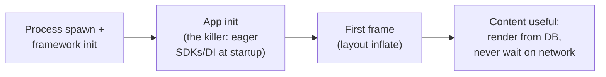

# Mobile 05 — Performance, Battery & Startup

> **Sources:** Android Vitals / iOS MetricKit docs (the thresholds are published) · platform performance guides.
> **Role in the track:** the numbers note. Google interviewers expect the budgets *by heart* — this is where "fast" becomes arithmetic, and where [16](16-image-loading-library.md), [25](25-tiktok-short-video.md), and [14](14-ride-hailing.md) get their physics.

## What you'll master

- **The numbers block** — the seven figures that turn hand-waving into budgets.
- **Cold start as a pipeline** with a per-phase budget, and the three highest-leverage fixes.
- **Frames and the main thread**: 16 ms, jank, and the discipline that protects it.
- **Memory arithmetic** — why images dominate, and the bitmap math to do aloud.
- **Battery as a wake problem**, not a CPU problem — and the field-measurement loop that keeps all of it honest.

## 1. The numbers block (recite-ready)

| Number | Meaning | Design consequence |
|---|---|---|
| **16 ms** (11 ms @ 90 Hz, 8 ms @ 120) | One frame at 60 Hz | Nothing unbounded on the main thread, ever |
| **~700 ms / 2 s / 5 s** | Cold start: good / acceptable / flagged by Android Vitals | Startup is a budgeted pipeline, not a hope |
| **5 s** | ANR threshold (main thread blocked) | The OS *publicly* files your jank as a crash-adjacent metric |
| **width × height × 4 bytes** | Decoded bitmap cost | A 12 MP photo ≈ 48 MB decoded — *downsample at decode to the view size* ([16 §3](16-image-loading-library.md)) |
| **~1/8 of heap** | Sane memory-cache budget | Caches are guests: size to budget + honor trim callbacks |
| **5–10 s** | Radio high-power tail after any traffic | Batch or die ([03 §1](03-networking-realtime.md)) |
| **4 KB** | Push payload cap | Push is a doorbell ([22](22-push-notification-system.md)) |

> **Staff-level insight:** the numbers aren't trivia — each one *is* a design rule (third column). Delivering the consequence with the number is what separates "read the docs" from "owns the budget."

## 2. Cold start — a pipeline with a budget

The three highest-leverage moves, in order:

1. **Defer everything deferable:** app-init is death by a thousand SDK `init()`s — lazy-init on first use, move non-critical registrations off the critical path (app-startup libraries make ordering explicit). The audit question: *"what, on this list, must run before the user sees content?"* — usually almost nothing.
2. **First screen renders from the local store** — cold start must not include a network round trip ([04](04-data-caching-sync.md)'s ordering pays here; [10 §2](10-google-maps.md)'s "render from resident, never wait on network" is the extreme form). Sync refreshes *after* content is on screen.
3. **Precompile the hot path:** baseline profiles / AOT hints for the startup classes — measured double-digit % wins for a config file's worth of effort.

Measure all of it **in the field** (Vitals / MetricKit percentiles by device tier), not on your flagship — the p90 user's device is 4 years old, and startup regressions gate releases ([07](07-release-engineering.md)).

## 3. Frames & the main thread

- **The main thread renders; everything else is intrusion**: I/O, JSON, DB, decode → off-main by construction (the architecture from [02](02-client-architecture.md) makes this structural: repositories do work on background dispatchers, the UI just renders arriving state).
- **Jank clusters at scroll** — the classic trio: decode-on-bind (fix: pipeline + placeholder, [16 §4](16-image-loading-library.md)), layout depth (flatten), and synchronous DB reads in adapters (observable queries prefetched by the pager, [19](19-pagination-library.md)).
- **The 5 s ANR is the same bug at catastrophic scale** — a lock held across a network call, a synchronous IPC on resume. ANR rate is a Vitals metric with *store-ranking consequences*: it's a business number, which is the EM's lever for funding the fix.

## 4. Memory — do the bitmap math aloud

Images dominate every content app's heap. The worked example interviewers want to hear: a feed showing 10 images at 1080×1080 decoded full-size = 10 × 1080×1080×4 ≈ **46 MB** — on a 192 MB heap budget, gone. Fix: decode at *view* size (a 300 px cell needs 300×300×4 ≈ 360 KB — a **13× saving per image**), LRU cache at ~1/8 heap, respond to trim callbacks by dropping tiers ([16](16-image-loading-library.md) end-to-end). Everything else is hygiene: no activity references outliving screens (the classic leak), pools for hot-path allocations, and heap dumps on the p90 device, not the dev machine.

## 5. Battery — a wake problem

Battery burn is dominated by **how often you force hardware awake**, not CPU cycles: radio wakes (batch, piggyback — [03 §1](03-networking-realtime.md)), GPS sampling (adaptive by product need — [14 §4](14-ride-hailing.md)'s driver ladder), and background execution (deferrable work goes to the OS scheduler with constraints — charging + unmetered for the heavy stuff, [23 §4](23-google-drive.md)). The OS is an adversarial auditor (Doze, App Standby, background limits): apps that fight the scheduler get throttled, apps that batch into OS-chosen windows keep their budget. Foreground work honesty: if it must run now, it's a foreground service with a visible notification — the user sees the cost you're spending.

## When NOT

- **Don't optimize without a field profile** — the p90 device and p95 metric decide priorities; flagship-lab intuition reliably lies.
- **Don't cache your way out of an algorithmic problem** — a 46 MB decode "fixed" by a bigger cache is deferred, not fixed.
- **Sub-16 ms micro-optimization** on cold paths is vanity; spend where frequency × cost is highest (scroll, startup, the sync loop).

---

## Interview Cheat-Sheet

**30-second version:** budgets, not vibes — 16 ms frames, 2 s cold start (5 s = flagged), 5 s ANR, w×h×4 bitmaps, 1/8-heap cache, 5–10 s radio tail, 4 KB push · cold start: defer init, render from DB, precompile hot path, measure p90 in field · main thread renders, all else off-main; jank lives at scroll · battery = wakes: batch radio, adaptive GPS, defer to OS scheduler · every number gates releases via Vitals.

| Probe | Answer |
|---|---|
| "App starts slowly — where do you look?" | Phase budget: app-init eager work first (defer it), then first-content source (must be the DB, not network), then baseline profiles — and I look at field p90 by device tier, not my phone |
| "Scrolling stutters?" | The trio: decode-on-bind, deep layouts, sync DB in binds — fix order by profiler, protect with the off-main architecture |
| "Why did memory spike on the feed?" | w×h×4: full-size decodes behind small views — downsample at decode, 13× per image |
| "How do you know a release hurt battery?" | Wake metrics in the field (radio wakes/hr, GPS-on time, job frequency) as release-gate dashboards — battery regressions are release regressions |

**Say-verbatim:**
- *"Performance is budgets, not adjectives — 16 milliseconds is the frame, and everything on the main thread is spending it."*
- *"Cold start renders from the database; the network is not on the critical path."*
- *"A decoded image is width times height times four — I do that math before it does me."*
- *"Battery is a wake problem: the question is never 'how much CPU' but 'who woke the hardware and could they have shared the ride.'"*
