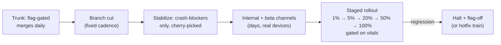

# Mobile 07 — Release Engineering & Experimentation

> **Sources:** Play Console / App Store Connect staged-rollout docs · release-train practice (large-app canon) · [21 — A/B & Feature-Flag SDK](21-ab-feature-flag-sdk.md) is this note's delivery mechanism.
> **Role in the track:** physics difference #4 — **you can't roll back an APK**. Every EM answer about risk eventually lands here; this note is the machinery that makes shipping safe anyway.

## What you'll master

- The **no-rollback physics** and its three consequences: trains, flags, and forced-upgrade floors.
- The **release train**: why cadence beats readiness, and what the branch-cut discipline buys.
- **Staged rollout as a gated pipeline** — percentages, the metrics that gate each step, and halt-vs-hotfix decisions.
- **The version tail**: shipped clients live for years — API compat, kill switches, and min-version as an ecosystem contract.
- **Experimentation at release scale** — flag-gated code as the unit of shipping, and the cleanup debt that follows.

## 1. The physics and its three consequences

A shipped binary cannot be recalled: users update on *their* schedule (or never), stores add review latency (hours–days), and at any moment production is a **distribution across dozens of versions**, not a version. Three consequences structure everything:

1. **Decouple ship from release** — code ships dark behind flags; *release* is a config flip you can reverse in minutes ([21 §5](21-ab-feature-flag-sdk.md)'s kill lane). The rollback you can't do at the binary layer, you buy at the flag layer.
2. **Ride a train, not a milestone** — fixed cadence (weekly/biweekly cut), miss the train → catch the next one. Removes the "hold the release for my feature" negotiation that turns releases into events.
3. **Maintain a floor** — forced-upgrade machinery (min-version check at API gateway + in-app upgrade wall) is built and *rehearsed before you need it*, because one day a shipped version will have a security hole or a protocol break, and "we can't make them upgrade" is not an answer ([08 §6](08-chat-app.md)).

## 2. The train — cadence as risk control

- **Trunk-based + flags** is what makes the cut cheap: no long-lived feature branches to merge-panic; unfinished work rides dark. The cut is mechanical — a date, not a judgment call.
- **Stabilization takes only crash-blockers** — everything else catches the next train (it's a week away, which is the point: the cost of missing is low, so the pressure to force-merge evaporates — this is the *organizational* payoff of cadence, and the EM says it that way).
- **Beta channels are the real-device test** the lab can't be: the device × OS × locale × network matrix ([framework §2](01-framework.md)'s fragmentation) only exists in the field. Size the beta for signal on your crash-rate precision.

## 3. Staged rollout — the gated ramp

- **Gates, not vibes:** each percentage step holds until the release-health dashboard clears — crash-free-sessions vs baseline, ANR rate, startup p90, key funnel conversion ([24](24-hotel-reservation.md)'s payment success), and the feature's own guardrails. A step is a *decision with data*, and the decision-maker is named (release owner rotation).
- **Halt is cheap, so halt early:** pausing at 5% caps the blast radius at 5% of one version's adopters. The order of response: **flag off** (minutes, if the regression is behind a flag — this is why it should be) → **halt rollout** (stops spread, doesn't fix the exposed) → **hotfix train** (expedited cut + review; hours–days) → **server-side mitigation** (the API bends so old clients survive). Rehearse all four; the postmortem question is "why wasn't it flag-off-able?"
- **Store review is a dependency with latency and veto** — expedited review exists but is a favor, not an SLA; policy changes can block a critical fix. The EM plans launches with review latency in the critical path and keeps a store-relations contact for the bad day.

## 4. The version tail — the ecosystem contract

- **Every API change is additive** until the floor passes it: old clients get unknown-field-tolerant payloads, enums carry escape hatches, and removals wait for min-version to catch up ([03 §3](03-networking-realtime.md)). The server supports the *distribution*, not the latest — and the support window is a written contract between client and backend teams (a Staff artifact, like [29 §5](29-ecommerce-checkout.md)'s idempotency contract).
- **Kill switches per shipped surface** ([21 §5](21-ab-feature-flag-sdk.md)): when v4.2's checkout is broken *and* v4.2 is 30% of traffic forever, the config lane is the only lane that reaches them.
- **Data migrations are one-way on someone else's device:** DB schema migrations run unattended at next launch — tested against *every* upgrade path in the wild (4.0→4.5 skips intermediates), with corruption fallbacks, because a failed migration is a bricked app you can't SSH into.

## 5. Experimentation at release scale

- **The unit of shipping is a flag-gated change; the unit of learning is an experiment** ([21 §4](21-ab-feature-flag-sdk.md) owns the mechanics — exposure logging, SRM). Release trains carry *code*; experiments decide *behavior* — separating the two is what lets a weekly train carry a hundred teams' work safely.
- **Guardrail metrics are release metrics:** every experiment ships with the same vitals gates as the rollout (crash, ANR, startup, battery proxies) — a "winning" variant that regresses vitals is a loss ([11 §6](11-youtube.md)'s rebuffer-gated rollouts generalized).
- **Flag debt is the tax:** expiry + owner per flag, cleanup ratchet in CI ([28 §6](28-modularisation.md)) — the hundred-flag app where nobody knows what's safe to delete is the failure mode; the EM budgets cleanup as part of shipping, not as a someday.

> **Staff-level insight:** the one-line synthesis interviewers reward — *"I can't roll back the binary, so I make everything else rollbackable: behavior by flags, exposure by percentages, and the API by contract. The release process is the risk-management system."*

## When NOT

- **Tiny teams / internal apps:** trains and staged ramps are overhead below ~weekly-release scale — ship simply, keep the kill switch.
- **Emergency security fixes** jump the train by design — the hotfix path *is* the exception lane, kept warm by rehearsal.
- **B2B/enterprise distribution** (MDM, private stores): different physics — slower fleets, admin-controlled updates, longer support windows; the contract shifts from stores to customers ([SDK-vendor lens: an SDK's versioning *is* this problem](19-pagination-library.md) — you can't force-upgrade someone else's app).

---

## Interview Cheat-Sheet

**30-second version:** can't roll back a binary → ship dark behind flags (release = reversible config), fixed train cadence with mechanical cuts, staged rollout 1→100% gated on vitals + funnel metrics, halt-early discipline with a rehearsed flag-off → halt → hotfix → server-mitigate ladder · version tail: additive APIs until the min-version floor passes, kill switches per surface, migrations tested per upgrade path · experiments separate learning from shipping, guardrailed by the same vitals · flag debt ratcheted down in CI.

| Probe | Answer |
|---|---|
| "Bad build at 100% — what now?" | In order: flag off the feature (minutes), server-side mitigation for the exposed tail, hotfix train for the binary — and the postmortem asks why the blast surface wasn't flag-gated |
| "Why a weekly train instead of shipping when ready?" | Cadence makes missing cheap, which kills force-merge pressure — the train is an organizational risk control wearing a schedule costume |
| "How long must the backend support an old client?" | A written window contract (e.g., N-4 versions / 18 months), enforced by additive-only changes until min-version passes the floor — the distribution is the client, not the latest |
| "Feature flag count is exploding" | Owner + expiry per flag, CI ratchet on the count, cleanup budgeted into Definition-of-Done — flag debt is modularisation debt's twin |

**Say-verbatim:**
- *"I can't roll back the binary, so I make everything else rollbackable — flags for behavior, percentages for exposure, contracts for the API."*
- *"Ship dark, release by config."*
- *"Production is a distribution of versions, not a version."*
- *"Halt is cheap at 5% — the discipline is halting before you're sure."*
