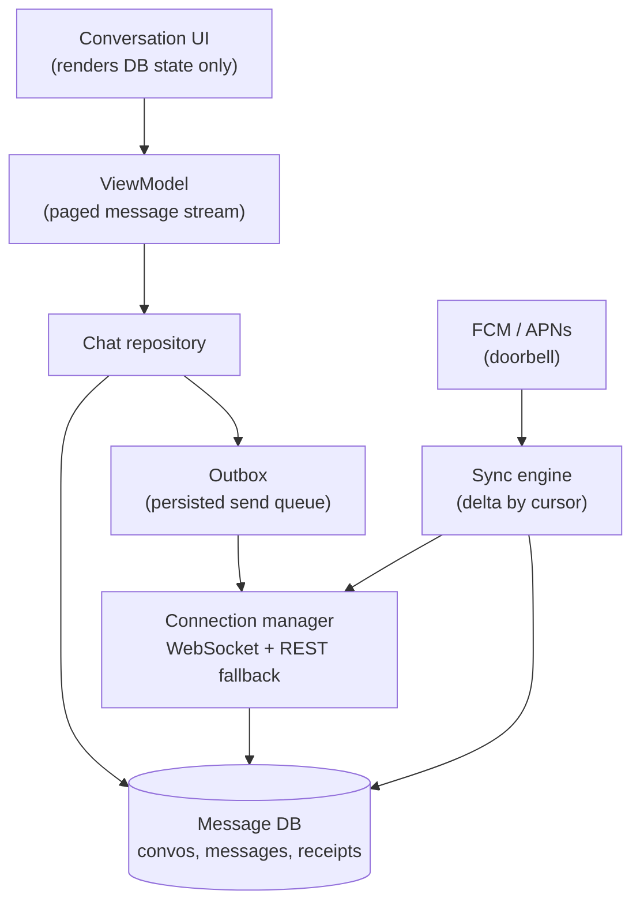
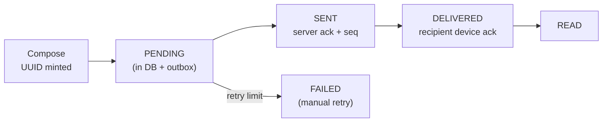

# Mobile 08 — Design a Chat App (WhatsApp / Messenger)

> **Sources:** [weeeBox — chat app exercise](https://github.com/weeeBox/mobile-system-design/blob/master/exercises/chat-app.md) · Manuel Vivo, *Mobile System Design Interview* (solved case study; premium) · [Educative — Grokking Mobile SD](https://www.educative.io/courses/mobile-system-design) chat chapter (premium outline).
> **Prerequisites:** [01 — The Framework](01-framework.md). Backend twin: [Deep Dives 13 — Realtime Updates](../Deep%20Dives/13-realtime-updates.md). **This is your home-turf question — the bar for you is flawless.**

## What you'll master

- The **message state machine** — pending → sent → delivered → read — and why it, not the socket, is the design.
- The **outbox pattern**: client-generated IDs + persisted queue + idempotent replay = sends that survive airplane mode and process death.
- The **transport ladder** for real-time: WebSocket foreground, FCM/APNs doorbell in background, delta sync on reconnect.
- **Ordering, receipts, and group fan-out** at the client contract level.
- The **Staff/EM layer**: protocol versioning for clients you can't upgrade, E2EE as a product/legal decision, SDK build-vs-buy.

## In the Room

| Decision | Default position | Justification | Revisit trigger |
|---|---|---|---|
| Source of truth | **Local message DB; server is sync peer** | Chat must read and *write* fully offline | E2EE multi-device changes the sync story |
| Message identity | **Client-generated UUID at compose time** | Makes send idempotent; dedup key everywhere | — |
| Real-time channel | **WebSocket foreground, push doorbell background** | Sockets in background die on both OSes; push wakes → sync | True background messaging entitlement (VoIP) |
| Ordering | **Server sequence per conversation; pending messages float last** | Device clocks lie; monotonic per-convo seq is cheap | E2EE without server visibility → hybrid logical clocks |
| Receipts | **Batched, best-effort, monotonic (read implies delivered)** | Receipt traffic can exceed message traffic; batch or die | — |

**Experience hooks:** you built this. Say so in the first minute — *"I've shipped a chat SDK; let me show you the design and flag where production diverged from the textbook."* Then actually flag two (e.g. receipt batching costs, socket keepalive vs OEM battery killers).

## 1. Requirements (~5 min)

- **Functional:** 1:1 + small groups (~256), text + media, delivery/read receipts, typing indicator, history pagination, push notifications.
- **Non-functional:** send works fully offline (queue + replay) · delivery latency p95 < 1 s when online · no message ever lost or duplicated *as seen by the user* · history scroll never blocks on network · works on 2 GB Android Go.
- **Out of scope (say it):** calls, E2EE key management deep-dive (flag where it plugs in), backend fan-out (name it — [DD-13](../Deep%20Dives/13-realtime-updates.md) covers it).
- **Scope:** client + API/protocol contract.

## 2. High-Level — the Anatomy, Specialized

Contracts: UI renders **only** what's in the DB (a send appears instantly because the outbox writes it locally as `PENDING`). The connection manager owns exactly one socket, exponential-backoff reconnect with jitter, and surfaces a connectivity state the UI can show. The sync engine is the *only* component that reconciles server state, always via the same delta API — reconnect, push-wake, and cold start are the **same code path**.

> **Staff-level insight:** "push is a doorbell" earns its keep here — FCM payload carries `conversation_id` + latest cursor only; the app *fetches* through the normal sync path. Rendering from push payload creates a second source of truth that will disagree with the first.

## 3. Deep Dive 1 — the Send Pipeline (the crux)

Message lifecycle as a persisted state machine:

The rules that make it bulletproof:

- **UUID at compose time**, written to DB before any network. Kill the app, reboot the phone — the outbox drains on next start. Server dedupes on the UUID, so replays are free: **at-least-once send + idempotent receive = exactly-once appearance.**
- **Ordering:** server assigns a per-conversation sequence on accept; clients render by `(seq, then local timestamp for pending)`. Pending messages float at the bottom until acked — users accept that; reordering *acked* history they do not.
- **Receipts are messages about messages** — tiny, batched (one receipt per convo per few seconds, carrying the max seq), monotonic (read ⇒ delivered). Unbatched receipts in a 256-person group turn one message into 512 packets.
- **Media = pointer pattern** ([framework §5](01-framework.md#5-the-deep-dive-menu--seven-recurring-cruxes)): upload bytes to blob storage via resumable upload, send a message carrying the URL + dimensions + blurhash. The message pipeline never carries bytes.
- **Failure UX is part of the contract:** spinner → subtle "pending" → explicit failed-with-retry. Silent retry forever reads as "message lost."

## 4. Deep Dive 2 — Sync & the Reconnect Story

One delta API serves every entry point: `GET /sync?cursor=X` → ordered events (messages, receipts, convo updates) + next cursor. Cursor persisted in DB after each applied batch — crash mid-sync resumes idempotently (events are upserts keyed by UUID/seq).

- Cold start: render DB instantly, sync in background — **never a spinner over history you already have.**
- Reconnect after gap: same call. Socket delivers live events *after* the sync cursor catches up (buffer or re-sync if a gap is detected via seq discontinuity).
- Per-conversation history pagination is separate: `GET /messages?convo=…&before_seq=…&limit=50`, cached forever (history is immutable).

## 5. The Staff/EM Layer

- **Protocol versioning (Staff):** old app versions live for *years*. Every message type carries a version; unknown types render as "update your app to see this" placeholder, never a crash. Adding a feature = new type + capability negotiation, not a breaking change. *"The wire contract is my five-year commitment; the UI is my two-week one."*
- **E2EE (EM):** a product/legal decision before a technical one — it kills server-side search, spam filtering, and multi-device-simple-sync, and changes your law-enforcement posture. If required: Signal protocol, keys in Keystore/Keychain, and the sync design shifts to device-to-device with a server mailbox. Name the cost, don't hand-wave the crypto.
- **Build vs buy (EM):** a chat SDK (Sendbird, Stream and similar vendors) is 6–12 engineer-months bought for a licence fee — the right call unless chat *is* the product or E2EE/compliance forces ownership. You can argue both sides of this honestly; do.
- **Rollout (EM):** socket/protocol changes ship behind a server-controlled flag with the old path as kill-switch fallback; gate on delivery-latency p95, dupe rate, and battery regressions per OEM. **The metric that pages you: end-to-end delivery success within 5 s.**

## Follow-Ups — the Interviewer Escalates

- **"User sends 30 messages in a tunnel, then reconnects — what exactly happens?"** — Outbox drains in order with the original UUIDs; server acks assign seqs; receipts arrive batched. The subtle part: the *sync* pull and the outbox *drain* run concurrently — dedup by UUID makes the interleaving safe, which is why identity was minted client-side.
- **"Two devices, same account — how does device B see device A's send?"** — A's message flows through the server like any inbound event: it appears in B's delta sync stream with a flag for "own message." Multi-device is why the sync cursor is *per device*, not per account.
- **"Typing indicators and presence — same pipeline?"** — No: ephemeral signals skip the DB and the outbox entirely — fire-and-forget over the socket, TTL on display, never persisted, never retried. Splitting durable from ephemeral traffic is the design decision; muddling them bloats the DB and the battery.
- **"What if the server's seq has a gap when a socket message arrives?"** — Buffer the live event briefly, trigger a cursor sync to fill the gap, then apply. Never render across a known gap — out-of-order *acked* history is the visible-corruption bug users screenshot.
- **"How do you keep the socket alive without murdering the battery?"** — You mostly don't: foreground gets the socket with OS-tuned keepalives; background relies on push-wake. Fighting OEM battery killers with foreground services is an arms race you lose in reviews — say that, then mention the high-priority-push escape hatch for the delivery-critical tier.
- **"1-on-1 works — now make groups of 10k."** — Client-side the model holds (receipts become counts-only, membership paged); the real shift is server fan-out and per-convo seq at scale — name [DD-13](../Deep%20Dives/13-realtime-updates.md) and offer to go there. Knowing where the problem *moved* is the Staff answer.

## When NOT / Variants

- **"Design the chat *SDK*"** — same engine, delete the UI; the public API surface (threading, error model, event listeners vs streams) becomes the crux — see [framework §4](01-framework.md#4-the-standard-client-anatomy).
- **Broadcast channels (1 → 1 M)** — receipts and typing die; becomes the feed problem ([09](09-news-feed.md)) with a realtime garnish.
- **Ephemeral (Snapchat-style)** — TTL enforcement client+server, screenshots, no long-term local store: the *deletion* contract is the crux.

---

## Interview Cheat-Sheet

**30-second architecture:** local DB is truth · outbox with client UUIDs → idempotent send · WebSocket live + push doorbell + one delta-sync path · server seq for order · batched monotonic receipts · media as pointers.

| Probe | Answer |
|---|---|
| "App killed mid-send?" | Message is in DB + outbox before network; drains on restart; UUID dedup makes replay safe |
| "Duplicate messages?" | Impossible at UI: at-least-once transport + UUID-keyed upserts = idempotent apply |
| "Out-of-order delivery?" | Server per-convo seq is render order; pending floats last; gap in seq triggers re-sync |
| "Group of 256 — receipts?" | Batched per-convo max-seq receipts, aggregate counts ("read by 12"), never per-message-per-user rows on device |

**Say-verbatim:**
- *"The message ID is minted on the device — that one decision buys idempotent send, dedup, and offline queueing."*
- *"Reconnect, push-wake, and cold start are the same code path: sync from cursor."*
- *"Receipts are messages about messages — batch them or they outnumber the messages."*
- *"E2EE is a product decision with a technical bill: it costs me server search, easy multi-device, and spam filtering."*
