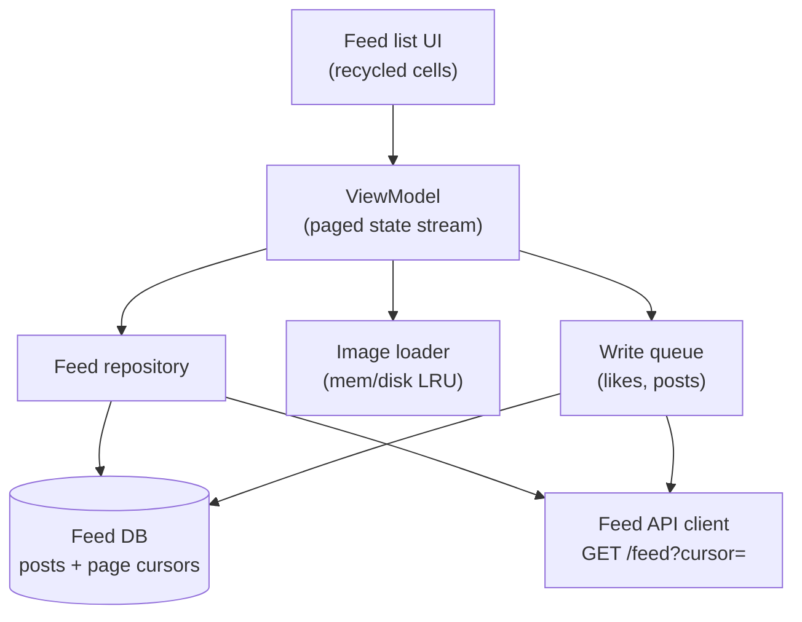

# Mobile 09 — Design a News Feed App (Twitter / Instagram)

> **Sources:** [weeeBox — "Design Twitter Feed"](https://github.com/weeeBox/mobile-system-design) (the framework's own worked example) · Manuel Vivo, *Mobile System Design Interview* (solved case study; premium) · [Educative — Grokking Mobile SD](https://www.educative.io/courses/mobile-system-design) newsfeed chapter (premium outline).
> **Prerequisites:** [01 — The Framework](01-framework.md). Backend twin: the feed module — ranking and fan-out live *there*; here we design the client that makes them feel instant.

## What you'll master

- **Cursor pagination + cache-then-network** — the two moves that define every list-shaped app.
- The **image pipeline budget**: why the feed's memory story is really an image story.
- **Optimistic mutations** (like/repost) through the write queue — the outbox pattern wearing a feed costume.
- **Scroll performance**: the 16 ms budget applied — prefetch, pre-measure, never decode on main.
- The **Staff/EM layer**: feed redesign rollout, prefetch-vs-data-cost in emerging markets, the metrics that gate it.

## In the Room

| Decision | Default position | Justification | Revisit trigger |
|---|---|---|---|
| Pagination | **Cursor-based, server-issued, opaque** | Offset breaks under insertion; cursor survives ranking churn | Purely chronological + static → offset is fine |
| Freshness | **Cache-then-network: render cached page 1 instantly, refresh behind it** | Cold-start spinner on content you had is self-inflicted jank | Strict-freshness feeds (breaking news ticker) |
| Feed cache | **DB-backed, page 1–3 only, TTL hours** | Feed is a *window*, not an archive; unbounded feed DBs rot | Offline-first product promise (read-later) |
| Mutations | **Optimistic + persisted write queue** | A like must feel instant and survive process death | Mutations with money attached |
| Ranking | **Server's problem — declare it** | Client re-ranking fights the server and A/B tests | Client-side blend (ads/local signals) required |

**Experience hooks:** *"Our SDK's conversation list is a small feed — same cursor pagination and cache-then-network; I've debugged the duplicate-cell and jumped-scroll bugs that come from getting the merge wrong."*

## 1. Requirements (~5 min)

- **Functional:** infinite scroll feed (text + images + video thumbs), pull-to-refresh, like/comment counts, compose post, view profile.
- **Non-functional:** cold start to *content* < 1 s (from cache) · scroll at 60 fps on a 2 GB device · like survives offline · data-frugal on metered networks · feed p95 page fetch < 500 ms.
- **Out of scope:** ranking algorithm, ads serving, video playback deep-dive (that's [11 — YouTube](11-youtube.md)).
- **Scope:** client + API contract.

## 2. High-Level

The repository merge rule is the whole game: **pull-to-refresh replaces the window** (new page 1, old pages invalidated); **scroll-down appends**; items are upserted by post ID so a post appearing in both refresh and page 2 renders once. Get this wrong and you ship the classic duplicated-cell / jumping-scroll bugs.

> **Staff-level insight:** the cursor must be **opaque and server-owned**. The moment the client parses or fabricates cursors, the server can never change ranking, sharding, or pagination internals again. One sentence, big contract.

## 3. Deep Dive 1 — Pagination & Caching

- `GET /feed?cursor=&limit=20` → `{items[], next_cursor, ttl}`. Items are full render models (post + author + counts + media URLs with dimensions) — **dimensions in the payload** so cells pre-measure and never reflow.
- **Cache:** page 1–3 in DB with fetch timestamp. Cold start: render cache immediately with staleness allowed up to TTL, kick refresh; on response, *replace* — with scroll-anchor preservation if the user already scrolled.
- **Prefetch:** request page N+1 when the user is ~5 items from the end; on Wi-Fi also prefetch page-2 images at display size. On metered: text pages yes, image prefetch no.
- **Gap problem:** user returns after 6 h — cached page 3's cursor is ancient. Rule: if cache older than TTL, treat as cold start (fresh page 1, drop the tail) rather than stitching a gap. Feed is a window; say that.

## 4. Deep Dive 2 — Images & Scroll Performance

The feed's memory budget **is** the image budget: 20 on-screen-ish images × full-res 12 MP × 4 bytes = ~1 GB — instant death. The pipeline ([framework §3 numbers](01-framework.md#3-requirements--the-scope-question-comes-first)):

- **Downsample to view size at decode** — a 300 px cell needs ~0.4 MB, not 48 MB.
- Memory LRU (~1/8 heap) → disk LRU (~100–250 MB) → network; request dedup so ten cells wanting one avatar issue one fetch; cancel on recycle.
- Decode strictly off-main; placeholder = blurhash from the payload (perceived speed for free).
- Cell binds are dumb: pre-computed text layouts where the platform allows, no measure passes in bind, stable IDs for diffing.

**What you'd measure:** jank rate (frames > 16 ms) per feed session, image cache hit rate, time-to-first-content. These are the dashboard the rollout gates on.

## 5. Deep Dive 3 — Optimistic Mutations

A like = DB update (count+1, liked=true) + job in the persisted write queue → instant UI from the DB change, sync later, **idempotent** (`PUT like` keyed by user+post, not `POST increment`). On terminal failure: revert the DB row + toast. Compose-post is the same queue with media-pointer upload first ([08 §3](08-chat-app.md#3-deep-dive-1--the-send-pipeline-the-crux)) — pending posts render at top from local truth.

> **Staff-level insight:** this is the third appearance of the persisted idempotent write queue (chat outbox, analytics batcher, likes). At Staff you say: *"I'd extract this as a platform primitive — one queue, pluggable jobs — so feature teams stop re-writing it badly."*

## 6. The Staff/EM Layer

- **Feed redesign rollout (EM):** feeds are the app's front door — redesigns ship behind a flag, staged 1 → 5 → 20 → 100 %, gated on crash rate, jank, *and* engagement funnel (session length, scroll depth). A redesign that's technically clean but drops engagement 3 % gets rolled back by the flag, not an app release.
- **Prefetch vs data cost (EM):** aggressive prefetch is a great UX and a real cost on prepaid data plans — make it a server-tunable policy per network class/market, not a hardcode. *"I'd rather tune a config than ship an APK."*
- **API evolution (Staff):** render-model payloads mean new post types need server + client releases in lockstep — mitigate with a `type` field and a graceful "unsupported post" cell, so the server can ship types ahead of oldest-client adoption.

## Follow-Ups — the Interviewer Escalates

- **"Pull-to-refresh while page 3 is mid-flight — walk me through the races."** — Refresh starts a new generation: the in-flight append is cancelled, its late response dropped by generation ID, and the fresh page 1 replaces the window. Without generations you get the stitched-Frankenstein feed — this is the same discipline as [19 §3](19-pagination-library.md#3-the-engine).
- **"A post is deleted server-side while it's in my cache — when does the user stop seeing it?"** — On the next window replace (refresh/TTL), plus tombstones in the feed response for moderated content that must vanish *now*; render-time the cell checks a local tombstone set. Distinguish "eventually gone" (fine for most) from "legally gone" (needs the tombstone push).
- **"Like count is wrong after my optimistic +1 — server says 41, I show 42."** — Server response is truth and overwrites on next sync; optimistic deltas apply only between mutation and ack. Track the pending delta separately from the server count — adding into one integer is how counts drift permanently.
- **"Feed has five item types today, twenty next year — how does the client survive?"** — `type` field + registry of cell renderers + a graceful fallback cell for unknown types; server gates new types on minimum app version *or* accepts the fallback rendering. The wire contract ages; plan for it ([08 §5](08-chat-app.md#5-the-staffem-layer) — same principle).
- **"Videos in the feed — what changes?"** — Autoplay preview needs the player-arbitration problem from [11](11-youtube.md): one active playback, viewport-driven acquire/release, mute-by-default, prefetch policy per network class. The feed's scroll performance budget now includes decoder spin-up — measure it.
- **"Your redesign A/B shows +2 % engagement and +8 % battery drain — ship it?"** — EM question, answer like one: no — battery regressions compound into uninstalls and OS-level app-standby penalties that lag the experiment window. Either fix the drain or run a longer holdback measuring retention, not just engagement.

## When NOT / Variants

- **Chronological-only feed of your own data** (e.g. order history) — offset pagination and simple caching are fine; don't ceremony it.
- **Stories rail** — different physics: aggressive whole-item prefetch, TTL deletion, full-screen media pipeline (roadmap 13).
- **Feed with live updates** (scores, prices) — add the realtime channel from [08](08-chat-app.md)/[15](15-stock-trading-app.md); don't poll page 1.

---

## Interview Cheat-Sheet

**30-second architecture:** opaque server cursor · cache-then-network window (pages 1–3, TTL) · upsert-by-ID merge · prefetch at N−5 · downsampled image pipeline with two LRU tiers · optimistic mutations via the persisted idempotent write queue.

| Probe | Answer |
|---|---|
| "Cold start with airplane mode?" | Cached window renders instantly, flagged stale; mutations queue; refresh joins on connectivity |
| "Post appears twice while paging?" | Upsert-by-post-ID in DB; list renders DB state — dedup is structural, not patched in the view |
| "Scroll is janky — where do you look?" | Decode-on-main, missing downsampling, measure-in-bind; then the jank dashboard per device class |
| "User returns after a day?" | TTL expired → treat as cold start, fresh page 1; feed is a window, not a stitched archive |

**Say-verbatim:**
- *"The cursor is opaque — the day the client parses it, the server's ranking is frozen forever."*
- *"Render the cache, then refresh — a spinner over content I already have is self-inflicted jank."*
- *"Image dimensions ride in the payload so cells never reflow."*
- *"Likes are a PUT, not an increment — optimistic UI is only safe on idempotent writes."*
