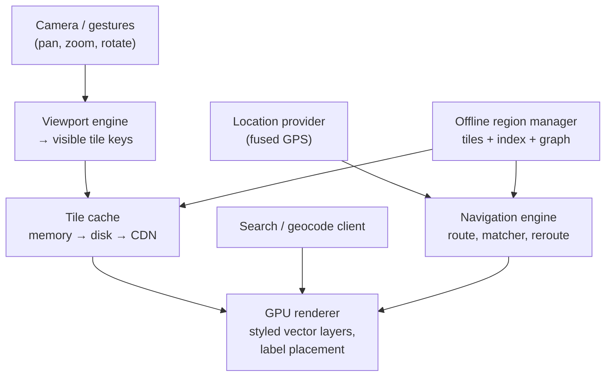

# Mobile 10 — Design Google Maps (Mobile Mapping Client)

> **Sources:** Educative — Grokking Mobile SD, Google Maps chapter (premium outline) · Mapbox/MapLibre architecture docs (the open reference for vector-tile clients).
> **Prerequisites:** [01 — The Framework](01-framework.md) · pairs with [29 — Geospatial Systems](../Core%20Course/29-geospatial-systems.md) (server-side geo) and feeds [14 — Ride-Hailing](14-ride-hailing.md).

## What you'll master

- The **tile pyramid** mental model — the world as a quadtree of tiles, viewport → tile keys, and the cache that hangs off it.
- **Vector vs raster tiles** — the trade that defines the client's rendering, data, and offline story.
- **Navigation mode**: routes as server products, on-device rerouting, and the battery physics of an hour of turn-by-turn.
- **Offline regions** — what you must download for maps to genuinely work with no signal.
- The **Staff/EM layer**: map data licensing, borders as a geopolitical config, graphics memory on low-end devices.

## In the Room

| Decision | Default position | Justification | Revisit trigger |
|---|---|---|---|
| Tile format | **Vector tiles, styled on-device, GPU-rendered** | ~5–10× smaller than raster, one dataset serves all styles/rotations/languages | Satellite imagery layer → raster by nature |
| Tile cache | **Memory (few hundred tiles) → disk LRU (~250 MB) → CDN** | Same three-tier shape as [16](16-image-loading-library.md), different payload | — |
| Routing | **Server computes routes; client renders + monitors deviation** | Global traffic + graph freshness live server-side | Offline nav → downloaded corridor graph |
| Reroute trigger | **On-device deviation detection (off-polyline > threshold)** | Can't round-trip to notice you missed a turn | — |
| Offline | **Explicit user-selected regions: tiles + search index + routing subgraph** | "Offline maps" that can't search or route are a screenshot | — |

**Experience hooks:** *"I haven't shipped a map renderer, but the caching, prefetch, and staleness patterns are the same ones from our media pipeline — what's genuinely different here is GPU memory management and the offline routing graph, so I'd budget my deep-dive time there."* (Honest positioning beats bluffing — and interviewers reward it.)

## 1. Requirements (~5 min)

- **Functional:** pan/zoom/rotate map, search + place details, turn-by-turn navigation with voice, traffic layer, offline regions, my-location.
- **Non-functional:** 60 fps pan/zoom on mid-range devices · tiles for a new viewport < 500 ms on LTE · navigation survives total signal loss · graphics memory bounded on 2 GB devices · an hour of navigation ≤ ~15 % battery (screen included).
- **Out of scope (say it):** map-data production, traffic inference, the routing engine's algorithms — server products we consume.
- **Scope:** client + tile/route API contracts.

## 2. High-Level

**The tile pyramid:** zoom level z has 4^z tiles; a viewport at (lat, lng, zoom) maps to a handful of tile keys `(z, x, y)`. That key is everything: the cache key, the CDN URL, the offline-pack unit, the prefetch unit. Pan → new keys at the edge; zoom → parent/child keys (and you *render parents scaled while children load* — the universal "never show blank" trick).

**Vector tiles** carry geometry + attributes (roads, buildings, POIs as coordinates and tags); the client styles them (colors, widths, label fonts) and the GPU draws. That's why rotation keeps labels upright, dark mode is a stylesheet, and a language change doesn't re-download the planet — and why the renderer, not the network, is where this app is hard.

> **Staff-level insight:** *"the tile key is the API"* — one addressing scheme unifies caching, offline packs, prefetch, and CDN sharding. When a design collapses many concerns into one primitive, say so; that's the systems-taste signal this question exists to probe.

## 3. Deep Dive 1 — Rendering & Memory (where 2 GB phones die)

- **Budgets, stated:** tile geometry buffers + glyph/sprite atlases + the GL surfaces themselves — a naive client holds hundreds of MB of GPU-adjacent memory. Cap in-memory tiles by *bytes not count* (city tiles are 10× rural), evict beyond a ring around the viewport, downshift `maxZoom` detail on low-RAM devices.
- **Label placement is a CPU tax:** collision detection for thousands of candidates per frame — do it incrementally, on a worker, cache placements per camera bucket; labels *fading* in late is acceptable, dropped frames are not.
- **Gesture loop discipline:** pan/zoom renders from whatever is resident (scaled parents, cached tiles) — network fetch is fully decoupled from the render loop. The map must never jank because the network is slow; it shows *older* pixels instead. Staleness-over-jank is the map's version of [09](09-news-feed.md)'s cache-then-network.
- Prefetch: one tile ring beyond the viewport + along the camera's velocity vector; during navigation, along the route corridor ahead.

## 4. Deep Dive 2 — Navigation & Offline

**Navigation:** route request → server returns polyline + maneuvers + traffic-annotated ETAs (plus **alternates, cached** — instant "faster route" switches). On device, the **map-matcher** ([14 §4](14-ride-hailing.md#4-deep-dive-2--the-rider-app-consume-location-fake-smoothness)'s snap-to-road, promoted to load-bearing) locks the noisy GPS to the route; deviation beyond threshold for ~N seconds → reroute: *instantly* against the cached alternates / downloaded graph, *refined* by the server when reachable. Voice guidance keys off matched-position-to-next-maneuver distance. Battery: screen is the biggest drain (dimmed/simplified nav display), GPS second (already high-rate by necessity), network third (corridor prefetch, then quiet).

**Offline regions:** a region download = tile pack for zoom range (bytes shown honestly before download) + search index subset (POIs/geocoding for the region) + routing subgraph. Update policy: scheduler-refreshed on Wi-Fi + charging, versioned packs swap atomically ([23](23-google-drive.md)'s rename-on-complete rule, pack-sized). Without all three pieces, "offline maps" demos well and fails the first real trip — enumerate the three.

## 5. The Staff/EM Layer

- **Map data licensing (EM):** tiles derived from licensed data carry contract terms — offline pack duration, cache TTLs, even *whether* you may serve offline. Some of the cache design is a legal document wearing an architecture costume; knowing that is the EM lens.
- **Borders are geopolitical config (EM):** disputed borders and place names legally *must* render differently per viewer country — a server-driven style/data dimension with legal sign-off, not an engineering choice. The map is the one app surface where a rendering bug is an international incident; this earns its sentence in any Google interview.
- **Device-tier strategy (Staff):** the render budget table (max zoom detail, 3D on/off, label density) is a per-device-class server config — low-end markets get a *deliberately* simpler map, decided by data, tunable without release.
- **The pager metrics (Staff):** frame rate during gesture p5, tile-load p95 by network class, reroute latency, offline-pack update failure rate, and navigation-session battery per hour by device class.

## Follow-Ups — the Interviewer Escalates

- **"Zoom from city to street level fast — what does the user see?"** — Resident parent tiles scaled up immediately, children streaming in and cross-fading per-tile. Never blank, never spinner; sharpness arrives progressively. The inverse (zoom out) renders children mosaicked until the parent lands.
- **"Navigation through a 2-hour dead zone — what breaks first?"** — Nothing critical if the corridor was prefetched + offline graph covers deviations: matching, guidance, reroute all run on-device. What degrades: traffic-based ETA (freezes at last known — label it stale), search off-corridor, alternates. Enumerate survives-vs-degrades; that's the offline answer structure.
- **"Traffic layer updates every 2 minutes — full tile refetch?"** — No: traffic ships as a separate small overlay (per-segment congestion deltas) composited over base tiles at render time. Layer separation by *change frequency* — base geometry changes monthly, traffic every minute; never couple their fetch cycles.
- **"Your GL renderer OOMs on exactly one OEM's mid-range line."** — Device-class telemetry first (GPU memory events by model), then: driver-specific surface/texture limits, atlas fragmentation, or the OEM lying about available graphics memory. Mitigate with per-model budget overrides in config while root-causing. The answer is the *process* (fleet telemetry → targeted override → root cause), not a guess.
- **"Search-while-typing on a slow network?"** — Debounced queries against local index (recents + offline region POIs) render instantly; server suggestions merge in as they arrive, labeled sections. Same local-first-merge-remote shape as [23](23-google-drive.md)'s search — cite the reuse.
- **"How would Google ship a map style refresh (new colors, road widths) safely?"** — Styles are server-delivered assets: staged rollout of the style version, gated on render performance (label collision cost changes with density choices!) and task-success metrics, instant rollback by config. A style is a *deployment*, and it can regress frame rate — that connection is the insight.

## When NOT / Variants

- **"Add a map to my app"** — embed the platform SDK; this note is for *building* the map layer, and saying so in minute one is the scope discipline this track keeps preaching.
- **Indoor maps / venues** — different substrate: floor plans, no GPS (BLE/Wi-Fi positioning), tiny "tiles" — reuse the layer/style architecture, replace the positioning stack.
- **AR navigation** — camera + pose estimation on top of the same route/matcher spine; the renderer changes, the navigation engine doesn't.

---

## Interview Cheat-Sheet

**30-second architecture:** viewport → tile keys → memory/disk/CDN cache → GPU-rendered styled vector layers · render-from-resident, fetch decoupled, parents-while-loading · server routes + on-device matching and instant reroute · offline = tiles + search index + routing subgraph, atomically versioned · budgets per device class via config.

| Probe | Answer |
|---|---|
| "Why vector over raster?" | 5–10× smaller, one dataset for all styles/languages/rotations, GPU-rendered — the cost is a hard client renderer, which is the right place to spend |
| "Pan is janky on low-end?" | Render loop must never wait on network or full label solve — scaled resident tiles + incremental labeling + byte-capped tile memory per device class |
| "Signal dies mid-navigation?" | Matching/guidance/reroute are on-device against corridor + offline graph; ETA freezes with a stale label — enumerate what survives vs degrades |
| "Offline maps = downloaded tiles?" | Tiles + search index + routing subgraph — without all three it's a screenshot, not a map |

**Say-verbatim:**
- *"The tile key is the API — cache, CDN, offline packs, and prefetch all address the world the same way."*
- *"The render loop never waits on the network — older pixels beat dropped frames."*
- *"Reroute is instant locally, refined remotely."*
- *"Disputed borders are server-driven config with legal sign-off — a map rendering bug can be an international incident."*
