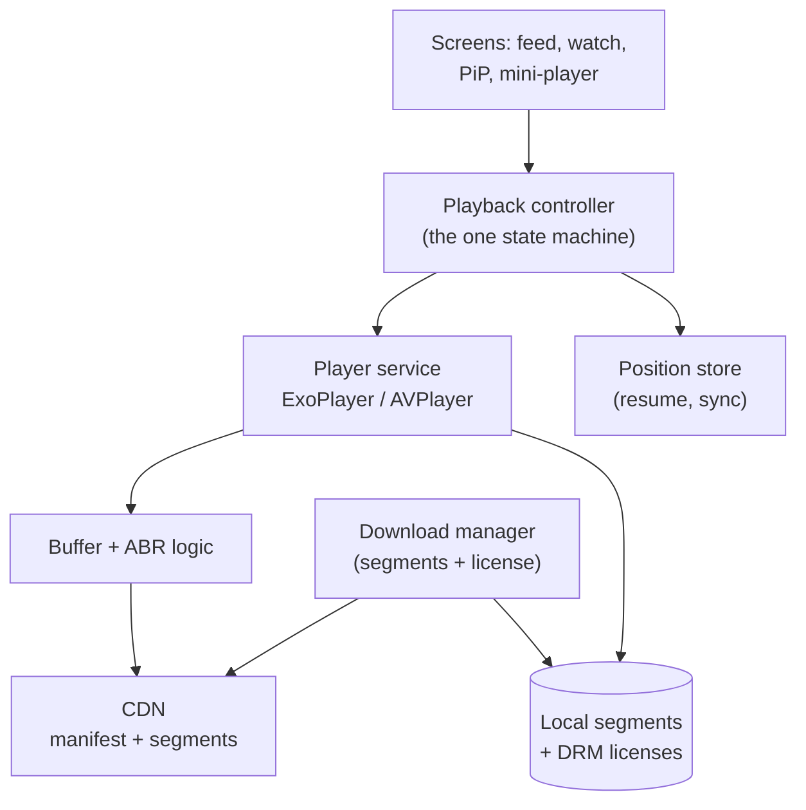

# Mobile 11 — Design the YouTube App (Video Client)

> **Sources:** Manuel Vivo, *Mobile System Design Interview* (solved case study; premium) · [Educative — Grokking Mobile SD](https://www.educative.io/courses/mobile-system-design) YouTube chapter (premium outline) · ExoPlayer/AVPlayer platform docs for the mechanics.
> **Prerequisites:** [01 — The Framework](01-framework.md) · [09 — News Feed](09-news-feed.md) (the browse surface is a feed; this note is about what happens when you tap play).

## What you'll master

- **Adaptive bitrate (ABR) streaming** from the client's seat: HLS/DASH, the manifest, and the buffer-driven quality ladder.
- The **player as a shared, lifecycle-independent service** — one decoder pipeline serving feed previews, full screen, PiP, and background audio.
- **Startup latency**: the time-to-first-frame budget and the tricks that hit it.
- **Offline downloads** and their DRM/licensing reality.
- The **Staff/EM layer**: rebuffer-gated experiments, preload spend vs data cost, DRM as a legal surface.

## In the Room

| Decision | Default position | Justification | Revisit trigger |
|---|---|---|---|
| Streaming | **ABR (HLS/DASH) via platform player (ExoPlayer/AVPlayer)** | Segment-based ABR is the entire product; never hand-roll a decoder | Ultra-low-latency live (< 3 s) → LL-HLS/WebRTC |
| Player ownership | **One player service, singleton-ish, independent of any screen** | Survives rotation/PiP/background; decoders are scarce hardware | Multi-video grid preview → tiny second pool |
| Quality choice | **Buffer- and throughput-driven automatic; user override sticky per session** | ABR beats humans at this; respect explicit intent | Data-saver mode caps the ladder |
| Preload | **Manifest + first segments of likely-next videos, policy server-tuned** | Time-to-first-frame is won before the tap | Metered network → thumbnails only |
| Downloads | **Segment-level, resumable, license-bound, scheduler-run** | It's the file-downloader pattern + DRM | — |

**Experience hooks:** *"Our SDK ships voice/video message playback — the lesson that transfers: the media pipeline must be lifecycle-independent, because the UI that started playback rarely lives to see it finish."*

## 1. Requirements (~5 min)

- **Functional:** browse/search feed, tap-to-play with quality adaptation, seek/scrub with previews, PiP + background audio, offline downloads, resume position sync.
- **Non-functional:** time-to-first-frame p50 < 1 s on Wi-Fi · rebuffer ratio < 0.5 % of watch time · smooth on 2 GB devices · data-saver mode · battery: screen-off audio must not keep the video decoder alive.
- **Out of scope:** upload/transcode pipeline (backend), recommendations, live chat.
- **Scope:** client + the CDN/API contract.

## 2. High-Level

The **playback controller** is the crux component: a single state machine (idle → loading → buffering → playing → paused → ended/error) that every surface *attaches to* rather than owns. Full screen → PiP → background audio is a **view change, not a playback change**. Position saves locally on every pause and periodically during playback — process death mid-video costs at most a few seconds of resume accuracy.

> **Staff-level insight:** hardware decoders are a scarce, shared resource — often literally one 4K decode session per device. Designing "who owns the player" is designing a resource arbiter, not a UI component. That sentence separates people who've shipped video from people who've read about it.

## 3. Deep Dive 1 — ABR From the Client's Seat

Video is served as **2–6 s segments encoded at a ladder of bitrates** (e.g. 144p→2160p), described by a manifest. The client player:

1. Fetches the manifest, picks a conservative start rung (fast first frame beats sharp first frame).
2. Measures **throughput per segment** + watches **buffer depth**; shifts rungs to keep the buffer in a healthy band (~10–30 s ahead).
3. Downshifts *before* the buffer empties — a rebuffer is 10× worse for retention than a quality dip, and everyone's metrics agree.

Client-side knobs you own: start-rung policy per network class, buffer band sizes (bigger band = fewer stalls, more wasted data on abandon), data-saver ladder cap, and **seek preview** (a separate tiny trick-play track / storyboard sprites — never the main pipeline).

**Time-to-first-frame budget:** manifest fetch + first segment + decoder warm-up. Wins: preload manifest+first-segment for the videos most likely to be tapped (autoplaying feed previews already paid this), reuse the warm decoder, start at a low rung. This is why the tap feels instant on good apps.

## 4. Deep Dive 2 — Downloads & DRM

Offline = the file-downloader pattern ([roadmap 17](00-INDEX.md)) with two twists:

- **Segment-level, resumable:** pick a quality rung, download its segments via the OS scheduler (unmetered + charging default, user-overridable), track completion per segment — resume costs nothing after kill/reboot.
- **DRM:** protected content needs a **license** (Widevine/FairPlay) fetched and stored alongside segments, with an offline expiry — playback checks license validity, and expiry drives re-license or graceful "renew online" UX. Keys live in hardware-backed secure storage.

> **Staff-level insight:** storage is a shared budget — downloads get a user-visible quota, LRU eviction *proposal* (never silent deletion of user-chosen downloads; ask), and a "manage storage" surface. Silent eviction of a movie downloaded for a flight is a support-ticket generator.

## 5. The Staff/EM Layer

- **Experiment gating (EM):** every player change — buffer tuning, ABR tweak, new codec — ships as an experiment gated on **rebuffer ratio, time-to-first-frame, watch time, battery drain**. Player regressions are subtle and catastrophic; the dashboard *is* the review. *"No player change lands without an A/B showing rebuffer-neutral."*
- **Preload spend (EM):** preloading feed videos burns user data for engagement — a policy decision per market/network, server-tunable, defaulted off on metered. Same shape as [09 §6](09-news-feed.md#6-the-staffem-layer); say it once, reference it here.
- **Codec strategy (Staff):** AV1 saves ~30 % bandwidth but needs hardware decode to be battery-sane — roll out per device capability matrix, keep H.264/VP9 fallback rungs in every manifest. The manifest *is* the compatibility layer.
- **DRM & licensing (EM):** content contracts dictate DRM level (hardware L1 vs software L3 → resolution caps), offline windows, concurrent-stream counts. Engineering enforces a *legal* contract — flag it as such and keep the enforcement server-driven.

## Follow-Ups — the Interviewer Escalates

- **"User seeks to a random point in a 2-hour video — what actually happens?"** — Manifest maps time → segment; player flushes the buffer, fetches the target segment (starting at a keyframe — that's why seeks snap slightly), often at a lower rung for speed, then climbs. Scrubbing previews come from the storyboard sprite track, never the main pipeline.
- **"Feed autoplay: five videos visible — who plays?"** — One. A playback arbiter grants the decoder to the most-visible candidate; scroll transfers ownership with acquire/release semantics. This is the scarce-decoder point made concrete — interviewers love hearing it as a *resource arbitration* problem.
- **"How do you know your ABR change didn't hurt users on 2G in India?"** — Segment the experiment metrics by network class and region; global averages hide exactly this cohort. Rebuffer ratio and abandonment for the worst quartile are the gate, not the mean — EM answer, dashboards named.
- **"Downloads: user's storage fills mid-download of episode 3 of 8."** — Pre-flight size check per item, pause the queue on a storage threshold, surface "3 of 8 downloaded — need 1.2 GB more" with the manage-storage screen. Never fail silently at item 3 and let them board the flight believing they have 8.
- **"Resume position: watched on TV last night, opens phone on the train."** — Position syncs through the account (periodic + on-pause beacons); local store is the offline fallback; conflict rule is max(progress) with a small rewind buffer. Tiny feature, but it's the cross-device state-sync pattern in miniature — say that.
- **"Battery: users report drain during plain playback — your investigation order?"** — Software decode fallback (codec/device matrix miss), radio held hot by tiny buffer band (bump ahead-buffer on Wi-Fi), screen brightness vs codec efficiency trade, then wakelocks from the position beacon. Ordered hypotheses, each with a metric — that's the Staff debugging answer.

## When NOT / Variants

- **Short-form video (Reels/Shorts):** flip the priorities — aggressive full-preload of next N videos, tiny buffers, instant loop; data cost accepted because videos are small. The feed *is* the player.
- **Live streaming:** smaller buffers (latency vs stall trade), no downloads, DVR window; ultra-low-latency → LL-HLS/WebRTC and a different note.
- **Audio-only (podcasts/music):** drop ABR complexity, keep the service/session design — background lifecycle + downloads dominate.

---

## Interview Cheat-Sheet

**30-second architecture:** ABR segments from CDN via platform player · one playback-controller state machine, surfaces attach to it · buffer-band-driven quality with downshift-before-stall · preload manifest+first-segment of likely-next · downloads = resumable segments + offline DRM license · everything gated on rebuffer/TTFF dashboards.

| Probe | Answer |
|---|---|
| "User rotates / goes PiP mid-video?" | View change, not playback change — surfaces attach to the shared player service; zero pipeline restart |
| "Network drops from LTE to 2G?" | ABR downshifts on throughput signal before buffer empties; floor rung + eventually a stall UI with retry |
| "App killed during a download?" | Segment-level completion tracking in DB; OS scheduler resumes; license already stored — nothing re-fetched |
| "Why is battery draining on screen-off audio?" | Video decoder left alive — background audio must tear down video tracks and render audio-only |

**Say-verbatim:**
- *"A rebuffer is 10× worse than a quality dip — the ABR bias is always downshift early."*
- *"Decoders are scarce hardware; 'who owns the player' is a resource-arbitration design, not a UI question."*
- *"First frame fast beats first frame sharp — start low, climb quickly."*
- *"No player change ships without an A/B showing rebuffer-neutral — player regressions are subtle and catastrophic."*
