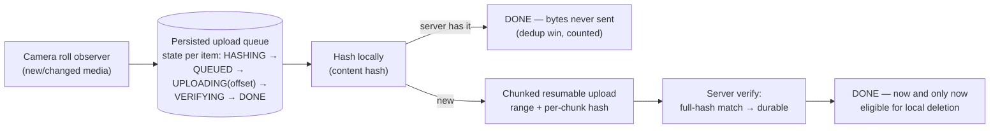

# Mobile 12 — Design Google Photos (Upload, Sync & "Free Up Space")

> **Sources:** platform background-work docs · this is [23 — Google Drive](23-google-drive.md)'s engine pointed at the camera roll — read that note first; this one covers what *changes* when the files are irreplaceable photos.
> **The crux in one line:** *never lose a photo — the upload queue must survive everything, dedup must not fool itself, and "free up space" may only delete what the server provably has.*

## What you'll master

- The **upload pipeline**: hash-first dedup → chunked resumable upload → server-verified completion — under battery/metered constraints.
- The **two-plane split** (metadata vs content) inherited from Drive, inverted: here the *thumbnail grid* is the product, originals are the lazy tier.
- **"Free up space"** as the scariest button in mobile — the proof obligations before deleting a local original.
- The Staff/EM layer: metered-data policy, ML-on-device privacy, and the pager metric for a product whose failure mode is *silent memory loss*.

## In the Room

| Decision | Default position | Justification |
|---|---|---|
| Upload trigger | **Persisted queue, drained by the OS scheduler (default: unmetered + charging; user can override per-setting)** | Camera roll upload is the canonical deferrable bulk job — fighting Doze loses ([05 §5](05-performance-battery-startup.md)) |
| Dedup | **Hash locally before upload; skip bytes the server has (per-account)** | Re-shoots and re-shares make duplicate bytes common; hashing is CPU-cheap vs radio-expensive ([03 §1](03-networking-realtime.md)) |
| Upload mechanics | **Chunked + resumable with per-chunk hashes — [23 §4](23-google-drive.md)'s transfer engine unchanged** | Multi-GB videos on flaky radios; progress must survive process death |
| Grid sync | **Thumbnails-first: the grid is a synced thumbnail store; originals fetch lazily, LRU-evicted** | The grid must scroll at 60 fps offline; originals are the [pointer pattern](01-framework.md) at photo scale |
| Free up space | **Delete local originals ONLY after server-side existence + hash verification** | The one unrecoverable operation in the app — proof, not optimism |

## 1. The upload pipeline

- **The queue is the product.** Every photo's upload state is a DB row ([04 §2](04-data-caching-sync.md)'s outbox with big payloads); the observer enqueues, the scheduler drains under constraints, and *nothing* about progress lives in memory. Kill the app at any arrow — the row says where to resume.
- **Hash before bytes:** content-hash locally, ask the server "have you got it?" — skipping the upload entirely is the biggest battery/data win in the app and the dedup that matters (exact-byte). *Perceptual* dedup (same shot, re-encoded) is a server-side suggestion surface, never an automatic skip — say that distinction; it's where candidates over-automate.
- **Resume must survive server-side change:** each chunk carries offset + hash; on resume, revalidate the upload session (ETag/session token) — a stale session restarts cleanly rather than stitching a corrupt file. [23 §4](23-google-drive.md) owns the mechanics; the photo-specific addition is **verification before DONE**: the server confirms the assembled full hash. DONE is a *proof state*, not an optimistic one.

## 2. Down-sync — the grid is the product

- **Thumbnail plane syncs eagerly** (change-log by cursor, [04 §3](04-data-caching-sync.md)): the grid renders offline from a local thumbnail store — small, bounded, always-resident. **Originals are lazy**: fetch on open, LRU-cache under a byte budget, pin explicitly ("keep on device") — [26 §5](26-spotify-music.md)'s two-pool discipline with photos instead of tracks.
- **Edits are non-destructive ops** synced as metadata (crop rect, filter id) applied at render — the original never mutates, which keeps dedup, sync, and undo coherent (and is [23 §5](23-google-drive.md)'s conflict story made trivial: edit ops merge; originals can't conflict).
- **Shared albums** ride the same change-log with per-album membership — the interesting probe is *notification fan-out on a new shared photo*, which is [22](22-push-notification-system.md)'s collapse-key case, not new machinery.

## 3. "Free up space" — the proof obligation

The feature that defines the app's trust: delete local originals to reclaim gigabytes. The checklist before deleting file X — **server has X (existence + hash match against the *local* file as it is now), X isn't mid-edit, X isn't pinned** — and deletion runs as a verified batch with a journal (crash mid-batch must not strand half-deleted state). Corrupted-local-file edge: hash mismatch vs server → *upload wins, never delete* — flag for re-upload. Say the posture sentence: *"this button converts optimism into data loss unless every deletion is preceded by a server-side proof — I'd rather free less space than trust a cached 'uploaded' flag."*

## 4. The Staff/EM Layer

- **Metered data is a policy surface, not a setting** (EM): default unmetered-only, explicit per-user override, and a "data used by backup" ledger visible in settings — backup burning a user's data plan is a one-star generator and, in some markets, a regulatory complaint.
- **On-device ML as the privacy answer** (EM): face grouping/search embeddings computed on device where feasible ([06 §4](06-security-privacy.md)) — "your photos are analyzed on your phone" is a defensible privacy posture; server-side analysis is a consent conversation.
- **The pager metric** (Staff): backup gap — photos taken vs photos durable, by cohort and app version, plus upload-queue age p95. The product fails *silently* (user discovers loss years later), so the metric must be a leading indicator, not support tickets. Dedup-hit rate and free-up-space verification failures round out the dashboard.

## Follow-Ups — the Interviewer Escalates

- **"Upload interrupted at chunk 40 of 100, app killed, network changed."** — Queue row has the session + offset; on next eligible drain, revalidate the session, resume at 40; if the session expired or the file changed (hash mismatch), restart that file cleanly. Chunks make restart cheap; the row makes it automatic.
- **"User takes 500 photos on vacation Wi-Fi-less week."** — Queue grows (bounded by disk, telemetered); nothing uploads on metered unless overridden; on hotel Wi-Fi + charging the scheduler drains in batches. The design *is* the queue discipline — no heroics.
- **"Two devices, same account, both have the same photo."** — Content hash collides server-side → one stored object, two library references — dedup is per-account storage, not per-device upload.
- **"Free up space deleted a photo the server didn't have — walk the failure."** — Only possible if deletion trusted a cached flag instead of live verification. That's why the check is server-side existence + hash-of-current-local-file at deletion time, journaled — the failure is designed out, and the verification-failure counter pages if it ever fires nonzero.
- **"Low disk during a burst — the OS wants space *now*."** — Originals LRU-evict (they're proven-remote), thumbnails stay, the upload queue's own staging respects a floor; trim callbacks ([05 §4](05-performance-battery-startup.md)) drop decode caches first. Order of sacrifice is designed, not improvised.

---

## Interview Cheat-Sheet

**30-second architecture:** camera-roll observer → persisted per-item upload state machine → hash-first dedup → chunked resumable upload → server-verified DONE · thumbnails sync eagerly (grid works offline), originals lazy + LRU + pins · edits are non-destructive ops · free-up-space deletes only against live server proof · scheduler-driven, unmetered+charging default.

| Probe | Answer |
|---|---|
| "Never lose a photo — what's the mechanism?" | A DB row per photo from observation to server-verified DONE; deletion gated on live proof; the backup-gap metric watches the whole promise |
| "Why hash before upload?" | Skipping bytes the server has is the largest battery/data win available — CPU is cheap, the radio isn't |
| "Difference from Drive?" | Same engines; inverted emphasis — thumbnails are the eager plane (the grid is the product), and irreplaceability makes verification-before-delete the crux |

**Say-verbatim:**
- *"DONE is a proof state, not an optimistic one."*
- *"Free up space converts optimism into data loss — every deletion is preceded by a server-side proof."*
- *"The grid is the product: thumbnails sync eagerly, originals are pointers."*
