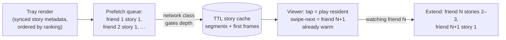

# Mobile 13 — Design Stories (Instagram/WhatsApp Ephemeral Content)

> **Sources:** sibling physics of [25 — TikTok/Shorts](25-tiktok-short-video.md) — read it first; this note covers what *ephemerality* and the *social ring* change. Upload side is [12](12-google-photos.md)/[23](23-google-drive.md)'s queue, small.
> **The crux in one line:** *tap-forward must be instant (prefetch against a social-graph priority), and expired content must be unshowable — with the server's clock, not the phone's.*

## What you'll master

- The **prefetch ring**: how the stories tray becomes instant playback — the [25](25-tiktok-short-video.md) preload matrix re-keyed by social graph instead of recommendation.
- **Expiry as a correctness problem**: 24 h TTL enforced with server-authoritative time, tombstones, and render-time checks.
- **The cache that empties itself** — the rare system where TTL eviction is exactly right.
- Batched **view receipts** at fan-out scale, and the Staff/EM privacy edges (screenshots, viewers list, expired-means-gone).

## In the Room

| Decision | Default position | Justification |
|---|---|---|
| Prefetch | **First story per friend, tray order, N-deep ring; matrix tuned by network class, server-configurable** | Tap-to-play must be 0 ms for the top of the tray; [25 §4](25-tiktok-short-video.md)'s tiered preload with social priority as the ranking signal |
| Expiry | **Server-authoritative: expiry timestamp + tombstones in sync; client re-checks at render** | Device clocks lie ([14 §3](14-ride-hailing.md)); showing an expired story is a trust breach, not a staleness blip |
| Media | **Short segments, capped bitrate ladder, aggressive first-frame optimization** | Stories are seconds long — startup latency *is* the experience; ABR ladders barely matter ([25 §3](25-tiktok-short-video.md) inversion continued) |
| Cache | **TTL-bounded story cache — content expires from the product and the disk on the same clock** | The one cache where TTL is the *product semantic*, not a freshness heuristic ([04 §1](04-data-caching-sync.md)) |
| Receipts | **Batched, monotonic per-story viewer marks — [08 §5](08-chat-app.md)'s receipt engine reused** | Viewer lists at celebrity fan-in need batching or they become a write storm |

## 1. The prefetch ring

- **Priority is the social graph, not a recommender:** prefetch first-story-per-friend in tray order (closeness ranking), then deepen around the currently-watched position — the viewing pattern is predictable (left-to-right through the tray), which makes prefetch *cheaper* than TikTok's: you're not guessing a feed, you're reading the tray.
- **The budget discipline transfers unchanged** ([25 §4](25-tiktok-short-video.md)): depth by network class, bytes-per-prefetch caps, server-tunable matrix ([21](21-ab-feature-flag-sdk.md) config), and **waste ratio** (prefetched-not-viewed) as the governing metric — with a higher tolerated waste than TikTok because story segments are small and tap-latency is the product.
- **First-frame is the KPI**: poster frame ships *with the tray metadata* (tiny, always prefetched) so even a cache miss shows content in one frame while the segment streams — perceived-instant beats actually-instant.

## 2. Expiry — ephemerality as an invariant

- **The server owns the clock.** Story metadata carries `expires_at`; the client renders countdowns and gates playback against *server-offset-corrected* time ([24 §4](24-hotel-reservation.md)'s discipline). A user's wrong clock must neither extend nor truncate a story's life.
- **Three enforcement layers:** sync delivers **tombstones** at expiry (and for author deletions — same path, [04 §3](04-data-caching-sync.md)); the **render path re-checks** `expires_at` before showing (the story that expired mid-session disappears at next tap, not tomorrow); and the **CDN/API stop serving** expired media — client enforcement is UX, server enforcement is the guarantee. Say that split; it's the security-shaped probe.
- **The cache empties itself:** disk entries carry the same expiry — eviction *is* expiry, plus an LRU byte-cap backstop. This is the one design where cache-TTL equals product semantics — call it out as the deliberate exception to "[TTL is a freshness heuristic](04-data-caching-sync.md)."

## 3. Upload & receipts (the reused engines, briefly)

- **Upload** = [12](12-google-photos.md)'s queue minus durability anxiety (a failed story upload is a retry banner, not data loss) plus a fast transcode-on-device step for the capped ladder; posting is optimistic in the tray with the outbox pattern ([08 §3](08-chat-app.md)).
- **View receipts** = [08 §5](08-chat-app.md)'s batched monotonic marks, per story: client batches "viewed story S at position k" on an interval/backgrounding; the viewer-list surface reads a server aggregate, never N raw events. Celebrity fan-in makes the *server* aggregate the hard part — from the client seat, batching + idempotent marks is the whole job.

## 4. The Staff/EM Layer

- **"Expired means gone" is a promise with legal weight** (EM): retention after expiry (server backups, CDN caches, analytics thumbnails) must match the product claim — the gap between "hidden from clients" and "deleted from infrastructure" is a regulator's and journalist's favorite question. Own the honest answer and the deletion SLA.
- **Screenshot detection is a product/legal stance, not a technical control** ([06 §1](06-security-privacy.md)'s adversary honesty): platforms can't reliably prevent capture — notify-on-screenshot (where the OS signals it) is deterrence UX; never promise prevention.
- **The pager metrics** (Staff): tap-to-first-frame p95 by network class, waste ratio, expired-content-served count (**must be zero — page on any**), and receipt-batch lag. The zero-tolerance metric is the expiry one — it's the product's trust invariant, the same role duplicate-charge plays in [29](29-ecommerce-checkout.md).

## Follow-Ups — the Interviewer Escalates

- **"User opens the app in airplane mode — what plays?"** — Whatever the ring prefetched *and is unexpired by last-known server offset*: typically the top of the tray. Expiry checks run against the offset-corrected clock; if confidence in the offset is stale beyond a bound, err toward not showing — fail closed on ephemerality.
- **"Story expires while the user is mid-view?"** — Finish the current segment (don't yank content mid-frame), don't advance into expired positions, tombstone applies at next render. Product-honest and race-free.
- **"Celebrity with 50 M viewers — what breaks first?"** — On the client: nothing new — receipts batch. Server-side: the viewer-list aggregate and receipt ingest ([P-17](../Deep%20Dives/17-pattern-scaling-writes.md)); the client-seat answer is "my job is batched idempotent marks and reading an aggregate."
- **"Why not reuse the TikTok player pool wholesale?"** — I do reuse the pool ([25 §2](25-tiktok-short-video.md)); what changes is the *predictor* (tray order beats recommendation guessing) and the *unit economics* (short capped segments → shallower ladders, poster-frame-first) — same machinery, different tuning.
- **"Prefetch is burning data plans."** — The matrix is server-config: depth per network class, metered caps, and the waste-ratio dashboard tells us where prefetch stops paying — turn the knob, ship no binary ([07](07-release-engineering.md)).

---

## Interview Cheat-Sheet

**30-second architecture:** tray = synced metadata + poster frames · prefetch ring: first-story-per-friend in tray order, deepen around the playhead, network-class matrix, waste ratio governs · playback = [25](25-tiktok-short-video.md)'s recycled player pool · expiry: server-authoritative `expires_at` + tombstones + render-time re-check + CDN stops serving — client enforcement is UX, server is the guarantee · TTL cache that empties itself · receipts batched monotonic ([08](08-chat-app.md)).

| Probe | Answer |
|---|---|
| "Instant tap-forward?" | The ring already holds friend N+1's first segment + every poster frame — the tray is a predictable read, cheaper to prefetch than a recommender feed |
| "Clock set 6 hours back — extra 6 hours of stories?" | No: expiry checks run against server-offset time, and the CDN stops serving regardless — the client clock is display-only |
| "Where does ephemerality actually live?" | Three layers: tombstones in sync, render-time check, server/CDN refusal — and 'expired-served' is a page-on-nonzero metric |

**Say-verbatim:**
- *"The tray is a predictable read — prefetch follows the social graph, not a guess."*
- *"Client enforcement of expiry is UX; server enforcement is the guarantee."*
- *"This is the one cache where TTL is the product, not a heuristic — the cache empties itself."*
