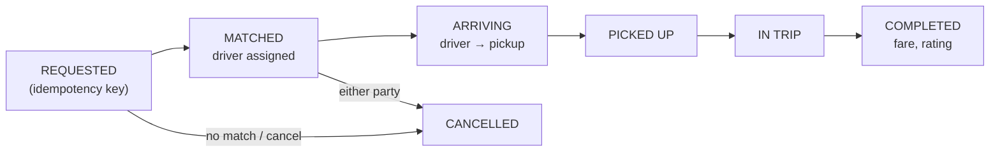

# Mobile 14 — Design a Ride-Hailing App (Uber / Lyft)

> **Sources:** Educative — Grokking Mobile SD, ride-hailing chapter (premium outline) · Uber engineering blog folklore (driver app, RIBs, location) · weeeBox exercise list (location sharing).
> **Prerequisites:** [01 — The Framework](01-framework.md) · [24 — Hotel Reservation](24-hotel-reservation.md) (the funnel state machine — a trip is a booking that *moves*) · [10 — Google Maps](10-google-maps.md) for the map substrate.

## What you'll master

- The **trip state machine** as the app's spine — server-authoritative, synced not owned, resumable from any process death.
- **Two location problems in one app**: the driver *produces* a high-frequency stream on a battery budget; the rider *consumes* it and must render smooth motion from sparse updates.
- **Reconnection discipline**: why every screen must be reconstructible from `GET /trip/current`.
- The **Staff/EM layer**: background-location as a privacy/policy surface, the driver app as a work tool, marketplace honesty (ETAs, surge).

## In the Room

| Decision | Default position | Justification | Revisit trigger |
|---|---|---|---|
| Trip state | **Server-authoritative state machine; client renders synced state** | Two parties + money + dispatch — the device can't own truth it shares | Offline-tolerant *display*, never offline transitions |
| State transport | **WebSocket while trip active + push doorbell + resync-on-connect** | [08](08-chat-app.md)'s ladder; trips are minutes-long, sockets earn their keep | Battery pressure in driver app → tune, don't switch |
| Driver GPS | **Adaptive: high-frequency during trip, batched upload every 2–4 s** | Battery is the driver's income tool; every reading justified | Pickup approach → burst frequency up |
| Rider's driver-marker | **Interpolate between updates + snap-to-road** | Smooth perceived motion from 3-second-sparse points | — |
| Request/cancel | **Idempotency keys + resolve-don't-guess** | [15 §4](15-stock-trading-app.md#4-deep-dive-2--the-orders-plane-the-crux) verbatim — a ride request is an order | — |

**Experience hooks:** *"The trip channel is our chat socket with coordinates in the payload — same reconnect discipline, same doorbell push. What's genuinely new to me here is the battery economics of being a driver's all-day work tool, so I'd lead with that."*

## 1. Requirements (~5 min)

- **Functional (rider):** set pickup/destination, fare estimate, request → match → track driver → in-trip → pay/rate. **(driver):** go online, receive/accept offers, navigate, all-day operation.
- **Non-functional:** trip state on screen ≤ 2 s behind truth · **no lost or duplicated ride requests** · driver app ≤ ~5 %/hr battery while online · rider sees smooth driver motion · both apps survive kill/reconnect mid-trip · works on weak urban networks.
- **Out of scope (name them):** dispatch/matching, pricing/surge computation, routing engine — backend; we consume their outputs.
- **Scope:** both clients + the realtime/API contract.

## 2. High-Level — the Trip Is the Spine

Both apps hold the same synced trip object (state + participants + route + fare) in the local DB; every screen is a **pure render of trip state** — there is no "navigation flow," there is a state machine and screens that materialize it. Cold start / crash / kill: `GET /trip/current` rebuilds everything — a rider who reinstalls the app mid-ride lands directly on the in-trip screen. Transitions arrive via socket, or push-doorbell → resync when backgrounded ([08 §4](08-chat-app.md#4-deep-dive-2--sync--the-reconnect-story) — same one-sync-path rule).

> **Staff-level insight:** *"the screen is a function of synced trip state, not of navigation history"* is the sentence. Every ride-app bug story ("stuck on finding-driver," "shows cancelled trip") is a violation of it — apps that navigate imperatively drift from truth; apps that render state can't.

## 3. Deep Dive 1 — the Driver App (produce location, spend battery)

- **Adaptive sampling by state:** offline → none; online-idle → coarse (~30 s, significant-change APIs); offer pending/arriving → high (1–2 s GPS); in-trip → high + sensor fusion. The state machine drives the sampling policy — location cost tracks earning state.
- **Batch the uplink:** readings buffer locally, upload every 2–4 s as a batch over the live socket (or immediately when an offer needs a fresh fix). Coordinates + heading + speed + accuracy + timestamps — the server needs the trail (fare audit, safety), not just the latest point.
- **Foreground-service reality (Android) / background-location entitlement (iOS):** an all-day tracker must be a declared, visible, user-comprehensible service with the persistent notification — both a platform requirement and a *policy* one (see §5). Doze/App-Standby exemptions only while online.
- **Buffer through dead zones:** location trail persists locally and uploads on reconnect with original timestamps — the fare-relevant trail must have no manufactured gaps.
- **Battery honesty:** the driver app publishes its own battery attribution dashboard internally; a 2 % regression is a driver-earnings regression and gets treated like a Sev.

## 4. Deep Dive 2 — the Rider App (consume location, fake smoothness)

- Driver position arrives every ~3 s; naive marker teleporting looks broken. **Animate marker between consecutive points over the update interval** (position + rotated heading), and **snap to the route polyline** when the raw fix drifts into buildings — plausible beats precise for *display* (the fare uses the real trail, never the smoothed one — say that distinction out loud).
- **ETA is rendered, not computed:** server sends ETA with each update; client displays with staleness rules ("last updated 20 s ago" once the stream gaps) — [15](15-stock-trading-app.md)'s undisclosed-staleness sin applies to arrival times too.
- Map substrate: tiles/camera/polyline from [10](10-google-maps.md); the trip screen composes map + trip-state panel; camera auto-follows with user-override (and a recenter affordance — fighting the user's pan is a top-3 map-UX bug).
- **Request flow integrity:** fare quote (id + TTL) shown → request carries quote id + idempotency key → [24 §4](24-hotel-reservation.md#4-deep-dive-2--checkout-holds--payment-the-zero-staleness-zone) resolution discipline on timeout/kill. Cancel races (rider cancels as driver accepts) resolve server-side; the client renders the outcome + any fee honestly.

## 5. The Staff/EM Layer

- **Background location is a policy surface (EM):** both app stores treat it as near-medical-grade sensitive; the *product* must justify collection scope (drivers: while online; riders: during trip ± pickup window), retention, and sharing. Privacy review is a launch gate, and "we track riders after drop-off for safety" is a *decision with a legal owner*, not a default. This paragraph is table stakes at Google.
- **The driver app is a work tool (EM):** runs on cheap Androids, 10 hours a day, in the sun, on prepaid data — device floor, battery, and data budgets are *earnings* issues; test-lab devices must match the real fleet. Staff insight: driver-app reliability has marketplace leverage — a crashing driver app removes *supply*, which degrades every rider's ETA.
- **Marketplace honesty (EM):** ETAs and surge shown at request time are promises the marketplace may break — display contracts (ranges not points, staleness labels, re-quote on change > threshold) are a trust budget managed jointly with the pricing team. The client's job is never making a stale promise look fresh.
- **The pager metrics (Staff):** trip-state staleness p95 (client view vs server truth), location-trail gap rate during active trips, request-resolution integrity (no trip stuck REQUESTED), driver-app battery per online-hour by device class.

## Follow-Ups — the Interviewer Escalates

- **"Driver goes through a tunnel for 90 seconds mid-trip."** — Driver side: trail buffers locally, uploads on exit with true timestamps. Rider side: marker continues briefly by dead reckoning (last speed + heading along the route), then degrades honestly to "connection lost, last seen 40 s ago" — animate the known, label the unknown, never fabricate arrival.
- **"Rider's app is killed during 'finding driver' — walk me through reopen."** — `GET /trip/current` on launch returns REQUESTED (spinner resumes), MATCHED (straight to tracking), or no-trip (the request never landed — the idempotency key resolution decides whether to offer retry). No local navigation state is trusted; the server's answer is the screen.
- **"Both cancel simultaneously — who pays the fee?"** — Server serializes; there is exactly one authoritative transition, and both clients render *its* result. The client's only obligations: send cancel-with-intent-timestamp, render the outcome (including "driver cancelled first — no fee"), and never locally assume the fee. Contention lives server-side ([DD-14](../Deep%20Dives/14-pattern-contention.md)); clients just refuse to guess.
- **"GPS says the driver is in a river — what does each party see?"** — Rider: snapped-to-road display position. Server: raw fix with accuracy radius (map-matching for fare/route). Driver: their own blue dot with accuracy circle. Three consumers, three renderings of one noisy truth — and the *fare* always uses map-matched raw data, never display smoothing.
- **"Driver app must keep working when your backend is degraded."** — Grace states: active trip continues on cached route + local trail buffering (navigation is on-device anyway); completion queues with idempotency key; new offers pause honestly ("reconnecting"). The driver finishes the current job and gets paid even if dispatch is down — resilience priority follows the money.
- **"How would you A/B a new driver-location batching algorithm?"** — Driver-side flag, cohort by device class + city; gate on battery per online-hour, trail-gap rate, *and* marketplace metrics (ETA accuracy, match rate) — a batching change that saves battery but degrades ETA accuracy fails the experiment. Cross-functional gates are the EM answer.

## When NOT / Variants

- **Food delivery (DoorDash):** same skeleton + a third party (merchant); trip machine gains prep states; batched multi-order routing changes the driver flow.
- **Live location sharing (WhatsApp/Find My):** the location pipeline without the marketplace — TTL'd sharing sessions, coarser cadence, heavier privacy UX.
- **Package-courier scanning apps:** trip machine → task-list machine; offline tolerance goes *up* (warehouses are Faraday cages) — transitions queue locally, the one case where client-side state transitions are right.

---

## Interview Cheat-Sheet

**30-second architecture:** server-authoritative trip state machine, screens render synced state (`GET /trip/current` rebuilds anything) · socket + doorbell + one resync path · driver: state-adaptive GPS sampling, batched uplink, buffered trails, foreground-service citizenship · rider: interpolated snapped markers, server ETAs with staleness labels · request/cancel via idempotency keys, races resolve server-side.

| Probe | Answer |
|---|---|
| "App killed mid-trip?" | Screen = f(synced trip state); relaunch → `GET /trip/current` → exact right screen; no navigation history trusted |
| "Smooth marker from 3-second updates?" | Interpolate position+heading between fixes, snap to route polyline for display; fare uses the raw map-matched trail |
| "Driver battery complaints?" | Sampling follows earning state, uplink batches 2–4 s, dashboard per device class — battery is treated as driver income |
| "Request timeout — retry?" | Never blind: idempotency key → query resolution → render REQUESTED/MATCHED truth or offer a clean retry ([15](15-stock-trading-app.md)'s discipline) |

**Say-verbatim:**
- *"The screen is a function of synced trip state, not of navigation history."*
- *"Location sampling follows the earning state — the driver's battery is their income tool."*
- *"Animate the known, label the unknown, never fabricate arrival."*
- *"Display positions are smoothed; fares use the raw trail — plausible for pixels, precise for money."*
