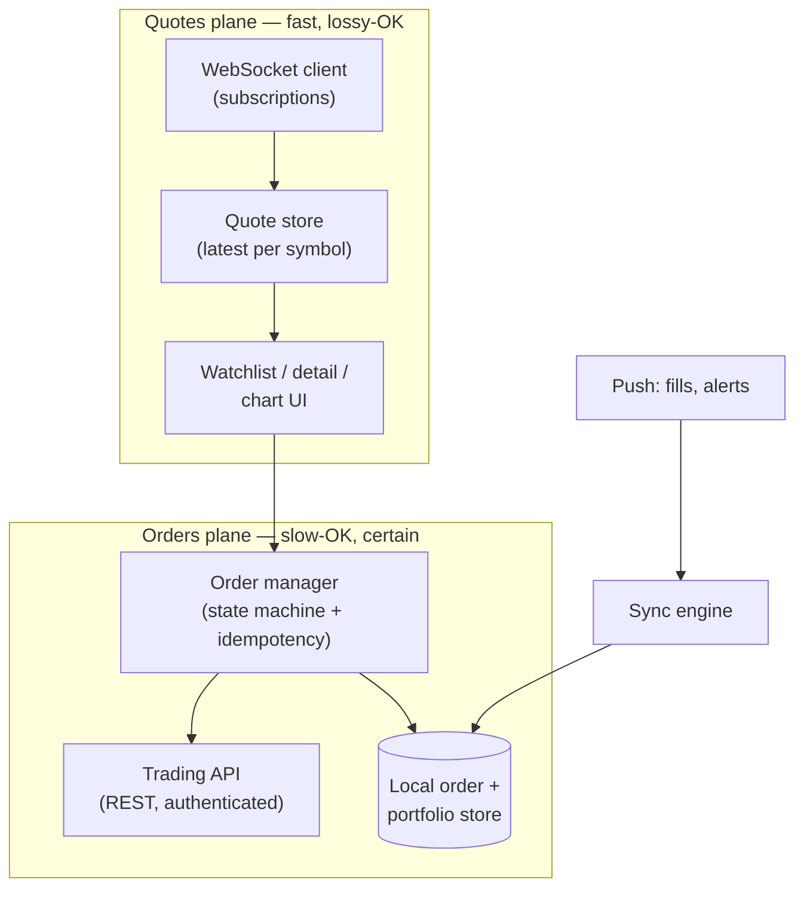
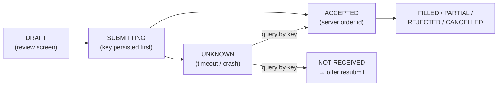

# Mobile 15 — Design a Stock Trading App (Robinhood)

> **Sources:** Manuel Vivo, *Mobile System Design Interview* (solved case study; premium) · [Educative — Grokking Mobile SD](https://www.educative.io/courses/mobile-system-design) stock-trading chapter (premium outline).
> **Prerequisites:** [01 — The Framework](01-framework.md) · [08 — Chat App](08-chat-app.md) (the realtime channel) · Deep Dives [14 — Contention](../Deep%20Dives/14-pattern-contention.md) for the server half of order integrity.

## What you'll master

- The app's split personality: **quotes want speed, orders want certainty** — two subsystems with opposite defaults.
- **Real-time quotes** done right: WebSocket + server-side conflation, UI-rate throttling.
- **Order integrity on a device**: idempotency keys, a persisted order state machine, and never trusting the app's view of the world.
- Money-handling hygiene: **no floats, server time, fail-closed**.
- The **Staff/EM layer**: regulatory surface, kill switches on the trading path, incident posture.

## In the Room

| Decision | Default position | Justification | Revisit trigger |
|---|---|---|---|
| Quotes channel | **WebSocket, subscribe-by-visible-symbols, server conflation** | Push beats polling for many small updates; conflation caps the flood | Casual portfolio app → 30 s polling is honest |
| Quote freshness | **Best-effort + on-screen staleness indicator** | Quotes are decoration until an order is placed | — |
| Orders | **REST with idempotency key + server-authoritative state machine** | Certainty over latency; duplicates are money bugs | — |
| Offline | **Read-only, loudly stale; orders require connectivity** | A queued market order executing hours later is a lawsuit | Queued *limit* orders as explicit product feature |
| Money math | **Integers in minor units / decimal strings — never float** | 0.1 + 0.2 ≠ 0.3 is a compliance incident in this app | — |

**Experience hooks:** *"Our chat SDK's send pipeline is at-least-once + idempotent receive — orders are the same pattern with the stakes turned up: the idempotency key isn't UX polish, it's the double-charge defense."*

## 1. Requirements (~5 min)

- **Functional:** watchlist + live quotes, symbol detail with chart, place/cancel orders (market, limit), portfolio + positions, order history, price alerts (push).
- **Non-functional:** quote-to-glass p95 < 500 ms · **an order is never lost, duplicated, or silently ambiguous** · UI at 60 fps during market open bursts · biometric auth + hardened storage · offline = read-only with explicit staleness.
- **Out of scope:** matching engine, market-data licensing plumbing, KYC flows (name them).
- **Scope:** client + API contract.

## 2. High-Level — Two Planes

Say the split out loud in the first minute: **a dropped quote costs nothing — the next one supersedes it; a dropped order ack costs money.** Every downstream decision (transport, retries, offline) follows from which plane you're in.

## 3. Deep Dive 1 — the Quotes Plane

- **Subscription = visible symbols only.** Screen binds/unbinds subscriptions as cells appear/recycle; backgrounding tears the socket down (quotes are worthless off-screen, and the OS will kill the socket anyway).
- **Server-side conflation:** at market open a hot symbol ticks hundreds of times per second; the server sends at most N updates/sec/symbol carrying the *latest* state (quotes are absolute values — safe to drop intermediates, which is exactly why this plane tolerates loss).
- **Client throttling:** quote store updates coalesce to one UI frame — batch-render visible cells at ≤ 60 Hz (charts happily live at 1–5 Hz). Never one `notifyItemChanged` per tick.
- **Staleness contract:** every quote carries server timestamp; > 5 s old renders a stale indicator, socket loss renders a banner. Traders forgive latency; they don't forgive *undisclosed* latency.
- Reconnect: resubscribe visible set + one REST snapshot to re-baseline — same "sync then live" shape as [08 §4](08-chat-app.md#4-deep-dive-2--sync--the-reconnect-story).

## 4. Deep Dive 2 — the Orders Plane (the crux)

Order placement as a persisted state machine, UUID idempotency key minted at tap-confirm:

The rules:

- **Key before network:** the idempotency key + order params are written to local DB *before* the request leaves. Crash anywhere after → on restart, `GET /orders?key=` resolves UNKNOWN to the truth. **The app never guesses; it asks.**
- **No automatic retry of an UNKNOWN market order.** Resolve first, then let the *user* resubmit — an auto-retried market order at a moved price is the classic money bug.
- **Server is the only truth for fills.** The push notification "order filled" is a doorbell → sync order status through the API; portfolio recomputes from synced positions, never from client arithmetic.
- **Time and price honesty:** display server timestamps; the confirm screen shows the quote's age; market orders state "executes at market price, which may differ."
- Cancels are also idempotent state transitions — cancel of a filled order returns "too late, here's the fill," and the UI must render that race gracefully because it *will* happen.

> **Staff-level insight:** the money-integrity toolkit — idempotency key, persisted state machine, resolve-don't-guess, server-authoritative — is exactly Deep Dives [15 — Multi-step Processes](../Deep%20Dives/15-pattern-multi-step-processes.md) running on the *client*. Cross-referencing the two is a strong systems-thinking signal.

## 5. Security & Compliance Hygiene

One deliberate paragraph — at Google-level this is expected, not bonus: biometric + short-session re-auth for trading actions; tokens in Keystore/Keychain; certificate pinning on the trading API; screenshot/screen-recording restrictions on sensitive screens where the platform allows; no PII or order details in logs/analytics; jailbreak/root detection as a *risk signal* (step-up auth), not a hard block. Money amounts as integers in minor units end-to-end.

## 6. The Staff/EM Layer

- **Fail-closed vs fail-open (EM):** quotes fail *open* (stale-with-banner beats blank); trading fails *closed* (degraded certainty → disable the buy button with an honest message). *"I'd rather lose an order than duplicate one"* is the sentence, and it's a compliance position, not just engineering taste.
- **Kill switches (EM):** server-controlled flags per order type/asset class — a bad rollout or a market incident must be stoppable in seconds without an app release. Trading apps keep a permanently-manned flag panel; that's an org design, mention it.
- **Regulatory surface (EM):** order timestamps/audit trails, best-execution disclosures, market-data licensing (real-time vs 15-min-delayed tiers per exchange contract — that's why free tiers show delayed quotes), regional feature gating. Engineering enforces legal contracts; the EM owns knowing which ones.
- **Incident posture (Staff):** the pager metric is **order-resolution integrity** (no order stuck UNKNOWN > N s), ahead of quote latency. Dashboards mirror the two planes.

## Follow-Ups — the Interviewer Escalates

- **"Chart with 5 years of daily candles plus live intraday — one data path?"** — No: historical candles are immutable → REST, cached forever, downsampled server-side per zoom level; only the live candle rides the socket and mutates. Mixing them gives you either a chatty socket or a mutable cache — split by mutability.
- **"Order book screen: 20 levels updating constantly — same conflation?"** — Tighter: the book is *relative* state (deltas), so unlike quotes you can't drop arbitrary updates — you need snapshot + sequenced deltas with gap detection forcing a re-snapshot. Flagging that quotes and books have different loss-tolerance is the depth marker here.
- **"User has 200 symbols in a watchlist — subscribe to all?"** — Visible cells only, plus maybe one screen of lookahead; off-screen symbols poll lazily for the summary row. 200 socket subscriptions for 12 visible cells is battery and server cost for invisible pixels.
- **"Regulator asks: prove the user saw price X when they tapped Buy."** — The order request carries the displayed quote (price + server timestamp + quote ID) alongside the order; server logs it as the decision context. You can't retrofit this — it's an API-contract decision made on day one, which is why it's a Staff question.
- **"Biometric prompt on every trade annoys power users — EM call?"** — Risk-tiered auth: session biometric for small orders, step-up for large/unusual ones, thresholds server-configurable per account and regulator. UX-vs-security is a dial you expose to policy, not a constant you compile in.
- **"Exchange feed goes down but your API is healthy — what does the user see?"** — Quotes freeze with a prominent stale banner and *timestamped* last prices; trading stays enabled only if the broker still has an execution path, else fail-closed with the honest message. The wrong answer is silently rendering frozen prices as live — that's the lawsuit screenshot.

## When NOT / Variants

- **Crypto exchange app:** same two planes; 24/7 market removes the open-bell burst but adds withdrawal-security weight.
- **Portfolio tracker (no trading):** the orders plane vanishes — it's [09 — News Feed](09-news-feed.md) with numbers; polling is honest.
- **Sports betting / auctions:** same order-integrity skeleton — countdown pressure plus [24 — Hotel Reservation](24-hotel-reservation.md)-style holds.

---

## Interview Cheat-Sheet

**30-second architecture:** two planes — WebSocket quotes (visible-only subscriptions, server conflation, UI-rate coalescing, staleness badges) and REST orders (idempotency key persisted pre-flight, state machine with UNKNOWN→query resolution, server-authoritative fills) · fail-open quotes, fail-closed money · integers for money, server time for truth.

| Probe | Answer |
|---|---|
| "App crashes right after tapping Buy?" | Key + params persisted pre-flight → restart queries by key → shows ACCEPTED or offers clean resubmit; never auto-resubmits a market order |
| "Market open: 500 ticks/sec on a symbol?" | Server conflates to N/sec latest-value; client coalesces to frame rate; charts at 1–5 Hz; drops are safe because quotes are absolute |
| "User on the subway wants to trade?" | Read-only with loud staleness; trading requires connectivity — queued market orders are a product/compliance decision, not a default |
| "Why not floats for prices?" | Binary float can't represent 0.1; accumulation errors in money are compliance incidents — minor-unit integers or decimal types end-to-end |

**Say-verbatim:**
- *"A dropped quote costs nothing; a dropped order ack costs money — so quotes get a lossy fast path and orders get a certain slow path."*
- *"The app never guesses an order's fate — it persists the idempotency key first and asks the server."*
- *"Quotes fail open with a staleness banner; the buy button fails closed."*
- *"Undisclosed staleness is the sin — show the quote's age, not just the quote."*
