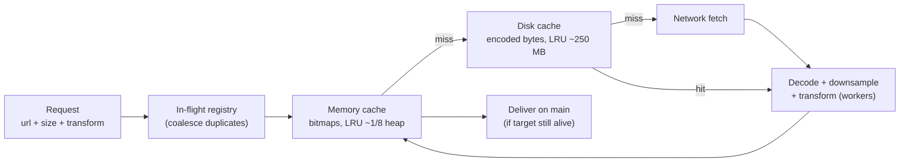

# Mobile 16 — Design an Image Loading Library (Glide / Coil / Kingfisher)

> **Sources:** [weeeBox — image library exercise](https://github.com/weeeBox/mobile-system-design/blob/master/exercises/image-library.md) · [Ayusch Jain — Design an Image Loading Library](https://medium.com/@jain.ayusch10/android-system-design-interview-design-an-image-loading-library-cb51740ce60d) · Glide/Coil internals as reference implementations.
> **Prerequisites:** [01 — The Framework](01-framework.md) (SDK variant) · [09 — News Feed](09-news-feed.md) (this library's biggest customer). Sibling SDK note: [19 — Pagination Library](19-pagination-library.md) — the API-surface-first discipline applies verbatim.

## What you'll master

- The one-line API that hides a pipeline: **request → dedup → memory cache → disk cache → network → decode → transform → deliver**.
- **OOM prevention as the core feature**: downsample-at-decode, cache keys that include size, bitmap reuse.
- **Lifecycle-bound cancellation** — why the library must know about views and screens.
- The **Staff/EM layer**: buy Glide/Coil, the telemetry story, and the one case where you build.

## In the Room

| Decision | Default position | Justification | Revisit trigger |
|---|---|---|---|
| API shape | **One fluent entry: `load(url).size(auto).into(target)`** | 95 % of call sites are a list cell; optimize for them | Power users get the request-builder escape hatch |
| Cache key | **url + target size + transforms** (memory); **url only** (disk, encoded bytes) | Same URL at 3 sizes = 3 bitmaps but 1 download | Auth-signed URLs → split key from signature |
| Decode | **Bounds-first, downsample to target size, never full-res** | A 12 MP photo is ~48 MB raw; a cell needs ~0.4 MB | Explicit full-res viewer request |
| Cancellation | **Automatic via target lifecycle (view detach / screen destroy)** | Scrolling a list fires hundreds of doomed requests | Fire-and-forget prefetch API |
| Failure | **Placeholder → error drawable; retries are the *caller's* policy** | An image library silently retrying burns radio invisibly | Configurable per-request retry opt-in |

**Experience hooks:** *"Our SDK renders avatars and media previews inside customer apps — we are a consumer of exactly this contract, and the bugs we've filed upstream (cache key misses on resized avatars, leaked targets) are the design points I'll hit."*

## 1. Requirements (~5 min)

- **Functional:** load from URL/file/resource into view targets · placeholders + error states · transformations (resize, crop, rounded) · prefetch API · manual cache control.
- **Non-functional:** **zero OOM contribution** by design · 60 fps scroll unaffected (all work off-main, one main-thread hop to deliver) · memory budget respected under pressure callbacks · request dedup · works in any host app without configuration.
- **Out of scope:** image *editing*, upload ([23](23-google-drive.md) owns transfers), video thumbnails (seam, not feature).
- **Scope check:** SDK — the API surface, the pipeline, the caches, the threading contract.

## 2. The Pipeline

The contracts that make it production-grade:

- **Dedup first:** ten cells requesting one avatar join a single in-flight operation; each gets a callback. Without this, list screens multiply every miss by visible-cell count.
- **Two caches, two currencies.** Memory holds *decoded bitmaps* (expensive to make, huge) keyed by url+size+transform. Disk holds *encoded bytes* (cheap to store, one per URL) so a new size costs a re-decode, not a re-download.
- **Decode is where OOM lives:** read bounds only → compute sample factor for target size → decode downsampled. The library *requires* a target size (from the view or explicit) — an API that lets you decode "whatever the file is" is an OOM generator with a fluent interface.
- **Delivery checks liveness:** the target holds a weak/lifecycle-scoped reference; deliver on main only if attached. Recycled cell → result goes to cache, not to the wrong row (the classic flickering-wrong-image bug is a missing request-tag check).
- **Memory pressure:** register for OS trim callbacks → drop memory cache tiers; bitmap pooling (reuse buffers for same-size decodes) where the platform rewards it.

> **Staff-level insight:** the cache-key sentence wins the round: *"memory keys include size and transform because bitmaps are size-specific; disk keys don't because bytes aren't — that asymmetry is the whole design."* Everything else falls out of it.

## 3. Threading & API Contracts (the SDK half)

- **Threading promise, documented:** requests may be created on any thread; decode/transform on a bounded worker pool (CPU-count-ish, separate tiny pool for disk I/O); exactly one main-thread hop at delivery. The host app never blocks.
- **Priorities:** visible > prefetch; scroll-flings can pause decode of far-offscreen requests. Expose `priority(HIGH)` sparingly — every public knob is a decade of support ([19 §2](19-pagination-library.md#2-the-public-api--design-this-first)).
- **Prefetch API** is fire-and-forget into *disk* (not memory — don't evict visible bitmaps for speculative ones): `prefetch(urls)` from the feed's page-load hook.
- **Signed URLs:** cache key = URL-sans-signature (configurable key extractor) or CDNs with rotating tokens get a 0 % hit rate. This is the interview's favorite "have you actually shipped this" probe.
- **Config seams:** pluggable fetcher (OkHttp/Cronet), decoder (GIF/WebP/AVIF), and cache sizes — defaults tuned so integration is `load().into()` with zero setup.

## 4. The Staff/EM Layer

- **Buy, almost always (EM):** Glide/Coil (Android) and Kingfisher/Nuke (iOS) *are* this design, battle-tested against a decade of OEM decode quirks. Build only for: KMP shared core, exotic decode (proprietary formats/DRM), or when the library must ship inside *your* SDK without third-party deps — that last one is a real SDK-vendor reason; name it.
- **Telemetry (Staff):** hit rates per tier, decode p95, bytes-over-network per session — the feed team's jank budget depends on your numbers, so publish dashboards, not vibes.
- **App-size budget (EM):** an image library rides into every APK; method count and native-lib size are adoption criteria for SDK consumers — treat binary size as a feature with a CI gate.
- **Evolution (Staff):** decoder registry means AVIF arrives as a plugin, not a major version. Additive seams over breaking changes — the [19 §5](19-pagination-library.md#5-the-staffem-layer) versioning economics apply verbatim.

## Follow-Ups — the Interviewer Escalates

- **"Scroll a 1,000-item list fast — what happens to the 990 images you'll never show?"** — View-detach cancels their requests: network calls abort, queued decodes drop; anything already decoded lands in cache. The in-flight registry plus lifecycle targets means waste is bounded by *visible* churn, not list length.
- **"Same image needed at 50 px in a list and 400 px in detail — how many downloads, decodes, cache entries?"** — One download (disk key = URL), two decodes, two memory entries (keys include size). Bonus point: the detail view can *show the 50 px bitmap upscaled instantly* while the 400 px decode finishes — placeholder-from-smaller-cache is a perceived-speed trick real libraries ship.
- **"OOM reports are coming from your library in production — debug it."** — In order: hosts loading unbounded sizes (audit for missing size constraints / full-res escapes), cache budget vs low-end heap (1/8 of a 96 MB heap ≠ 1/8 of 512 MB — verify it scales), bitmap pool fragmentation, then leaked targets holding bitmaps past screen death. Each hypothesis has a metric; say which dashboard you check first.
- **"GIFs and animated WebP?"** — Pluggable decoder producing an animatable drawable; frame buffers make animated images ~10× memory — cap concurrent animations and pause off-screen ones. The seam matters more than the codec.
- **"Host app goes to background — your caches?"** — Memory cache responds to trim callbacks (drop half, then all); disk untouched; in-flight requests for dead screens cancel. An SDK that ignores trim signals gets the *host* killed — and the one-star review goes to them, which is why they'll rip you out.
- **"How would you A/B a new decode path inside a library?"** — Library-level remote config flag with per-host sampling, comparing decode p95 / OOM / hit rates, host opt-out honored. Rolling out SDK internals via config beats shipping N versions — but disclose it: silent behavioral flags inside SDKs are a trust decision the EM owns.

## When NOT / Variants

- **A handful of static images** — platform APIs are fine; a pipeline for 12 icons is résumé-driven engineering.
- **Full-screen photo viewer** (pinch-zoom gigapixel) — different beast: tiled region decoding, not the cell pipeline; flag it as a separate component.
- **Image *pipeline* question** ("design Instagram's photo pipeline") — that's capture → transform → upload → CDN; this library is only the last hop. Re-scope in minute one.

---

## Interview Cheat-Sheet

**30-second architecture:** fluent one-liner API · in-flight dedup · memory LRU of sized bitmaps + disk LRU of encoded bytes · bounds-first downsampled decode on workers · lifecycle-bound delivery and cancellation · trim-callback citizenship · pluggable fetcher/decoder seams.

| Probe | Answer |
|---|---|
| "Why did row 7 briefly show row 3's image?" | Recycled cell without request-tag check — delivery must verify the target still wants *this* request; the library owns that, not the app |
| "Cache hit but still janky scroll?" | Memory hits are sync-safe; disk hits still decode — keep decode off-main even for hits, and pre-warm memory via prefetch |
| "How big are your caches?" | Memory ~1/8 heap (scaled to *actual* heap class), disk ~100–250 MB LRU — and both are host-configurable defaults, not constants |
| "Signed CDN URLs rotate hourly — hit rate?" | Key extractor strips the signature; cache by stable identity, fetch with the fresh URL |

**Say-verbatim:**
- *"Memory keys include size and transform; disk keys don't — bitmaps are size-specific, bytes aren't."*
- *"The API requires a target size because decode-at-full-res is an OOM with a fluent interface."*
- *"Cancellation is lifecycle-driven, not caller-driven — callers forget; detach doesn't."*
- *"I'd ship Coil and spend the innovation budget on telemetry — unless this library must live inside our SDK dependency-free, which is the one honest build case."*
