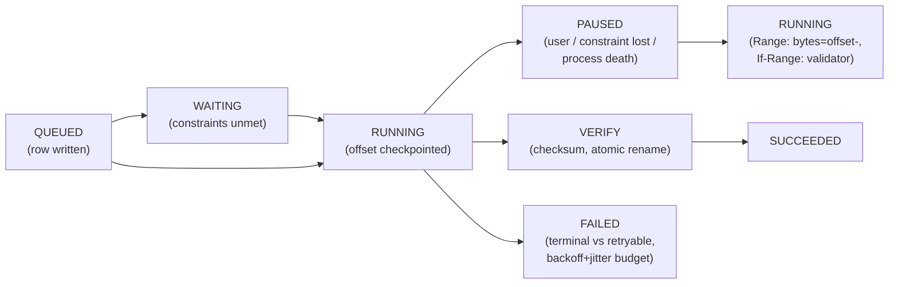

# Mobile 17 — Design a File Downloader / Uploader Library

> **Sources:** weeeBox file-downloader exercise · the transfer engine from [23 §4](23-google-drive.md), extracted as the SDK it was always going to become.
> **The crux in one line:** *transfers deliberately outlive screens — the exact inversion of the [image loader](16-image-loading-library.md)'s lifecycle-bound cancellation — so the design is a persisted queue with resumable transfers behind a small API.*

## What you'll master

- **API-first design** ([19](19-pagination-library.md)'s discipline): enqueue → observable handle → terminal states; constraints as data.
- The **persisted transfer state machine** and why it, not the network code, is the library.
- **Resumability done honestly**: HTTP ranges + validators down, chunked sessions up, and the changed-file trap.
- The **lifecycle inversion** vs the image loader — one sentence that shows you own both designs.
- Scheduler integration, foreground-service honesty, and the error taxonomy consumers actually need.

## In the Room

| Decision | Default position | Justification |
|---|---|---|
| Lifecycle | **Transfers survive process death and screen exits by default; cancellation is explicit** | A download is a user *task*, not a view decoration — the [16](16-image-loading-library.md) inversion |
| State | **Every transfer is a DB row (state, offset, session, constraints); memory holds only active workers** | Resume-after-anything falls out of the row ([04 §2](04-data-caching-sync.md)) |
| Resume down | **HTTP `Range` + validator (`ETag`/`If-Range`); validator mismatch → clean restart** | Stitching ranges of a changed file is silent corruption — the classic trap |
| Resume up | **Chunked upload sessions with per-chunk hashes ([23 §4](23-google-drive.md))** | Multi-GB on flaky radios; server assembles + verifies |
| Execution | **Deferrable work rides the OS scheduler under constraints; user-initiated-now runs as a foreground service with a visible notification** | The platform's rules are the physics ([05 §5](05-performance-battery-startup.md)); honesty buys the budget |
| Integrity | **Post-transfer checksum verification; temp file + atomic rename** | A partial file at the destination path is worse than no file |

## 1. The API surface (design this first)

```
handle = transfers.enqueue(
  DownloadRequest(url, destination,
    constraints  = { network = UNMETERED_OK | ANY, requiresCharging = false },
    priority     = USER_INITIATED | BACKGROUND,
    integrity    = Checksum(sha256) | None,
    headers, tag))

handle.state: Flow<TransferState>
  // QUEUED → WAITING(constraint) → RUNNING(progress: bytes, total, rate)
  //        → PAUSED(cause) → SUCCEEDED(file) | FAILED(error, retryable)
handle.pause() / resume() / cancel()      // explicit — nothing implicit on screen exit
transfers.query(tag) → handles            // re-attach after process death
```

The re-attach line is the tell: **because transfers outlive the UI, the API's hardest requirement is *reconnecting* to work you didn't start this session** — `query(tag)` returning live handles for rows in the DB is what makes the persisted queue real to consumers. Progress is a Flow re-derivable by anyone at any time, not a callback owned by a dead screen.

## 2. The state machine is the library



- **Checkpoint the offset with the bytes:** progress persists as the temp file grows (offset = temp-file size on recovery — the file *is* the checkpoint); resume sends `Range: bytes=offset-` with `If-Range: <validator>` so a changed server file returns 200-full-body → clean restart, never a stitched corrupt file. No validator from the server? Then no resume — restart is the honest default, and say so.
- **Retry discipline is [03 §3](03-networking-realtime.md) verbatim:** backoff + jitter, retry budgets, retryable-vs-terminal taxonomy (416/404/403 terminal; timeouts/5xx/network-loss retryable), constraint-loss → WAITING not FAILED.
- **Completion is transactional:** verify checksum on the temp file, then atomic rename into destination — consumers must never observe a partial file at the final path ([18](18-caching-library.md) uses the same rule for cache entries).
- **Uploads mirror it** with a session URL + per-chunk hashes and server-side assembly-verification — the engine [23 §4](23-google-drive.md) specifies; the library packages it behind the same handle API.

## 3. Scheduling, concurrency & the platform

- **Two lanes:** `BACKGROUND` requests ride WorkManager/BGTaskScheduler under their constraints (batched, OS-timed, battery-polite); `USER_INITIATED` runs now via a foreground service with the progress notification the OS requires — the notification isn't decoration, it's the *payment* for execution guarantee ([22 §4](22-push-notification-system.md)'s honesty norm).
- **Concurrency caps per network class** (e.g., 3 parallel on Wi-Fi, 1 on cellular) with priority preemption — parallelism past a few connections buys congestion, not speed, on mobile radios.
- **Storage checks up front**: reserve-or-fail at enqueue beats ENOSPC at 98%.

## 4. The Staff/EM Layer

- **The lifecycle inversion is the interview's center:** *"the image loader cancels when the view dies because its output is view decoration; the downloader survives because its output is a user task. Same pipeline skeleton — dedup, queue, disk, network — opposite cancellation default, and choosing per-library is the design judgment."*
- **SDK consumer trust** (the SDK-vendor lens): the library runs inside someone else's app — battery blame lands on *their* brand. Constraint defaults conservative, telemetry hooks for bytes/battery attribution, and no surprise foreground notifications without the host app's opt-in.
- **Build-vs-buy honesty** (EM): platform `DownloadManager` exists — free, but coarse (limited progress granularity, policy control, no upload story). The build case is needing chunked uploads, custom integrity, or fleet-tuned constraints; state the trigger rather than defaulting to build.

## Follow-Ups — the Interviewer Escalates

- **"Process death at byte 400 MB of 900 MB?"** — Row says RUNNING with session + temp file at 400 MB; recovery marks PAUSED(process-death); next eligible drain resumes with `Range: bytes=400M-` + `If-Range` validator. Worst case (validator changed) is a clean restart — never corruption.
- **"Server doesn't support ranges?"** — Detect via `Accept-Ranges`/probe; those transfers restart-on-resume, and the API surfaces `resumable: false` so consumers can warn on large files. Don't fake resumability you can't verify.
- **"Wi-Fi drops mid-download, cellular available, request says UNMETERED_ONLY?"** — RUNNING → WAITING(constraint), not FAILED; resumes when Wi-Fi returns. Constraint transitions are states, not errors — that's why the taxonomy exists.
- **"100 queued downloads, the user opens one item and wants it *now*."** — Priority bump: preempt a background slot, promote to the user-initiated lane (foreground service), keep the preempted transfer's offset checkpointed. Priorities are queue policy, not new machinery.
- **"How does the host app resume progress UI after relaunch?"** — `transfers.query(tag)` re-attaches to the rows; state Flows re-emit current truth. The library's contract is that the queue, not the screen, is the source of truth.

---

## Interview Cheat-Sheet

**30-second architecture:** enqueue → persisted row per transfer (state, offset, session, constraints) → OS-scheduler lane for background, foreground-service lane for user-initiated → resume via Range + If-Range (down) / chunked sessions + hashes (up) → verify checksum, atomic rename → explicit cancel only; `query(tag)` re-attaches after process death · retry = backoff + jitter + budget; constraint loss is a state, not an error.

| Probe | Answer |
|---|---|
| "Difference from your image loader?" | Lifecycle inversion: view-bound cancellation there, screen-independent persistence here — same skeleton, opposite default, chosen by what the output *is* |
| "Corrupted resume?" | Impossible by construction: If-Range validator gates stitching, checksum gates completion, atomic rename gates visibility |
| "Battery cost?" | Background lane batches under OS constraints; user lane pays with a visible notification; concurrency capped per network class |

**Say-verbatim:**
- *"The image loader decorates views; the downloader executes tasks — that one distinction sets every default."*
- *"The temp file is the checkpoint; the validator decides resume-vs-restart; the rename is the commit."*
- *"Constraint loss is a state transition, not an error."*
