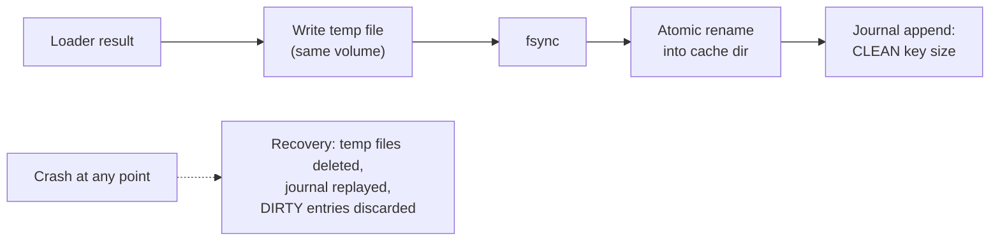

# Mobile 18 — Design a Caching Library

> **Sources:** weeeBox caching exercise · DiskLruCache/OkHttp-cache semantics (the reference implementations) · applies [04](04-data-caching-sync.md)'s policy note as an SDK.
> **The crux in one line:** *the API contract IS the design — `get(key, loader)` with single-flight, two budgeted tiers, and crash-safe disk writes; everything else is policy the consumer chooses.*

## What you'll master

- The **API contract**: why `get(key, loader)` (read-through) beats `get`/`put` pairs, and what single-flight guarantees.
- **Two tiers, two currencies**: object count/weight in memory, bytes on disk — budgeted, LRU, trim-aware.
- **Crash-safe disk caching**: temp-write + atomic rename + a journal — the part homegrown caches get wrong.
- **Freshness policy as the consumer's choice**: TTL, stale-while-revalidate, generations — mechanisms provided, policy not imposed.
- When a cache is the wrong tool ([04](04-data-caching-sync.md)'s line: this library holds what you can afford to lose).

## In the Room

| Decision | Default position | Justification |
|---|---|---|
| API shape | **Read-through `get(key, loader)`, single-flight per key** | `get`/`put` pairs reinvent the stampede at every call site; the library owns dedup once |
| Tiers | **Memory (weight-budgeted LRU) over disk (byte-budgeted, journaled)** | Different currencies, different eviction pressure — [16 §2](16-image-loading-library.md)'s split generalized |
| Keys | **Consumer key + library-managed version/variant suffix; hashed for filenames** | Key discipline (url+size+transform) is what makes caches correct, not just fast |
| Crash safety | **Temp file + fsync + atomic rename; journal for LRU order + sizes** | A cache that can serve a torn write is a corruption amplifier |
| Freshness | **Mechanisms (TTL, SWR, generation clear) — no imposed policy** | Freshness is a product decision ([04 §5](04-data-caching-sync.md)); the library sells knobs, not opinions |
| Failure mode | **Cache errors degrade to loader pass-through, never to consumer-visible failures** | A broken cache must cost performance, not correctness |

## 1. The API contract

```
cache = Cache.Builder(dir)
  .memory(maxWeight = heapFraction(1/8), weigher = { k, v -> v.byteCount })
  .disk(maxBytes = 250.MB, serializer = protoSerializer)
  .build()

value = cache.get(key) { loader() }          // read-through, single-flight, suspend/async
  // policy per call: cache.get(key, ttl = 5.minutes, staleWhileRevalidate = true) { … }
cache.invalidate(key) / invalidateAll()      // generation bump — O(1), no file sweep
cache.edit(key) { … }                        // explicit write path for non-loader use
```

- **Read-through is the contract because it centralizes the two hard guarantees:** *single-flight* (concurrent `get`s for one key share one loader call — the [16 §2](16-image-loading-library.md) dedup, generalized; without it every screen rotation is a mini-stampede, [Core Course 03](../Core%20Course/03-caching.md)'s thundering herd at app scale) and *tier promotion* (disk hit populates memory; loader result populates both) — call sites can't forget what they never had to do.
- **`invalidateAll` is a generation bump**, not a file sweep: entries carry their generation; stale generations miss and get lazily reclaimed — O(1) logout/account-switch, which is the moment consumers actually call it.
- **Failure posture:** disk full, corrupt entry, serialization error → treat as miss, run the loader, try to repair/evict in the background. The library's exceptions never propagate a *cache* problem as a *data* problem.

## 2. Two tiers, two currencies

- **Memory:** LRU by *weight* (consumer-defined weigher — entries aren't equal; a bitmap and a bool both "count 1" only in broken caches), budget defaulting to a heap fraction, and **trim-callback integration** ([05 §4](05-performance-battery-startup.md)): the OS memory signal drops tiers by severity. Values must be immutable/snapshot — handing out mutable cached objects is the concurrency bug generator.
- **Disk:** LRU by bytes with a **journal** (append-only log of reads/writes/removes → LRU order and sizes survive restart without an O(n) scan; compacted periodically — DiskLruCache's design, name-checked). Filenames are hashed keys; sizes tracked per entry; eviction honors in-flight readers.
- **What the disk tier refuses to be:** a database. No queries, no partial updates, no transactions across keys — [04 §1](04-data-caching-sync.md)'s line is the API's scope fence: *this library holds what you can afford to lose.* Outboxes, entities, and cursors belong in the DB; put them here and eviction becomes data loss.

## 3. Crash safety — the part that separates libraries from bugs



Write path: temp file → fsync → atomic rename → journal `CLEAN` record. Crash anywhere leaves either no entry or a complete entry — **a torn write is unrepresentable**, the same commit discipline as [17](17-file-downloader.md)'s downloads and [29](29-ecommerce-checkout.md)'s claim-in-transaction, at cache scale. Recovery on open: discard temps, replay journal, drop `DIRTY` (mid-write) entries. Optional per-entry checksums catch bit-rot on read → treat as miss, evict, reload.

## 4. Freshness — knobs, not opinions

Per-`get` policy, because [staleness is a budget the *surface* owns](04-data-caching-sync.md): **TTL** (expired = miss), **stale-while-revalidate** (serve stale now, refresh in background, notify via the returned Flow if the consumer subscribed — the [09 §3](09-news-feed.md) pattern as a library primitive), **generations** for mass invalidation, and **no policy** (content-addressed keys where bytes are immutable — the [16](16-image-loading-library.md) case). The library documents the menu and defaults to *no expiry* — silent TTL defaults are how caches lie to their consumers.

## 5. The Staff/EM Layer

- **The SDK lens** (SDK-vendor hook): a cache inside someone else's app must budget conservatively by default, expose size/hit-rate metrics hooks (their pager, your telemetry), and honor the host's storage pressure — an SDK that fills a user's disk burns the *host's* brand.
- **Build-vs-buy** (EM): memory tier — use the platform's LRU primitives; disk tier — DiskLruCache-descended libraries exist and are hardened; HTTP responses — OkHttp's cache already implements RFC semantics. The build trigger is a genuinely custom value pipeline (your own serialization + integrity + tiering policy); otherwise this note is your *evaluation checklist* for the buy.
- **The metric that matters:** hit rate *by tier* and *by key family*, plus eviction-pressure (evictions/hour vs budget). A 95% aggregate hiding a 20% hit rate on the hot key family is the standard misread — say it.

## Follow-Ups — the Interviewer Escalates

- **"Two coroutines `get` the same key simultaneously."** — Single-flight: one loader runs, both await the same result; the per-key mutex/flight map is the library's first guarantee. Follow-up-proof: the flight map is bounded and cleaned on completion — a leaked flight entry is a deadlocked key.
- **"App crashes mid-write — next launch reads the entry."** — It can't read a torn entry: rename is the commit, journal recovery discards DIRTY. Worst case is a miss and a reload — cost, never corruption.
- **"Logout — user B must not see user A's cache."** — Either namespace keys by account (two users coexist) or `invalidateAll` generation-bump at switch (O(1)); for sensitive data, the disk tier supports encryption-at-rest via the serializer seam ([06 §2](06-security-privacy.md)) — and the honest answer for truly sensitive values is "don't disk-cache them."
- **"TTL expired but the network is down."** — Consumer's policy call, which is why it's a knob: strict (miss → error), or serve-stale-with-flag (the value + its age, consumer renders the hedge — [04 §5](04-data-caching-sync.md)'s tiers). The library reports honestly; the surface decides.
- **"Your cache is at 100% budget constantly — bug?"** — No: a full LRU cache at steady state is a *working* cache; the health signals are hit rate and eviction churn vs reload cost. Sizing answers come from the hit-rate-by-family dashboard, not from "make it bigger."

---

## Interview Cheat-Sheet

**30-second architecture:** read-through `get(key, loader)` with single-flight · memory tier (weight LRU, trim-aware, immutable values) over disk tier (byte LRU, hashed keys, journal) · temp + fsync + atomic rename + journal = torn writes unrepresentable · freshness as per-call knobs (TTL / SWR / generations / none) · cache failures degrade to loader pass-through · scope fence: holds what you can afford to lose — the DB owns the rest.

| Probe | Answer |
|---|---|
| "Why `get(key, loader)` instead of get/put?" | Single-flight and tier-promotion live in one place — get/put pairs re-implement the stampede at every call site |
| "Crash during a write?" | Rename is the commit; journal recovery drops DIRTY entries — miss, never corruption |
| "How big should it be?" | Weight/byte budgets with trim integration; sized by hit-rate-by-key-family vs eviction churn, not by vibes |
| "Cache the user's messages here?" | No — eviction would be data loss; this holds refetchables. Messages live in the DB with sync ([04](04-data-caching-sync.md)) |

**Say-verbatim:**
- *"The API is the design: read-through with single-flight — consumers can't forget what they never had to do."*
- *"The rename is the commit — a torn write is unrepresentable."*
- *"This library holds what you can afford to lose; the moment eviction would be data loss, you wanted a database."*
