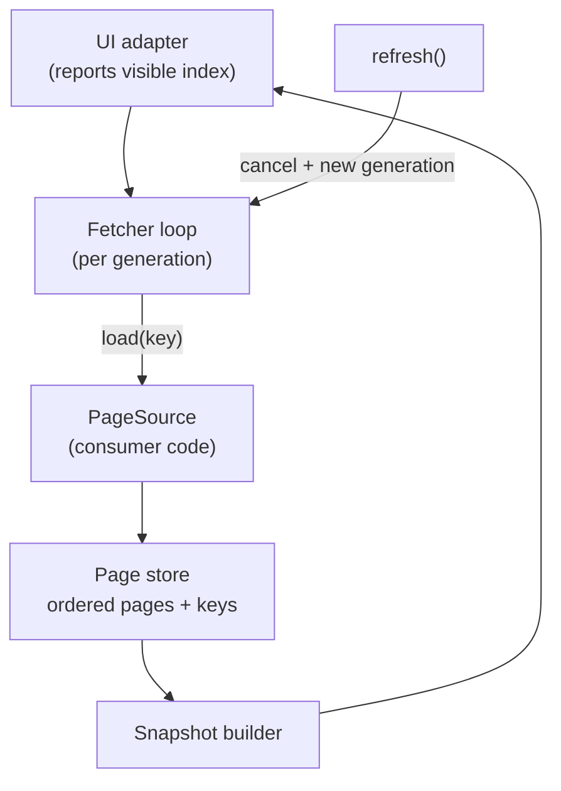

# Mobile 19 — Design a Pagination Library

> **Sources:** Manuel Vivo, *Mobile System Design Interview* (solved case study; premium) · [weeeBox — exercises](https://github.com/weeeBox/mobile-system-design) (pagination library is on its list) · Jetpack Paging 3 as the reference implementation.
> **Prerequisites:** [01 — The Framework](01-framework.md) (the SDK variant of the anatomy) · [09 — News Feed](09-news-feed.md) (pagination as a *feature*; here it becomes the *product*).

## What you'll master

- The **SDK inversion**: no UI to hide behind — the public API *is* the design, and every signature is a ten-year contract.
- A minimal, correct **paging abstraction**: data source, page keys, the loaded-pages state, and the prefetch loop.
- The hard parts: **invalidation, error surfaces, placeholders, and threading contracts**.
- The **Staff/EM layer**: platform-team economics — versioning, adoption, and when the answer is "use Paging 3, don't build."

## In the Room

| Decision | Default position | Justification | Revisit trigger |
|---|---|---|---|
| Key model | **Opaque `Key` generic (cursor-shaped), not page numbers** | Cursors survive inserts/ranking; offsets are a special case of keys | — |
| API style | **Pull-based stream of immutable `PagingState` snapshots** | Declarative UIs consume states; callbacks invert control badly | Imperative/legacy consumers → thin adapter |
| Refresh model | **Invalidate → new generation, old pages torn down** | Patching stale pages in place is the bug factory | — |
| Errors | **Per-load-type (refresh/append/prepend) state with `retry()`** | The UI must distinguish "first load failed" from "page 7 failed" | — |
| Caching | **In-memory pages by default; DB layer pluggable, not bundled** | A paging library that mandates a database fails half its adopters | — |

**Experience hooks:** *"I ship an SDK for a living — every public signature we got wrong in v1 is still haunting us, because customers can't be forced to upgrade. I design the API surface first and treat it as the deliverable."*

## 1. Requirements (~5 min)

- **Functional:** page loads from any async source (network/DB/composite) · forward + backward paging · prefetch ahead of scroll · pull-to-refresh · per-page retry · optional placeholders.
- **Non-functional:** UI-framework-agnostic core (adapters for RecyclerView/Compose/UIKit) · zero jank added (all loads off-main, delivery on main) · bounded memory (page eviction option) · consumer integration < 50 lines.
- **Out of scope:** disk persistence (pluggable seam), item-level mutations (consumer's domain).
- **Scope check:** "library" means: define the public API, the internal engine, the threading/error contracts, and the extension seams.

## 2. The Public API — Design This First

```kotlin
// The one interface consumers implement:
interface PageSource<Key : Any, Item : Any> {
    suspend fun load(params: LoadParams<Key>): LoadResult<Key, Item>
    // LoadParams: key? (null = initial), loadSize, direction
    // LoadResult.Page(items, prevKey?, nextKey?) | LoadResult.Error(e)
}

// The one object consumers configure:
class Pager<Key : Any, Item : Any>(
    config: PagingConfig,          // pageSize, prefetchDistance, maxPagesInMemory
    sourceFactory: () -> PageSource<Key, Item>
) {
    val state: Flow<PagingState<Item>>   // snapshots: items + load states
    fun refresh()                        // invalidate → new generation
    fun retry()                          // re-run whichever load failed
}
```

Why these shapes survive scrutiny:

- **`load()` returns the next keys with the page** — the source owns key semantics (cursor, offset, timestamp); the engine never inspects keys. Opaque-cursor discipline from [09](09-news-feed.md#3-deep-dive-1--pagination--caching), enforced by the type system.
- **`sourceFactory`, not a source instance** — invalidation works by *building a new source* (new generation); sources are single-generation and therefore stateless-simple.
- **`PagingState` is an immutable snapshot** — items plus `refresh/append/prepend` load states (`Loading | Error | NotLoading(endReached)`). Diffing snapshots is the adapter's job, one per UI framework.
- **Threading contract, stated in the docs as a promise:** `load()` is called on the library's worker context; state is delivered on main; the library never blocks main. An SDK's threading contract is API.

> **Staff-level insight:** count the concepts a consumer must learn: two types (`PageSource`, `Pager`), one config, one state. Every additional exposed concept multiplies adoption cost across every consuming team — API minimalism is an *economic* argument at Staff level, not aesthetics.

## 3. The Engine



- **Prefetch loop:** adapter reports the last-bound index; when `distanceToEnd < prefetchDistance`, fetch `nextKey`. Same backward. One in-flight load per direction — a scroll flurry must **not** queue five loads (classic bug; the visible-index signal is *level*, not edge).
- **Generations:** `refresh()` cancels in-flight loads, builds a new source, loads from the initial key. Old snapshots keep rendering until the first new page lands — no blank flash. Late results from a dead generation are dropped by generation-ID check (the race everyone ships).
- **Memory bound:** optional `maxPagesInMemory` drops pages far behind the scroll direction (keeping their keys for re-fetch) — the 100k-item list on the 2 GB phone is the library's problem, by design.
- **Placeholders** (only if total count is known): render count-sized list with null slots. Default off — half the sources can't count, and nullable items infect the consumer API. An honest library makes the rare feature opt-in, not the default tax.

## 4. Errors, Edge Cases, and the Test Story

- Error states are **per-direction** with one `retry()` that re-runs exactly the failed loads. Refresh-error with cached content ≠ refresh-error empty — the snapshot exposes both so the UI can choose full-screen error vs snackbar.
- **End-of-list** is `nextKey == null` → `NotLoading(endReached = true)` — a state, not an error and not an infinite spinner.
- Ship a **`TestPager`** driver (feed pages, assert snapshots) and a fake-source kit. For an SDK, the testing story is a first-class feature: it's the difference between teams adopting it and teams wrapping it.

## 5. The Staff/EM Layer

- **Build vs buy (EM, and say it first):** on Android, **Paging 3 already is this design** — the honest recommendation is *adopt it*, and the interview answer is "here's the design I'd want, which is why I'd buy the thing that already implements it; I'd build only for cross-platform KMP cores or exotic sources." Recommending not-building your own library question, with reasons, is a *strong* EM signal, not a dodge.
- **Versioning (Staff):** semver with near-permanent v-majors — an SDK breaking change costs every consumer a migration, so deprecate-with-shims for cycles before removal. Design seams (`PageSource` as interface, adapters separate) so evolution happens by *addition*.
- **Adoption economics (EM):** a platform library succeeds on migration cost, docs, and the testing kit — budget as much for those as for the engine. Track adoption % and top blocker, not just correctness.
- **Telemetry (Staff):** built-in hooks (load latency, error rates, prefetch hit rate) — anonymous, opt-in, because your library becomes infrastructure you must debug across apps you don't own.

## Follow-Ups — the Interviewer Escalates

- **"An item in page 2 gets edited — full invalidation?"** — Item mutations aren't the pager's job: the source of truth (DB) updates and the snapshot rebuilds the affected item by stable ID; generation invalidation is reserved for *membership/order* changes. Conflating the two makes every like-button refetch the world.
- **"Two RecyclerViews share one Pager — supported?"** — Snapshots are immutable values, so N observers is safe; but the prefetch signal must merge (max of visible indices). Decide and *document* it — undocumented sharing semantics are how SDK bugs become customer architecture.
- **"Consumer's `load()` throws instead of returning `LoadResult.Error` — what happens?"** — The engine catches and converts (consumer code is hostile input for a library), logs through the telemetry hook, and surfaces the same error state. An SDK that crashes the host app on a consumer bug gets uninstalled — defensive boundaries are part of the API.
- **"Backward paging from the middle — chat history opening at an unread marker?"** — `initialKey` targeting mid-list plus bidirectional loads from there; this is exactly why `prevKey` exists and why placeholders stay optional (you don't know the count above). If they push: jump-to-position with unknown counts = anchor-based snapshots — offer to whiteboard it.
- **"How do you roll out a breaking fix to the threading contract?"** — You don't break it: additive API with the new behavior opt-in via config, telemetry on who still hits the old path, deprecation over N releases, then majors. For an SDK the rollout unit is *consumer migrations*, not binaries — that's the EM cost model.
- **"Prove the library doesn't jank the host app."** — Benchmark suite in CI (frame timing during scripted scroll with synthetic sources), plus the telemetry hook reporting p95 snapshot-build time in the field. "Zero jank added" was a requirement; requirements get dashboards.

## When NOT / Variants

- **A single 200-item list:** load it all; paging machinery is overhead below ~3 pages of content.
- **Realtime lists (chat):** pagination backward through history + live inserts at the head — the generation model must tolerate head-inserts without invalidation ([08 §4](08-chat-app.md#4-deep-dive-2--sync--the-reconnect-story)); vanilla page-append engines fit badly, flag it.
- **Offline-first with DB:** put the DB *behind* `PageSource` (DB-as-source, network fills DB — remote-mediator pattern); the paging engine stays unchanged. That seam is why persistence was left pluggable.

---

## Interview Cheat-Sheet

**30-second architecture:** consumer implements `PageSource.load(key) → page + next keys` · `Pager` engine: prefetch-distance loop, one in-flight per direction, generation-based invalidation, immutable state snapshots · per-direction error states with `retry()` · placeholders/persistence/adapters as opt-in seams · threading contract is part of the API.

| Probe | Answer |
|---|---|
| "User scrolls very fast — five pages queued?" | Level-triggered prefetch with one in-flight load per direction; visible-index updates coalesce; no queue to build |
| "Refresh while page 5 is loading?" | New generation: in-flight loads cancelled, late results dropped by generation ID, old snapshot renders until fresh page 1 lands |
| "How does the consumer handle a mid-scroll failure?" | Snapshot exposes append-error distinct from refresh-error; `retry()` re-runs only the failed direction |
| "10k items on a low-end phone?" | `maxPagesInMemory` evicts distant pages, keys retained for re-fetch — bounded memory is the library's contract |

**Say-verbatim:**
- *"For a library, the API surface is the deliverable — internals I can rewrite; signatures I maintain for a decade."*
- *"The engine never inspects keys — cursor semantics belong to the source, enforced by the generics."*
- *"Invalidation is a new generation, not a patch — stale-page surgery is where paging bugs live."*
- *"On Android this design already ships as Paging 3 — I'd adopt it and spend my innovation budget elsewhere."*
