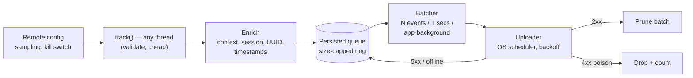

# Mobile 20 — Design a Mobile Analytics SDK

> **Sources:** weeeBox exercise list (analytics library) · Segment/Firebase Analytics architectures as reference · your own scars — this is the persisted-queue pattern's purest form.
> **Prerequisites:** [01 — The Framework](01-framework.md) (SDK variant) · [08 — Chat App](08-chat-app.md) §3 (the outbox — this note is that queue with the durability dial turned differently).

## What you'll master

- The **event pipeline**: capture → enrich → persist → batch → upload → prune, and where each guarantee lives.
- **The dropping policy** — the design decision everyone skips: analytics is the one queue allowed to *lose* data, on purpose, with a budget.
- **At-least-once + server dedup** via event UUIDs; client + server timestamps for clock-skew honesty.
- SDK citizenship: **never crash the host, never own more than ~1 % of battery**, thread-hop at the boundary.
- The **Staff/EM layer**: consent/PII governance, event taxonomy as an org problem, cost-per-event.

## In the Room

| Decision | Default position | Justification | Revisit trigger |
|---|---|---|---|
| Durability | **Persisted queue (DB), size-capped ring buffer, oldest-dropped** | Survive process death, but analytics never gets unbounded disk | Regulated events (payments audit) → separate durable lane |
| Delivery | **At-least-once + event UUID; server dedupes** | Cheap on device; exactly-once client-side is a lie ([DD-02 §8](../Deep%20Dives/02-kafka.md#8-delivery-guarantees)) | — |
| Batching triggers | **N events OR T seconds OR app-background, whichever first** | Radio wakeups are the battery unit — one wakeup, many events | Real-time events (live ops) → priority lane |
| Upload | **OS scheduler, unmetered-preferred, exponential backoff + jitter** | Analytics must never compete with user-facing traffic | Session-critical delivery windows |
| Timestamps | **Client event-time + client clock offset + server receive-time** | Device clocks are wrong by minutes; analysts need both | — |

**Experience hooks:** *"Our chat SDK ships with usage telemetry — the constraint that shaped it: we run inside someone else's app, so our crashes are their crashes and our battery is their review score. SDK citizenship is the requirement the design hangs off."*

## 1. Requirements (~5 min)

- **Functional:** `track(event, properties)` + `identify(user)` + `screen(name)` · automatic context (app version, OS, device class, network) · session semantics · server-configurable sampling/kill.
- **Non-functional:** **zero host crashes, ever** · < 1 % battery attribution · bounded disk (~few MB) and memory · events survive process death · p99 event loss < 1 % under normal operation, *measured* · consent-gated from the first byte.
- **Out of scope:** the ingestion backend and query side ([DD-20 — ClickHouse](../Deep%20Dives/20-clickhouse.md) owns that story), crash reporting (different pipeline: must survive the crash itself).
- **Scope check:** SDK for third-party (or first-party) developers — API + pipeline + guarantees + governance hooks.

## 2. The Pipeline

- **`track()` is nonblocking and boring:** validate against limits (name length, property count, value types), stamp UUID + timestamps, hop to the SDK's single worker. Cost on the caller's thread: microseconds. An analytics call in a scroll handler must be free.
- **The queue is a ring buffer with a size cap** (say 10k events / 5 MB): full → drop *oldest* (recent behavior beats ancient history) and increment a `dropped_events` counter that itself gets reported. **Analytics may lose data, but never silently** — the loss is itself a metric.
- **Batch semantics:** upload marks a batch in-flight (not deleted); 2xx prunes, 5xx/timeout returns it to the queue (UUIDs make the redelivery harmless), 4xx schema-poison drops it with a counter — one poison event must not wedge the pipeline forever (the DLQ lesson, [P-19](../Deep%20Dives/19-pattern-long-running-tasks.md), in miniature).
- **Clock honesty:** event carries client event-time; the batch carries "sent-at"; server stamps receive-time and computes the offset — analysts correct skew per batch. Never trust, never discard, record both.

> **Staff-level insight:** this is the third time the track has drawn a persisted idempotent queue ([08](08-chat-app.md) outbox, [09](09-news-feed.md) mutations) — but with the dials inverted: chat = never drop, deliver ASAP; analytics = drop under budget pressure, deliver *lazily*. Same primitive, different SLO. Saying "it's one queue component with per-lane policies" is the platform-extraction answer.

## 3. SDK Citizenship (the half candidates skip)

- **Crash containment:** every public entry point catches everything; internal failure degrades to no-op + self-reported health event. The SDK that crashes the host once gets removed in the next sprint.
- **Battery/data budget:** batching means the radio ideally never wakes *for* analytics — piggyback on scheduler windows; on metered networks stretch T; foreground-exit flush uses the OS's brief background allowance, not a foreground service.
- **Config-before-code:** remote config (fetched lazily, cached, default-safe) controls sampling per event name, upload cadence, and the global kill switch — a misbehaving event type gets muted server-side in minutes, no release ([framework §6](01-framework.md#6-non-functionals-that-win-at-google): can't roll back an APK).
- **Consent gate at the front door:** before consent, either nothing is collected or events buffer in memory only (jurisdiction-dependent) — a *legal* toggle, wired as the pipeline's first predicate, not a filter bolted on later.
- **Multi-process reality (Android):** queue writes must be process-safe (single-writer process or serialized access) — analytics from a push-handler process silently corrupting the DB is a classic field bug; mentioning it is a shipped-it signal.

## 4. The Staff/EM Layer

- **Event taxonomy is an org problem (EM):** without a schema registry + review, 40 teams invent `checkout_done`, `CheckoutComplete`, and `purchase` in one quarter and the data lake becomes a swamp. Ship typed event definitions (codegen from a registry) and a lint that blocks free-string names. The SDK is the *enforcement point* for data governance.
- **Cost per event (EM):** every event costs ingest + storage + query forever. Sampling high-volume low-value events (scroll ticks at 1 %) is a budget decision the config system makes reversible. Ask "who queries this?" before "how do we send it?"
- **Privacy (EM, and it's the big one):** PII never in property values — client-side scrubbers (regex for emails/phones) as a safety net, allowlisted property schemas as the real control; GDPR deletion needs a user-ID→deletion path through the *pipeline and the lake*; SDK docs must make the host's consent obligations explicit because *their* regulator reads *your* payloads.
- **The pager metric (Staff):** end-to-end event loss rate (client `dropped` counters + server-side sequence gaps per device) and time-to-ingest p95. Loss you can't measure is loss you'll discover during an incident post-mortem.

## Follow-Ups — the Interviewer Escalates

- **"App is killed the instant after `track()` returns — is the event safe?"** — Depends on the flush-to-disk policy, and that's a real dial: strict write-through per event (safest, most I/O) vs micro-batched writes every ~100 ms (loses a blink of events on hard kill). Default: micro-batch, because analytics tolerates epsilon loss — and say the number.
- **"Your SDK is blamed for battery drain — defend or fix?"** — Pull the attribution data: wakeup count and radio-time from OS batterystats per app. If it's real: batching regression, backoff bug (retry storm), or a host calling `flush()` in a loop — each has a counter. The credible answer is instrumentation-first, not "our design is efficient."
- **"Marketing wants events delivered within 5 seconds for live campaigns."** — Priority lane: separate small queue, immediate upload, tighter payload — *priced* separately (battery + infra) and capped per app. Don't speed up the whole pipeline for one consumer; sell lanes.
- **"How do you version the wire schema when 20 app versions are live?"** — Envelope version + additive-only properties; server tolerates unknown fields and back-fills defaults; breaking changes get a new endpoint version with dual-write during migration. Standard [08 §5](08-chat-app.md#5-the-staffem-layer) wire-contract discipline.
- **"A/B assignment events and exposure logging — same SDK?"** — Same transport, but exposure events get the durable lane and *deduplication semantics per assignment*, because experiment analysis breaks on loss and double-count in ways engagement dashboards don't. This is where [21 — A/B SDK](00-INDEX.md) plugs in.
- **"Offline for two weeks — what does the server see on reconnect?"** — Ring buffer means the oldest of those weeks is gone (by design, counted); what remains uploads in order with original event-times; analysts see a gap + a `dropped_events` marker. Honest data with a documented hole beats a heroic 200 MB backlog upload on a metered connection.

## When NOT / Variants

- **Crash reporting SDK** — related but different physics: must capture *during* a crash (signal handlers, minidumps), write-through always, upload next launch. Don't merge the pipelines; share the uploader at most.
- **Regulated audit events** (payments, consent records) — not analytics: durable lane, no sampling, no drops, possibly synchronous acknowledgment. Different SLO, different queue policy.
- **Server-side-only products** — if the client is thin (TV dashboards), collect server-side; an SDK is for behavior only the device can see.

---

## Interview Cheat-Sheet

**30-second architecture:** nonblocking `track()` → enrich (UUID, dual timestamps) → size-capped persisted ring (drop-oldest, counted) → batch on N/T/background → OS-scheduled upload with backoff → server dedup by UUID · remote-config sampling + kill switch · consent gate first · crash-contained everywhere.

| Probe | Answer |
|---|---|
| "Exactly-once analytics?" | No — at-least-once + UUID dedup server-side; client exactly-once is a fiction, and analytics doesn't need it |
| "Queue fills up offline?" | Ring buffer drops oldest, increments a reported counter — bounded disk, measured loss, no silent lies |
| "One malformed event poisons a batch?" | 4xx → drop batch with counter (or bisect if cheap); a poison event must never wedge the pipeline |
| "Why two timestamps?" | Client clocks are minutes wrong; event-time for analysis, receive-time + offset for correction — record both, trust neither |

**Say-verbatim:**
- *"Analytics is the one queue that's allowed to lose data — on purpose, within a budget, and the loss is itself a metric."*
- *"Batching means the radio never wakes for analytics — it piggybacks."*
- *"The SDK is the enforcement point for data governance — typed events from a registry, or the lake becomes a swamp."*
- *"Consent is the pipeline's first predicate, not a filter bolted on later."*
