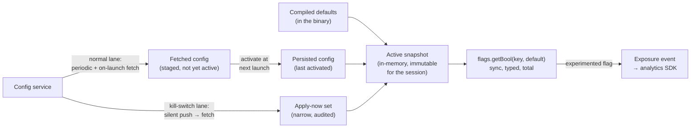

# Mobile 21 — Design an A/B Testing / Feature-Flag SDK

> **Sources:** Firebase Remote Config / LaunchDarkly / Statsig architecture docs (the reference implementations) · weeeBox framework · experimentation-platform literature (exposure logging, SRM).
> **Prerequisites:** [01 — The Framework](01-framework.md) · [20 — Analytics SDK](20-analytics-sdk.md) (exposure events ride on it) · [22 — Push](22-push-notification-system.md) (the kill-switch fast path rides on *it*). Sibling: [28 — Modularisation](28-modularisation.md) (flag debt is the same ratchet discipline).

## What you'll master

- **The bootstrap problem** — the defining crux: what does `getFlag()` return on the very first launch, offline, before any config has ever arrived?
- **Snapshot semantics** — why config activates as an atomic generation per session, and why "fetched" and "active" are different states on purpose.
- The **two-speed freshness model**: experiment flags can wait a session; kill switches cannot — one SDK, two delivery lanes.
- **Correct bucketing and exposure logging** — deterministic assignment and the log-on-evaluation rule that make experiment results *true*, not just plumbed.
- The **Staff/EM layer**: this SDK is the mechanism behind "you can't roll back an APK" — which makes it the most reliability-critical code in the app, and a governance surface, not just a library.

## In the Room

| Decision | Default position | Justification | Revisit trigger |
|---|---|---|---|
| Read API | **Synchronous, from an in-memory snapshot, typed, with compiled-in defaults — never null, never throws, never blocks** | Flag reads happen on startup's hottest path; any I/O or failure surface here holds the whole app hostage | — |
| Activation | **Fetch in background; activate atomically at next launch (or explicit safe point)** | Mid-session flag flips tear the UI — half-old, half-new checkout | Kill-switch class (below) |
| Bootstrap | **Compiled defaults → last-persisted snapshot → fresh fetch; each layer optional** | First launch offline must work; the SDK degrades to shipped behavior, never to a spinner | — |
| Kill switches | **Separate high-priority lane: silent-push-triggered fetch + apply-immediately semantics** | "Disable broken payments NOW" cannot wait for next session | — |
| Bucketing | **Client-side deterministic hash of stable unit ID + experiment salt** | Same user, same arm, every evaluation, offline, forever — no server round-trip per decision | Server-side assignment for cross-platform consistency |
| Exposure logging | **Log on evaluation of an experimented flag (deduped per session), via the analytics SDK** | Logging on fetch poisons results with users who never hit the surface | — |

**Experience hooks:** *"Shipping an SDK into other people's apps taught me the flag-SDK paradox: it exists to make everything else safe to change, so it is the one component that must never itself misbehave — it can't be behind a flag, it can't crash, and its failure mode must be 'the app behaves as compiled.'"*

## 1. Requirements (~5 min)

- **Functional:** typed flag reads (`bool/string/number/json`) with defaults · experiment assignment with variants · targeting (app version, locale, cohort) · kill switches · exposure logging for analysis.
- **Non-functional:** flag read = nanoseconds, zero I/O, zero crash surface · first-launch-offline correct · config consistent *within* a session · kill-switch propagation in minutes, not sessions · assignment stable across launches and offline · experiment data trustworthy (no sample-ratio mismatch by construction).
- **Out of scope (name them):** the targeting-rule engine's server side, stats engine/dashboards, web/backend SDK parity — this is the mobile client + its delivery contract.

## 2. High-Level — Three Stores and Two Lanes

The read path never touches the network: `getBool()` consults the **active snapshot**, an immutable map assembled at startup as *persisted-config over compiled-defaults*. Fetching runs in the background and **stages** config without applying it; staged config becomes active at the next launch. A second, narrow lane exists for kill switches: a silent push ([22](22-push-notification-system.md)) triggers an immediate fetch, and flags explicitly marked apply-now take effect mid-session — a deliberate, audited exception, not the default.

> **Staff-level insight:** the fetched/active split is the design. Firebase Remote Config's `fetchAndActivate` looks like ceremony until you've watched a checkout screen re-render mid-payment because a config landed. Say it as a principle: *"Config is a snapshot, not a stream — the app reasons against one consistent generation per session, and I choose the moments generations may change."*

## 3. Deep Dive 1 — The Bootstrap Problem (the crux)

The question every interviewer asks first, because every naive design dies on it: **first launch, airplane mode — what does `getFlag("new_onboarding")` return?**

- **Layer 0 — compiled defaults:** every flag referenced in code has a default *at the call site* (`getBool(key, default = false)`), and the app must be fully functional on defaults alone. This is non-negotiable API design: the type system makes "no config yet" unrepresentable as a failure — there is no null, no exception, no loading state. The SDK's worst case is "the app behaves exactly as shipped," which is by definition a state QA has tested.
- **Layer 1 — last activated snapshot:** from the second launch on, the persisted config from the previous session applies. Staleness is bounded by fetch cadence and is *accepted* — a day-old experiment assignment is fine; a blocking fetch on the startup path is not. Never block launch on config: a config service outage that holds your cold start hostage turns a dashboard incident into an app-down incident.
- **Layer 2 — fresh fetch, staged:** completes whenever the network allows; applies next session. The window where a brand-new user runs on pure defaults (one session, typically) is a *known, accepted cost* — name it, and note the mitigation for the one flow where it hurts: for first-session experiments (onboarding!), either accept a bootstrap fetch with a hard timeout of a few hundred ms then fall back to defaults, or pre-assign server-side during signup. This is the one legitimate exception to never-block, and it's bounded.
- **Ship-a-snapshot option:** bake the current config as a resource at *release build* time, shrinking the defaults-only window to zero for flags that existed at ship time. Cheap, underused, worth mentioning.

## 4. Deep Dive 2 — Bucketing & Exposure (what makes experiments *true*)

- **Deterministic client-side assignment:** `hash(unit_id + experiment_salt) % 100` → arm. Same inputs, same arm — across launches, devices offline, and SDK versions. The unit ID choice is a real decision: user ID once logged in (cross-device consistency), falling back to a persisted install ID pre-auth — and the login transition is a documented discontinuity you flag, not a surprise.
- **Log exposure on evaluation, not on fetch — and not on every evaluation:** the exposure event ("user U saw experiment E, arm B") fires the first time an experimented flag is *actually evaluated* in a session, deduped thereafter, and rides the [20](20-analytics-sdk.md) pipeline. Logging at fetch time dilutes the experiment with users who never reached the surface; skipping exposure logging entirely makes the analysis unrunnable. This one rule is where most homegrown experiment stacks silently rot.
- **Sample-ratio mismatch (SRM) as a built-in tripwire:** if arms were assigned 50/50 but exposures arrive 55/45, something structural is broken (a crash in one arm before exposure fires, a targeting bug, a caching asymmetry) — and the experiment's results are *invalid, not just noisy*. The platform checks SRM automatically; the SDK's job is making exposure firing so mechanically tied to evaluation that SRM cleanly signals real bugs.
- **Holdouts and mutual exclusion:** long-running holdout cohorts (users who see no experiments) measure cumulative effect; layered salts give mutual exclusivity between conflicting experiments (two checkout experiments can't share a user). Client-side this is just more salt arithmetic — the discipline is server-side taxonomy, which is a governance point, and you say so.

## 5. Deep Dive 3 — The Kill-Switch Lane (config-over-release, made real)

- **Why it exists:** the track's refrain — you can't roll back an APK ([01 §7](01-framework.md)). When 4.2 ships with broken payments, the fix must travel at *config speed*, not release speed. The flag SDK is therefore the delivery mechanism for the app's emergency brake — this lane is why the SDK is tier-0 infrastructure, not tooling.
- **Mechanics:** kill switches are a declared class — server marks them apply-immediately; a silent, high-priority push triggers fetch ([22 §4](22-push-notification-system.md)'s "genuinely event-driven invalidation" case); polling cadence backstops push loss. Apply-now semantics are safe *because the class is narrow*: kill switches gate entry into flows ("checkout disabled") rather than mutating mid-flow state — a user inside checkout completes; the next entry is blocked. Fail-safe direction per flag is declared at registration: a payments kill switch fails closed, a cosmetic one fails open ([15](15-stock-trading-app.md)'s posture, delivered by config).
- **The SLA is a number you commit to:** push-connected devices in ~1–5 minutes, push-lost devices at next poll (~hours) or next launch. State it, monitor it (config-generation age per active device, reported through analytics), and page on the tail — a kill switch that 20% of devices never received is an incident that *looks* resolved on the dashboard.
- **The SDK itself has no flag:** bootstrap, fetch, and apply paths are flag-free and maximally boring — the emergency brake cannot depend on the thing it's braking. Changes to the SDK ride full staged rollouts with the app release, the one path that deliberately moves slowly.

## 6. The Staff/EM Layer

- **Flag debt is modularisation debt's twin (Staff):** every flag is a fork in the codebase — two paths to test, reason about, and eventually delete. Governance mirrors [28](28-modularisation.md)'s ratchet: registry with owner + expiry per flag, CI warning on expired flags, periodic cleanup with a *count that may only go down*. A three-year-old flag whose "off" path no longer compiles is the standard horror story — tell it.
- **A flag flip is a deploy (EM):** it changes production behavior for millions of users with no build, no review, no CI. So it gets deploy discipline: audit log, two-person rule for protected flags (kill switches, payment paths), staged percentage rollout *of the flip itself*, and monitoring hooks — flip → watch the guardrail metrics → auto-revert on regression. The tooling investment is the point; the SDK is the easy half.
- **Experiment integrity is a cultural budget (EM):** SRM checks, minimum runtimes, pre-registered metrics — the platform can enforce them only if leadership backs "your experiment is invalid" as an acceptable answer. The EM's job is defending the referee.
- **Targeting data is a privacy surface (EM):** every targeting attribute (locale, device, cohort) is data shipped and evaluated about the user — minimize to declared attributes, keep PII out of targeting payloads, delete assignment history with the account. Config requests are traffic on every launch; they're in scope for every privacy review whether you invite them or not.
- **Build-vs-buy (EM):** the client SDK is the *simple* part — snapshot store, hash, fetch loop. The stats engine, dashboards, SRM tooling, and targeting service are the expensive part. Default: buy the platform (Statsig/LaunchDarkly/Firebase) unless experimentation is core competency at scale; if you build, build because of data-residency or cost-at-scale arguments, and staff the analysis side, not just the SDK.

## Follow-Ups — the Interviewer Escalates

- **"Flag flips while the user is mid-checkout."** — By default it doesn't: reads come from the session's immutable snapshot, so the checkout the user entered is the checkout they finish. Kill switches are the exception, and they're designed to be safe under immediacy: they gate *entry*, not mid-flow state. The dangerous middle — ordinary flags applied mid-session — is exactly what the fetched/active split forbids.
- **"First launch, offline, and your onboarding experiment needs an assignment."** — The honest answer has three tiers: default arm for pure-offline (accepted, small, measured); a bounded bootstrap fetch (~300 ms timeout) for online first launches; server-side pre-assignment at signup when the experiment matters enough. What I won't do is block launch indefinitely — the SDK's prime directive is that its failure mode is the shipped app.
- **"Same user, phone and tablet — different arms?"** — If bucketing keys on install ID, yes, and for UI experiments that's acceptable; for anything touching synced state it isn't — key on user ID post-auth. The pre-auth-to-post-auth transition is the subtle bug: assignments can flip at login. I document it and, for sensitive experiments, delay exposure until the stable unit ID exists.
- **"How do you *know* a kill switch reached the fleet?"** — Devices report their active config generation as an analytics dimension ([20](20-analytics-sdk.md)); the dashboard shows generation adoption by age. The pager line is the tail: N% of active devices still on a pre-kill-switch generation after the SLA. Without this loop a kill switch is a prayer, not a control.
- **"Your config service is down for six hours."** — Nothing user-visible happens: reads are local, snapshots persist, fetches fail quietly and retry with backoff + jitter (a fleet of clients must not thundering-herd the recovering service — [22](22-push-notification-system.md)'s backoff discipline). The *risk* is frozen kill switches — which is why config-service availability is tier-0 and why the fetch path is the boring-est code we own.
- **"Two teams' experiments collide on the same screen."** — Mutual-exclusion layers: experiments in the same layer share a salt and split traffic disjointly; experiments in different layers stack. The client just hashes; the real fix is governance — a launch calendar and a registry that makes collisions visible *before* they ship. This is a people-problem wearing a hashing costume.
- **"Why can't the flag SDK itself be behind a flag?"** — Circular dependency on the emergency brake: if the new fetch path is broken *and* gated by a flag the fetch path delivers, you've built a lock with the key inside. The SDK changes ride app releases with staged rollout — the slow lane — precisely so everything else can ride the fast one.

## When NOT / Variants

- **Server-driven UI:** config that ships *structure* (layouts, flows) rather than booleans — same delivery machinery, radically bigger testing surface; treat it as a rendering engine design, not a flag SDK.
- **Backend flags:** same concepts, easier physics — restarts are cheap, fleets converge in seconds, no bootstrap-offline problem. The mobile constraints (snapshot-per-session, bootstrap layers, push-triggered kill lane) are exactly the parts that don't transfer.
- **Remote config for content** (copy, promos): freshness beats consistency — apply-on-fetch is fine because nothing forks logic; don't burden it with experiment machinery.
- **Regulated flows:** some markets require *no* remote behavioral changes without review (medical, banking features) — flags there become build-time, and the registry must know which is which.

---

## Interview Cheat-Sheet

**30-second architecture:** three stores — compiled defaults, persisted snapshot, staged fetch — assembled into one immutable per-session active snapshot · reads are sync, typed, total, nanosecond, from memory · fetch stages, next launch activates (config is a snapshot, not a stream) · kill switches are a narrow apply-now lane: silent push → fetch → gate-entry semantics, declared fail-open/fail-closed · deterministic hash bucketing on stable unit ID + salt · exposure logs on first evaluation per session via the analytics SDK; SRM is the tripwire · flag registry with owner + expiry, count only goes down.

| Probe | Answer |
|---|---|
| "First launch, offline?" | Compiled defaults at every call site — the app's worst case is behaving exactly as shipped; no null, no block, no spinner |
| "Mid-session flip?" | Forbidden by the fetched/active split — except declared kill switches, which gate entry into flows, never mutate mid-flow |
| "Trust the experiment results?" | Exposure fires on evaluation (deduped), deterministic bucketing, SRM check — if the ratio drifts, the experiment is invalid, not noisy |
| "Config service down?" | Invisible: local reads, persisted snapshot, backoff+jitter refetch — the only real exposure is kill-switch latency, which is why that service is tier-0 |

**Say-verbatim:**
- *"Config is a snapshot, not a stream — one consistent generation per session, and I choose when generations change."*
- *"The SDK's failure mode is the shipped app — which is by definition a state QA has tested."*
- *"A flag flip is a deploy: audit it, stage it, watch it, auto-revert it."*
- *"Exposure logs on evaluation, not on fetch — that one rule is the difference between an experiment platform and a random-number generator."*
- *"The flag SDK can't be behind a flag — never build a lock with the key inside."*
