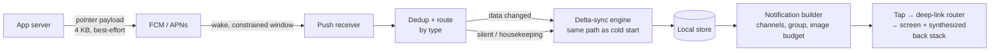
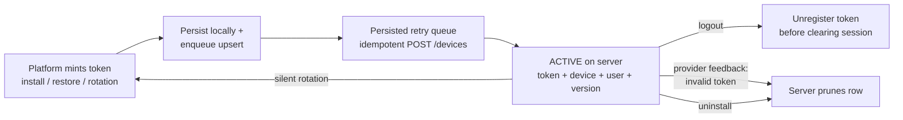

# Mobile 22 — Design a Push Notification System (client side)

> **Sources:** FCM & APNs platform docs (the constraints are the design) · weeeBox framework · the chat exercise's push section, expanded to a standalone system.
> **Prerequisites:** [01 — The Framework](01-framework.md) · [08 — Chat App](08-chat-app.md) ("push is a doorbell" is born there — this note is the doorbell's own design) · [20 — Analytics SDK](20-analytics-sdk.md) (delivery measurement rides on it). Backend twin: Deep Dives [13 — Realtime Updates](../Deep%20Dives/13-realtime-updates.md).

## What you'll master

- Why **push is a doorbell, not a data channel** — 4 KB, unordered, unguaranteed, collapsible — and how every correct design falls out of refusing to fight that.
- The **token lifecycle** — the unglamorous state machine (mint, sync, rotate, invalidate, multi-device) where real-world push systems actually break.
- The **wake path**: push → constrained execution window → delta-sync → render from the local store — one pipeline shared with cold start and reconnect.
- **Rendering as a system**: channels/categories, collapse and grouping, images on a time budget, deep-link routing that survives any app state.
- The **Staff/EM layer**: notification fatigue as a churn metric, the permission prompt as a one-shot product decision, and why critical flows never depend on push.

## In the Room

| Decision | Default position | Justification | Revisit trigger |
|---|---|---|---|
| Payload contract | **Pointer, not payload: IDs + type + collapse key; content comes via delta-sync** | 4 KB cap, no ordering, no delivery guarantee, E2EE payloads can't transit plaintext | Trivial single-string notifications |
| Wake behavior | **Push triggers the same delta-sync as cold start / reconnect** | One sync path to harden ([08 §4](08-chat-app.md)); push-specific fetch paths rot | — |
| Token sync | **Idempotent upsert `{token, device_id, app_version}`, retried via persisted queue; re-verified on every launch** | Token rotation is silent and unannounced; a stale token is a silently deaf user | — |
| Duplicates/ordering | **Render idempotently: dedup by notification/entity ID against the local store** | The channel may deliver twice, late, or out of order — the client is the last line | — |
| Criticality | **Push is an accelerator, never the sole carrier of anything critical** | Delivery is best-effort by contract; polling/sync backstop always exists | — |
| Provider | **FCM + APNs directly (FCM fronts both); vendor layer only for campaign tooling** | The platform ships the transport; differentiation is in your routing + governance | Marketing-team campaign needs |

**Experience hooks:** *"At a chat-SDK company I worked at, the push integration was the #1 support-ticket generator — not our socket, not our sync: customers' token lifecycles. That's what taught me the token table is the design, and the notification itself is just the UI on top."*

## 1. Requirements (~5 min)

- **Functional:** receive and render notifications in every app state (foreground, background, killed) · tap → deep-link to the right screen with correct back stack · per-category user preferences · grouping/summaries · rich content (images, actions, replies).
- **Non-functional:** no lost *information* even when pushes are lost (sync backstop) · no duplicate or stale renders · token freshness (a logged-in user is reachable within minutes of any rotation) · battery-respectful (no polling resurrection) · privacy: payloads may transit Google/Apple infrastructure — treat accordingly.
- **Out of scope (name them):** server-side fan-out, campaign targeting/scheduling, the rate-limiter service — this note is the device half plus the API contract it imposes upward.

## 2. High-Level — the Doorbell and the Four Journeys

Four journeys, one machine: **foreground** (suppress the system notification, update the live screen via the store), **background/killed** (constrained window: sync, then post), **tap** (route by entity ID through the deep-link registry — the screen rebuilds from the store, [28](28-modularisation.md)'s route registry doing the dispatch), and **token refresh** (silent, the lifecycle below). The load-bearing choice: the push never *carries* the truth, it *announces* that truth changed — the local store stays the single source every screen renders from.

> **Staff-level insight:** the platform's contract is explicitly best-effort — FCM/APNs may throttle, collapse, delay, or drop, and background delivery on iOS is deliberately budget-limited. Say early: *"I design assuming any individual push can vanish — push accelerates the sync engine, it never replaces it."* Interviewers use "what if the push doesn't arrive?" as a trapdoor; this sentence removes the floor before they pull it.

## 3. Deep Dive 1 — The Token Lifecycle (where push systems actually die)

- **Registration is a sync problem, not a call:** the upsert `{token, device_id, platform, app_version, locale}` rides a persisted idempotent queue (the track's standard primitive — [08](08-chat-app.md)'s outbox again) because first launch is exactly when the network is flakiest. Keyed by `device_id` so re-registration *replaces* rather than accumulates.
- **Rotation is silent and unannounced.** The platform can rotate the token at any time (restore from backup is the classic). Two defenses: the OS rotation callback enqueues an upsert, *and* every app launch re-verifies current-token-vs-last-synced. Belt and suspenders, because a missed rotation has no error — just a user who quietly stops hearing from you.
- **Logout ordering matters:** unregister the token *before* dropping auth — after logout you no longer have credentials to disown the device, and the next account on this phone inherits ghost notifications. Multi-account: tokens map to `(device, account)` pairs, and account switch re-points them.
- **The server prunes on provider feedback:** FCM/APNs return "unregistered/invalid" on send — that's the uninstall signal; the token table's hygiene is a shared contract you drive with backend ([29 §5](29-ecommerce-checkout.md#5-deep-dive-3--the-server-side-of-the-contract-what-staff-negotiates) energy: write it down, test it).
- **Token = PII-adjacent:** it's an addressable identifier for a person's device. Scope access, encrypt at rest server-side, and delete on account deletion — the EM owns knowing that this table is in GDPR scope.

## 4. Deep Dive 2 — The Wake Path (a constrained execution window)

- **The budget:** background wakes are seconds, not minutes — iOS notification service extensions get ~30 s and Android background handlers similar practical windows; heavy work must hand off to deferrable jobs (WorkManager / BGTaskScheduler). The wake path is therefore *triage*: dedup → sync the delta → post the notification → get out.
- **Delta-sync, not payload-trust:** the handler calls the same cursor-based sync as cold start. This collapses the hard cases for free — pushes arriving out of order (sync returns current truth), duplicated (upsert by ID is a no-op), or referencing already-deleted content (sync says so; suppress the notification rather than advertise a dead tap target).
- **Priority is a spent currency:** high-priority pushes pierce Doze/throttling but are quota'd — overuse teaches the platform to ignore you (and iOS will throttle background pushes app-wide). Classify at the API contract: user-visible-urgent (message, ride arriving) rides high; everything else rides normal and may wait for the next natural wake. This classification is a *server-side* field you negotiate, not a client whim.
- **E2EE and rich content:** encrypted apps can't put plaintext in the payload — the push carries a message ID; the constrained window fetches and decrypts locally, then *mutates* the notification before display (iOS's mutable-content extension exists precisely for this). Images download inside the same window on a strict sub-budget: miss it → show the textual notification; never block on a slow CDN.
- **Foreground suppression:** if the relevant screen is visible, don't post — the store update already re-rendered it, and a notification for the chat you're reading reads as a bug. The receiver consults an app-state + current-route check before building anything.

## 5. Deep Dive 3 — Rendering & Routing (the product surface)

- **Channels/categories are a public API:** Android channels are user-controllable and *irrevocable once created* — naming and granularity (messages / mentions / promotions) is a product decision you can't refactor freely. Map server-side notification types → a small stable set of channels; iOS categories carry the action buttons (reply, mark-done) with the same taxonomy.
- **Collapse and grouping, both layers:** a collapse key server-side replaces stale versions of the same logical event (score updates, "3 new messages" counters) *in transit*; client-side grouping (by conversation, by thread) renders 40 arrivals as one expandable summary. Fifty chat messages must become one notification that says fifty — the alternative is an uninstall.
- **Deep-link routing is state restoration:** tap → route registry resolves `type + entity_id` → target screen, which loads from the local store (syncing if needed) with a *synthesized* back stack (chat → conversation list → home). The screen must build from IDs alone — the same contract that made [24](24-hotel-reservation.md)'s deep links honest. A tap on a stale notification (entity deleted) lands on a graceful "no longer available," never a crash.
- **Preferences enforced at both ends:** locally as rendering rules, but *server-side as send suppression* — a muted category shouldn't even burn the device's wake budget. Preference sync is ordinary synced state, versioned per user, cross-device.

## 6. The Staff/EM Layer

- **Fatigue is churn (EM):** notification-triggered uninstalls and channel-mutes are measurable and brutal. Governance mirrors [20](20-analytics-sdk.md)'s taxonomy registry: every notification type has an owner, a priority class, and a frequency budget; a server-side rate limiter + quiet hours + digest folding enforce it. New notification types go through review, not just code review — the scarce resource is user attention, and every team wants to spend it.
- **The permission prompt is one-shot (EM):** Android 13+ and iOS both gate push behind a runtime permission, and a denial is near-permanent. Never ask at first launch: pre-prompt in context ("get notified when your order ships?") and trigger the system dialog only on an affirmative, at a moment of demonstrated value. Prompt conversion rate is a product KPI with a named owner.
- **Never the sole channel (Staff):** anything critical (payment result, security alert) must also land via sync-on-open plus a fallback channel (SMS/email) where stakes demand. Push is an accelerator on a system that is already correct without it — the [30](30-banking-money-transfer.md) transfer completes and reconciles whether or not the "transfer complete" push survives.
- **Measurement rides the analytics SDK (Staff):** delivery receipts (received-event fired from the handler), open rates, and token-health metrics (rotation lag, invalid-token rate, share of users with no live token) flow through [20](20-analytics-sdk.md). The pager metric: **reachability** — % of active logged-in users with a verified-fresh token — because it degrades silently and every downstream product metric quietly follows it.
- **Build-vs-buy (EM):** transport is FCM/APNs — there is no build option. The buy question is the campaign layer (Braze/OneSignal et al.): buy for marketing tooling velocity, but keep *transactional* notifications on your own pipeline — you don't want a vendor outage between a user and "your ride is here," and you don't want a marketing tool holding your token table.

## Follow-Ups — the Interviewer Escalates

- **"The push doesn't arrive. What breaks?"** — Nothing, eventually: push only accelerates the sync engine. The information lands on next app open (sync-on-start), next high-priority push for the same conversation, or the periodic background refresh. What's lost is *latency*, and for classes where latency is the product (calls, rides) I escalate the channel — VoIP push / high-priority with quota discipline — not the payload.
- **"Token rotated while the device was offline for a week."** — The rotation callback may itself be lost, which is why launch-time verification exists: on next open, current token ≠ last-synced token → enqueue upsert. The gap week is genuinely deaf — that's the platform's contract, and it's why reachability is a monitored metric rather than an assumption.
- **"User gets 50 messages while asleep — 50 wakes, 50 banners?"** — No, at three layers: server folds per-conversation sends under a collapse key after the first unacknowledged push; the client groups per conversation into a summary notification; and the sync engine means the 50th push renders exactly the same store state as the 1st plus deltas. Wake budget spent: a handful, not fifty.
- **"How does this work for an E2EE chat?"** — Payload carries only the message ID (ciphertext routing metadata minimized — even *who* messaged you is metadata worth protecting). The constrained window fetches ciphertext, decrypts with local keys, mutates the notification. If decryption can't complete in budget, show a generic "new message" — degrade privacy-safe, never plaintext-through-FCM.
- **"Two notifications for the same event, out of order — third one arrives after the user already acted."** — Idempotent rendering: notifications key by entity ID; the handler checks the local store first — event already read/acted/deleted → suppress or update-in-place rather than re-post. The channel is allowed to misbehave; the renderer is not.
- **"Silent pushes to keep your cache warm — why not fire one every 10 minutes?"** — Because the platforms explicitly punish it: iOS budgets background pushes per app and demotes abusers; Android's Doze batches them. Cache warmth comes from the deferrable-job scheduler under OS-chosen windows; silent pushes are reserved for genuinely event-driven invalidation (config kill switch, [21](21-ab-feature-flag-sdk.md)-style) where staleness has a real cost.
- **"What do you page on?"** — Reachability (fresh-token share of active users), token-sync queue age, receipt-measured delivery rate by platform/priority class, and notification-triggered mute/uninstall spikes per type — the last one pages the *product* owner, which is exactly the point.

## When NOT / Variants

- **In-app messaging (user is present):** different system — no OS notification, no wake path; it's just synced state rendering ([13 — Realtime](../Deep%20Dives/13-realtime-updates.md) on the client).
- **VoIP / calls:** dedicated platform lanes (CallKit + VoIP push, Android full-screen intents + foreground service) with stricter guarantees and stricter abuse rules — a separate design with its own quota politics.
- **Live activities / widgets (scores, ride ETA):** platform-specific frequent-update channels (Live Activities budgets, widget refresh quotas) — the collapse-key idea graduates into a dedicated streaming surface.
- **China / de-Googled Android:** FCM absent — vendor push SDKs (or your own socket while foregrounded) behind the same internal interface; the abstraction seam you drew around "transport" earns its keep here.

---

## Interview Cheat-Sheet

**30-second architecture:** pointer payloads (IDs + type + collapse key, never content) · push wakes the same delta-sync as cold start; store stays the single truth · token lifecycle as a synced state machine (persisted idempotent upsert, rotation callback + launch verification, unregister-before-logout, provider-feedback pruning) · constrained wake window: dedup → sync → post, images on sub-budget · channels as irrevocable product API, group per conversation · deep link = route registry + rebuild-from-store + synthesized back stack · reachability is the pager metric; push is never the sole channel for anything critical.

| Probe | Answer |
|---|---|
| "Push dropped?" | By design survivable: push accelerates sync, never carries truth — next open/sync delivers; only latency was lost |
| "Stale token?" | Rotation callback + launch-time re-verification + provider-feedback pruning; reachability metric catches the silent failures |
| "50 events, 50 banners?" | Collapse key in transit, grouping at render, idempotent store-backed dedup — three layers, one summary |
| "Payload design?" | 4 KB doorbell: type + entity ID + collapse key; content via sync — also the only shape E2EE permits |

**Say-verbatim:**
- *"Push is a doorbell, not a data channel — it announces that truth changed; the sync engine fetches the truth."*
- *"The token table is the design; the notification is just its UI."*
- *"I design assuming any individual push can vanish — it accelerates a system that's already correct without it."*
- *"Priority is a spent currency: overuse high-priority and the platform teaches itself to ignore you."*
- *"The permission prompt is one-shot — I spend it at a moment of demonstrated value, never at first launch."*
