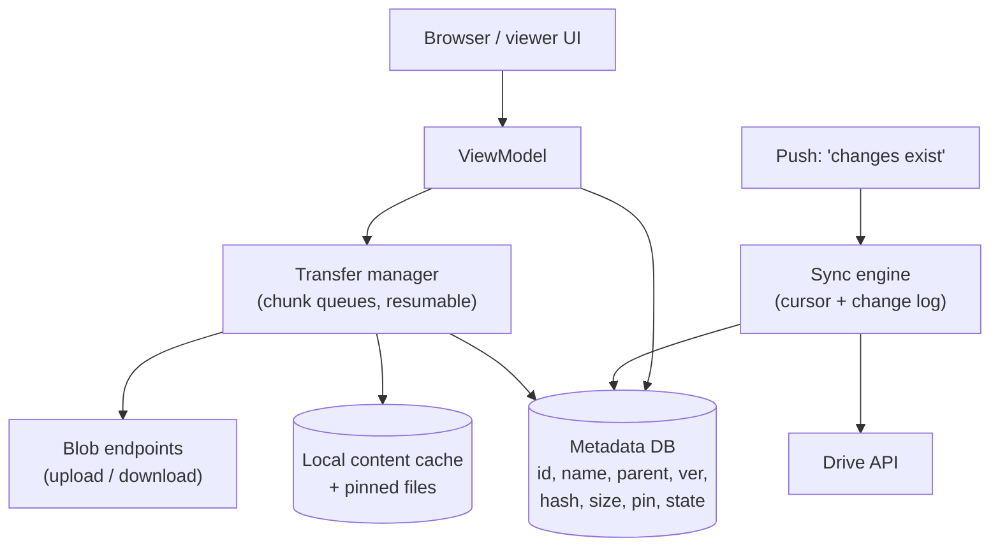

# Mobile 23 — Design the Google Drive App (File Sync)

> **Sources:** Manuel Vivo, *Mobile System Design Interview* (solved case study; premium) · Dropbox/Drive engineering write-ups for the sync-engine folklore.
> **Prerequisites:** [01 — The Framework](01-framework.md) · [08 — Chat App](08-chat-app.md) (delta sync by cursor — same spine, files instead of messages). Backend twin: Deep Dives [18 — Large Blobs](../Deep%20Dives/18-pattern-large-blobs.md).

## What you'll master

- The load-bearing split: **metadata (small, hot, relational) vs content (huge, cold, blob)** — two stores, two sync strategies.
- The **change-log sync engine**: one cursor API for cold start, reconnect, and push-wake.
- **Resumable chunked transfer** with hashing — upload and download as restartable state machines.
- **Conflict resolution** a client can actually ship: rename-copy beats clever merging.
- The **Staff/EM layer**: sync rewrites as existential risk, shadow-mode verification, privacy of user files.

## In the Room

| Decision | Default position | Justification | Revisit trigger |
|---|---|---|---|
| Data split | **Metadata DB synced eagerly; content fetched lazily** | 100k files of metadata ≈ tens of MB; 100k files of *content* ≈ the phone's storage | Tiny accounts → prefetch recents' content too |
| Sync protocol | **Server change log + client cursor (delta sync)** | One idempotent path for cold start/reconnect/push; server orders truth | True P2P/offline-mesh requirements |
| Conflicts | **Server wins the name; loser becomes "Conflicted copy (device, date)"** | Never destroys data, needs no merge UI, users self-resolve | Docs-style collaborative editing → OT/CRDT, out of scope |
| Transfer | **Chunked + resumable + content-hashed, via OS scheduler** | Mobile radios die mid-file as a rule, not an exception | — |
| Offline | **Explicit per-file/folder pinning** | "Everything offline" is a storage lie on a phone | Desktop client (different storage physics) |

**Experience hooks:** *"Our SDK's attachment pipeline is this in miniature — pointer messages + resumable media upload. Drive is that pattern promoted to being the whole product."*

## 1. Requirements (~5 min)

- **Functional:** browse/search folder tree, view/download files, upload (incl. camera auto-backup), rename/move/delete, share links, pin for offline, background sync.
- **Non-functional:** browsing feels local (metadata pre-synced) · uploads survive kill/reboot/network loss · **no silent data loss, ever** · battery/data-respectful (scheduler-gated) · 100k+ files per account on a 2 GB device.
- **Out of scope (say it):** collaborative editing (OT/CRDT — one flag sentence), server storage internals, virus scanning.
- **Scope:** client + sync API contract.

## 2. High-Level — Metadata Plane vs Content Plane

**Metadata plane:** the whole folder tree lives in the local DB (flat table, `parent_id` self-reference — never nested paths as keys; renames of a folder must not rewrite ten thousand rows). Browsing, search, and rename/move/delete are local DB operations plus queued mutations — Drive *browsing* works in airplane mode by construction.

**Content plane:** file bytes fetched on open, cached LRU with a user-visible budget; pinned items are guaranteed-local and refreshed by the sync engine when their version changes.

> **Staff-level insight:** every mutation is a **metadata operation with an optional content operation attached**. Rename = metadata only. Upload = content transfer *then* metadata commit (pointer pattern — the file "exists" only when its metadata lands). That framing collapses twenty API endpoints into one mental model.

## 3. Deep Dive 1 — the Sync Engine

Server keeps an ordered **change log** per account; client holds a cursor ([08 §4](08-chat-app.md#4-deep-dive-2--sync--the-reconnect-story), promoted):

- `GET /changes?cursor=X` → `[{file_id, type, new_metadata, version}...] + next_cursor`. Client applies as **idempotent upserts keyed by file_id + version**, persists cursor per applied batch. Crash mid-batch → replay is harmless.
- Push says **"changes exist"** (doorbell, no payload of substance) → sync engine pulls. Foreground refresh, reconnect, cold start: same pull.
- **Local mutations** go to a persisted operation queue (client-generated op IDs → idempotent, exactly the chat outbox). Ops carry the **base version** they were made against — the server detects staleness and answers "conflict," which feeds §4.
- Ordering matters across ops (create folder → move file into it): the queue replays **in order, per account**, pausing on hard conflicts rather than reordering around them.

## 4. Deep Dive 2 — Transfers & Conflicts

**Upload:** hash content → `initiate` (server may answer "have it already" — instant dedupe upload) → chunked PUTs (~4–8 MB, per-chunk retry, offset tracked in DB) → `commit(hash)` → server verifies hash → metadata change appears in the change log. Kill/reboot mid-file: resume from last acked chunk. Auto-backup runs this under scheduler constraints (unmetered + charging default).

**Download:** ranged GETs into a temp file, rename-on-complete (a half-file must never look whole), verify hash.

**Conflicts:** two devices edit `report.docx` offline. Loser's upload commits against a stale base version → server keeps both contents; client materializes **"report (conflicted copy — Pixel, Jul 15).docx"**. No data destroyed, no merge UI, resolution is a user-space rename/delete. Deletes conflict the same way (edit-vs-delete → keep the edit as a conflicted copy). *"For opaque files, last-writer-wins destroys someone's work — rename-copy never does."* Collaborative merge (Docs) is a different product with OT/CRDT — one sentence, move on.

## 5. The Staff/EM Layer

- **Sync rewrites are existential (EM):** a bug here deletes user files — the one incident class a storage product cannot survive. Rewrites ship in **shadow mode** (new engine computes, old engine acts, divergence alarms) for weeks before flag-flip, staged by cohort, with per-account kill switch back. Dropbox's sync rewrite ran shadow-mode for months; cite it.
- **The pager metric (Staff):** not crash rate — **divergence**: local tree vs server tree mismatches per million syncs, and stuck-operation age. A sync engine that's "up" but wrong is worse than down.
- **Privacy (EM):** file contents are the most sensitive payload in this track — content never in logs/analytics; thumbnails and search indexes are contracts about *where* user data may be processed (on-device vs server) that legal, not engineering, decides. GDPR deletion must reach caches, thumbnails, and the operation queue.
- **Storage honesty (Staff):** cache + pins get a user-visible budget and a management screen; auto-eviction never touches pins without asking ([11 §4](11-youtube.md#4-deep-dive-2--downloads--drm), same rule).

## Follow-Ups — the Interviewer Escalates

- **"User moves a folder with 10k descendants — what syncs?"** — One metadata op: the folder row's `parent_id` changes. Children reference parents by ID, so nothing else moves — this is precisely why paths were rejected as keys. If they probe cycles: server validates move targets (can't move a folder into its own subtree); client pre-checks for UX.
- **"Search across 100k files — on device or server?"** — Both, honestly: local DB search over synced metadata (instant, works offline) merged with server results for content-text matches (which need the server index). Label the sections; don't pretend one path does both.
- **"Upload of a 4 GB video on a phone that backgrounds you after 30 seconds?"** — Chunked transfer under the OS background scheduler (WorkManager/URLSession background) which owns the process lifecycle; progress persisted per chunk; notification surfaces progress. You design *for* being killed, not against it — the transfer manager has no in-memory state worth mourning.
- **"Shared file: collaborator's changes vs my offline rename of the same file?"** — Both are versioned ops against the same file ID; rename (metadata) and content edit don't conflict — they merge field-wise. Same-field conflicts fall to the conflicted-copy rule. Distinguishing field-level merge (safe here) from content merge (not attempted) shows precision.
- **"'Free up space' just deleted originals for a user whose uploads silently failed — post-mortem?"** — The button must gate on *server-verified* hashes per file, not queue completion; the bug class is trusting local state about remote truth. Fix: verification pass + tombstoned trash with recovery window + the divergence alarm that should have fired. This is the data-loss question — treat it as the gravest one in the note.
- **"Thumbnails for 100k files — generate where?"** — Server-generated at standard sizes, fetched lazily and LRU-cached like content; on-device generation burns battery and, for enterprise/DLP, may violate where-may-data-be-processed policy. That last clause is the EM-lens bonus point.

## When NOT / Variants

- **Camera auto-backup app (Google Photos):** same transfer engine, thinner tree, plus dedupe-by-hash and "free up space" (delete local once verifiably uploaded — the scariest button in mobile; it demands hash-verified server copies).
- **Note-sync (Keep):** payloads small enough to inline content into the metadata sync; conflicts become field-level merges.
- **Enterprise DLP flavors:** downloads/screenshots policy-gated, pins encrypted, remote wipe — the *policy engine* becomes the deep dive.

---

## Interview Cheat-Sheet

**30-second architecture:** metadata DB synced eagerly via change-log cursor · content lazy + LRU + pins · persisted ordered op queue with client op IDs and base versions · chunked resumable hashed transfers, commit-then-metadata · conflicts = conflicted-copy rename · shadow-mode rewrites.

| Probe | Answer |
|---|---|
| "Phone dies at chunk 47 of 200?" | Chunk offsets persisted; resume from 47 after reboot; commit is hash-verified so a corrupt resume can't slip through |
| "Two devices rename the same file offline?" | Ops carry base version; second lands stale → server keeps both; client shows conflicted copy — nothing lost |
| "100k files on a 2 GB phone?" | That's the metadata/content split: tens of MB of DB rows synced; bytes only on open or pin |
| "How do you ship a new sync engine safely?" | Shadow mode computing alongside the old one, divergence alarms, cohort rollout, per-account rollback flag |

**Say-verbatim:**
- *"Metadata is hot and tiny — sync all of it; content is cold and huge — fetch it lazily. That split is the whole design."*
- *"Every op carries the version it was made against — conflicts are detected by the server, materialized by the client, resolved by the user."*
- *"A sync engine that's up but wrong is worse than down — my pager metric is divergence, not availability."*
- *"For opaque files, last-writer-wins destroys someone's work; a conflicted copy never does."*
