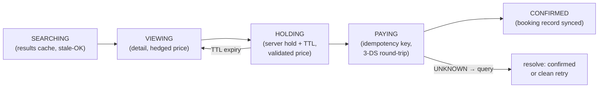

# Mobile 24 — Design a Hotel Reservation App (Booking.com)

> **Sources:** Manuel Vivo, *Mobile System Design Interview* (solved case study; premium) · weeeBox exercise list ("flight booking" — same skeleton).
> **Prerequisites:** [01 — The Framework](01-framework.md) · [15 — Stock Trading](15-stock-trading-app.md) (money integrity — this note assumes its toolkit). Backend twin: Deep Dives [14 — Contention](../Deep%20Dives/14-pattern-contention.md) (the inventory race lives server-side).

## What you'll master

- The **booking funnel as a persisted state machine** — search → detail → hold → pay → confirmed — that survives process death at every arrow.
- **Freshness tiers**: why search results may lie, the detail page hedges, and checkout must tell the truth.
- **Payment integrity on device**: idempotency + the 3-DS redirect round-trip (the flow where apps get killed *by design*).
- **Holds and countdowns** against server-authoritative time.
- The **Staff/EM layer**: conversion-funnel experimentation vs correctness risk, fail-closed payments, build-vs-buy for payment UI.

## In the Room

| Decision | Default position | Justification | Revisit trigger |
|---|---|---|---|
| Funnel state | **Persisted state machine keyed by draft-booking ID** | Users background the app at *every* step (price-compare, OTP, wallet) | — |
| Inventory truth | **Search cached & stale-OK; checkout re-validates price + availability server-side** | Freshness tiering — pay staleness where it's cheap, never where money moves | Flash-sale inventory → tighter tiers |
| Hold | **Server-side hold with TTL at checkout entry; client renders countdown from server expiry timestamp** | Device clocks lie; a client-computed countdown oversells or underpromises | No-hold business model (book-direct) |
| Payment | **Idempotency key minted at pay-tap; UNKNOWN resolves by query, never blind retry** | [15 §4](15-stock-trading-app.md#4-deep-dive-2--the-orders-plane-the-crux) with hotel rooms instead of shares | — |
| Payment UI | **Provider SDK / platform pay (Google Pay, Apple Pay)** | PCI scope + 3-DS handled by people whose whole job it is | Provider gaps in target markets |

**Experience hooks:** *"Same integrity pattern as our chat outbox — client-minted ID, persist before network, resolve-don't-guess — except here the retry question has a price attached, so the resolve step becomes the design."*

## 1. Requirements (~5 min)

- **Functional:** search (location/dates/guests, filters, map), hotel detail + room selection, checkout with hold countdown, payment (cards + wallets), booking management (view/cancel), deep links from marketing/emails.
- **Non-functional:** search feels instant (cached + progressive) · **no double-charge, no phantom booking, ever** · funnel survives kill/background at every step · price shown at checkout = price charged · i18n/currencies from day one.
- **Out of scope:** inventory/pricing engines, loyalty, reviews pipeline (name them).
- **Scope:** client + API contract.

## 2. High-Level — the Funnel Is the Architecture

Each state is a row in the local DB (draft-booking ID, step, server references, expiry timestamps). Kill the app anywhere; on restart the funnel **resumes from the persisted step** — re-entering HOLDING checks the hold's server expiry; re-entering PAYING runs the payment-resolution query before showing any button. The standard anatomy ([framework §4](01-framework.md#4-the-standard-client-anatomy)) sits underneath; this state machine is the specialization that earns the offer.

> **Staff-level insight:** the freshness contract *tiers down the funnel*: search results may be minutes stale (cheap, cacheable, browsable offline), detail hedges ("price at last refresh"), the hold locks price+room server-side, payment charges exactly the held amount. Announcing "staleness is a budget I spend where it's cheap" is the sentence that frames the whole answer.

## 3. Deep Dive 1 — Search & Browse (the cheap-staleness zone)

- Results = cursor-paged render models ([09 §3](09-news-feed.md#3-deep-dive-1--pagination--caching)) keyed by a **normalized query** (destination, dates, guests, filters); cached with TTL ~ minutes; pull-to-refresh replaces the window.
- **Progressive detail:** list card ships thumbnail + headline price; detail screen fetches full gallery/rooms — perceived speed without paying full payloads for 40 scrolled-past hotels.
- Map view = same result set with clustering; viewport moves debounce into new queries (level-triggered, one in-flight — the [19](19-pagination-library.md#3-the-engine) discipline).
- **Deep links** land on detail with nothing cached: route → fetch by hotel ID + restore search context lazily. Every funnel screen must be constructible from a URL + IDs alone — that's the deep-link contract, and it's also what makes state restoration honest.
- Recent searches + viewed hotels persist locally — the "planning a trip" loop is multi-session by nature.

## 4. Deep Dive 2 — Checkout, Holds & Payment (the zero-staleness zone)

**Entering checkout:** `POST /holds {room, dates, price_seen}` → server re-validates price and availability, returns `hold_id + expires_at + final_price`. Price moved? Render the delta explicitly ("was ₹8,200, now ₹8,600") — silently charging a new price is the app-store-review generator. Countdown renders from **server `expires_at`** minus server-synced clock offset; expiry → back to detail, gracefully.

**Paying:** idempotency key minted and persisted with the draft *before* `POST /payments`. Then the hard part — **3-D Secure**: the flow bounces to a bank app/browser and *your process routinely dies while backgrounded*. This is why the funnel is a DB row: the return deep link (or next cold start) reloads the draft, finds state PAYING, and **queries by key** — outcomes: confirmed (celebrate), failed (clean retry, same hold if alive), pending (poll with backoff + honest UI). Blind resubmission is forbidden by construction: no payment call ever fires without first consulting persisted state.

**Confirmation:** booking record synced to local DB (offline-visible in "My bookings" — airports have no signal, that's precisely where users check), push + email as receipts, calendar-add offered.

## 5. The Staff/EM Layer

- **Funnel experimentation vs correctness (EM):** checkout is the most A/B-tested and least forgiving surface. Split it: UI/copy/layout experiments run freely behind flags gated on conversion; the **integrity spine (holds, keys, resolution) is not experimentable** — one hardened path, changed only with staged rollout + payment-success dashboards. *"I let a hundred experiments touch the paint, none touch the plumbing."*
- **Fail-closed money (EM):** payment-provider degradation → disable pay with honesty ("payments are down, your hold is safe until 18:40") over optimistic acceptance. A phantom booking costs a customer *and* a chargeback; a delayed one costs patience.
- **Build-vs-buy (EM):** payment UI/PCI via provider SDKs and platform wallets — owning card entry is PCI-DSS scope, certification cycles, and liability for negative differentiation. Own the *funnel*; rent the *card form*.
- **i18n as architecture (Staff):** currencies (minor-unit integers + currency code end-to-end), date formats, RTL, local payment methods (UPI, iDEAL) as server-driven checkout options — market launches must be config, not app releases.
- **The pager metric (Staff):** payment-resolution integrity — drafts stuck in PAYING > N minutes — and hold-to-confirm conversion by cohort. Crash rate won't catch a funnel that eats money politely.

## Follow-Ups — the Interviewer Escalates

- **"Two devices, same account, both at checkout for the last room?"** — Holds are server-side and exclusive: second `POST /holds` fails cleanly at hold time ("no longer available"), not after payment. The client's job is rendering that race honestly; contention itself is the server's ([DD-14](../Deep%20Dives/14-pattern-contention.md)).
- **"User's clock is 40 minutes wrong — what breaks?"** — Nothing: countdowns render from server expiry against a server-time offset captured at hold creation; local clock is display-only, never authority.
- **"Payment succeeded but the confirmation response was lost — user retries and sees an error. Walk me through it."** — Retry hits the same idempotency key; server replies "already succeeded" with the booking record; client transitions to CONFIRMED. The user experiences a hiccup, not a double charge — that's the whole point of key-before-network.
- **"Hold expires while the user is inside the 3-DS bank flow?"** — Payment resolution wins: if the charge landed in time, honor it (server-side grace on holds with in-flight payments — flag this as an API-contract negotiation you'd drive); if not, refund-or-void automatically and land the user on a re-hold screen with an apology, never a silent charge-without-room.
- **"Prices change every hour — cache invalidation strategy?"** — Don't chase it: short TTLs on search, hedged labels on detail, revalidation at hold. Chasing per-price invalidation buys complexity to protect a tier where staleness is already priced in.
- **"How would you take this to 3 new countries in a quarter?"** — Server-driven checkout config (payment methods, tax lines, legal copy), currency-safe money types already in place, translations as async content not code, and a market-launch flag per country — the launch is ops, not engineering.

## When NOT / Variants

- **Flight booking:** same skeleton, tighter holds (seats + fare classes churn faster), multi-leg carts, and stricter identity data (passenger records) — privacy weight goes up.
- **Restaurant reservations (no payment):** funnel shrinks to hold-and-confirm; no-show deposits reintroduce the payment spine.
- **Event ticketing (flash sales):** the queue-at-the-front problem dominates — waiting-room UX + server-issued turn tokens; holds get seconds, not minutes.

---

## Interview Cheat-Sheet

**30-second architecture:** persisted funnel state machine (draft ID + step in DB) · staleness tiered down-funnel: cached search → hedged detail → server hold with TTL → idempotent payment with UNKNOWN-resolves-by-query · 3-DS survives process death because the funnel does · fail-closed money, server-authoritative time, minor-unit currency.

| Probe | Answer |
|---|---|
| "App killed during 3-DS bank redirect?" | Expected path, not edge case: draft row says PAYING → on return/restart, query by idempotency key → confirmed / clean-retry / pending — never blind resubmit |
| "Price changed between search and pay?" | Tiers: search may lie, hold revalidates and shows the delta explicitly, charge equals held price — no silent repricing |
| "Countdown accuracy?" | Server `expires_at` + captured clock offset; local clock is never authority |
| "Room sells out at payment moment?" | It can't — the hold made checkout exclusive; the race resolves at hold time with an honest "no longer available" |

**Say-verbatim:**
- *"Staleness is a budget — I spend it freely on search, hedge it on detail, and spend zero at checkout."*
- *"The funnel is a database row, not a navigation stack — 3-DS will kill my process and I plan for it."*
- *"Experiments touch the paint, never the plumbing — the integrity spine has one hardened path."*
- *"Fail-closed with honesty: 'payments are down, your hold is safe' beats a phantom booking every time."*
