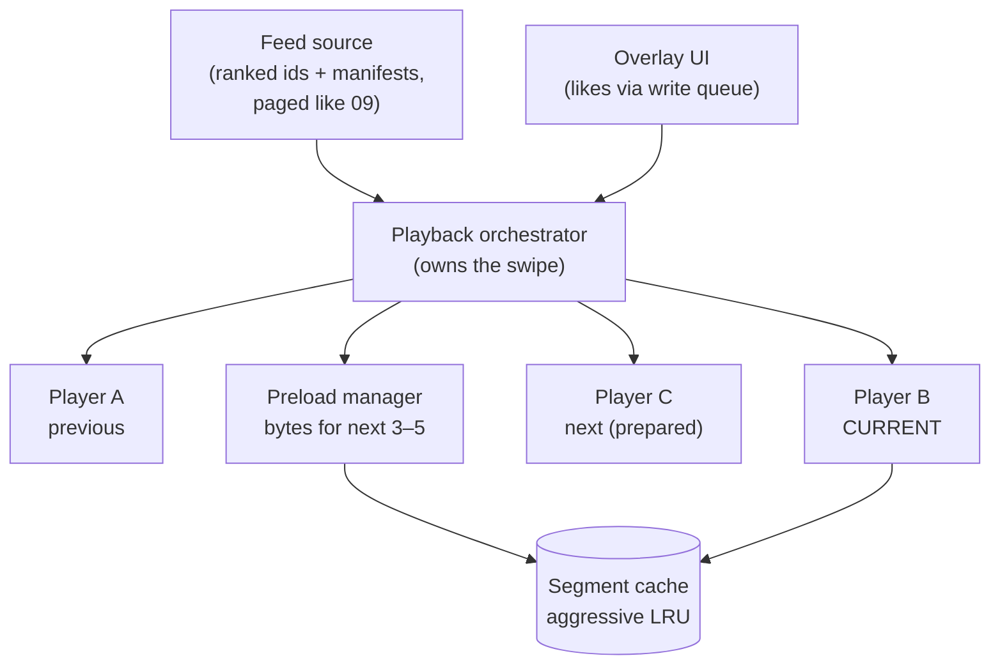

# Mobile 25 — Design TikTok / YouTube Shorts (Short-Form Video)

> **Sources:** DesignGurus TikTok-question outlines · player-engineering folklore (ExoPlayer preload APIs exist *because* of this app shape).
> **Prerequisites:** [11 — YouTube](11-youtube.md) — this note is that note **with every dial inverted**. Read them as a pair; interviewers love asking "what changes from YouTube?" and the delta *is* the answer.

## What you'll master

- The inversion: long-form optimizes *within* a video (ABR, big buffers); short-form optimizes *between* videos (instant next).
- The **player pool** — recycled decoder instances as the scarce resource, choreographed with the swipe.
- **Preload economics**: bytes-wasted-per-watched as the governing metric, and the server-tuned preload policy.
- Why **the feed and the player merge into one component**, and what that does to the architecture.
- The **Staff/EM layer**: data cost per market, engagement-vs-battery ethics, low-end strategy.

## In the Room

| Decision | Default position | Justification | Revisit trigger |
|---|---|---|---|
| Startup target | **First frame < 100 ms perceived on swipe** | The product *is* the instant swipe; 1 s = a dead feed | — |
| Preload | **Fully prepare next 1–2 players; bytes for first ~2–4 s of next 3–5 videos** | Startup is won before the swipe ([11 §3](11-youtube.md#3-deep-dive-1--abr-from-the-clients-seat), radicalized) | Metered/data-saver → shrink window server-side |
| Player instances | **Pool of ~3 recycled players: previous, current, next** | Decoders are scarce ([11](11-youtube.md)); create/destroy per swipe stalls | Low-end → pool of 2, thumbnails as crutch |
| Encoding | **Short segments, low-rung first segment, capped ladder** | Files are 15–60 s; startup rung matters more than peak quality | — |
| Buffer | **Small (~5–10 s)** — abandon rate makes big buffers waste | Watch-through rates are low; don't buy seconds users won't watch | — |

**Experience hooks:** *"Our SDK's media previews taught me the recycled-player-pool discipline — the new physics here is that *most content is abandoned*, so every byte-ahead decision is a bet priced against a ~50 % swipe-away rate."*

## 1. Requirements (~5 min)

- **Functional:** vertical swipe feed of autoplaying videos, like/comment/share overlays, seamless loop, upload/record path (scoped out or thin), prefetching driven by a server ranking feed.
- **Non-functional:** swipe-to-first-frame < 100 ms p50 / < 300 ms p95 · zero visible rebuffers within a clip on healthy networks · smooth 60 fps overlay interactions *during* playback · bounded data spend (server-tunable per network class) · viable on 2 GB devices.
- **Out of scope:** ranking/recommendation, transcode pipeline, creation tools beyond the upload seam.
- **Scope:** client + feed/CDN contract.

## 2. High-Level — the Feed *Is* the Player

In [11](11-youtube.md), a browse surface *hands off* to a player screen. Here there is no handoff: the **playback orchestrator** owns a pool of ~3 player instances bound to feed positions. A swipe is a *rotation of roles* — next becomes current (already prepared: bytes buffered, decoder warm, first frame pre-rendered), current becomes previous (paused, kept for swipe-back), previous recycles to prepare position N+1. First frame in ~a frame's time, because everything expensive happened before the gesture.

Feed pagination, like/comment mutations: straight from [09](09-news-feed.md) — cursor pages of video metadata, optimistic writes through the persisted queue. The overlay UI renders above the player and must never contend with it for the main thread.

> **Staff-level insight:** the one-sentence framing — *"long-form spends its budget inside a video; short-form spends it between videos"* — organizes every follow-up: buffers shrink, preload widens, ABR simplifies, the player pool appears. State the inversion first and the interview becomes a guided tour instead of twenty separate answers.

## 3. Deep Dive — Preload Economics (the crux)

Every pre-fetched byte is a bet that the user watches video N+k. The governing metric: **waste ratio = bytes downloaded ÷ bytes actually watched.**

- **Tiered preparation:** position N+1 gets full preparation (player + buffer + decoded first frame); N+2..N+5 get first-segment bytes into cache only; beyond that, metadata + thumbnail. Swipe velocity adapts the window (fast flicking → widen shallow tier, skip deep prep).
- **Server-tuned policy:** the preload matrix (depth × bytes × network class × data-saver) ships in the feed response, not the binary — the [09 §6](09-news-feed.md#6-the-staffem-layer) config-over-release rule with 10× the stakes, because video bytes dwarf image bytes.
- **First-segment engineering:** encode so the first ~2 s land in one small low-rung fetch (fast start), ladder up within the clip if it keeps playing. ABR within a 30 s clip barely matters; the *start* rung is everything.
- **Cache policy:** aggressive LRU over segments; watched-and-passed clips evict almost immediately (swipe-back tolerance ~1 clip); the cache is a *conveyor belt*, not a library.
- **Loop seamlessly:** clips loop; the last→first segment seam must be buffered too — a rebuffer *on loop* is the tell of a naive implementation.

## 4. The Staff/EM Layer

- **Data cost per market (EM):** at scale, preload policy is a *P&L line* — CDN egress on wasted bytes — and a user-trust line on prepaid plans. The waste-ratio dashboard by market/network class is the negotiation table between growth (deeper preload) and cost/trust. Owning that dial, not just the code, is the EM job.
- **Engagement vs battery/wellbeing (EM):** an app this good at autoplay drains batteries and attention; expect a values probe at Google. Have a position: honest battery accounting, data-saver defaults on detection, respecting OS screen-time signals — *"the retention curve isn't the only gauge on the dashboard."*
- **Low-end strategy (Staff):** pool of 2, software-decode-aware prep depth, capped ladder, thumbnails-first — a deliberately different device-class experience, config-driven ([10 §5](10-google-maps.md#5-the-staffem-layer), same move). Growth markets are low-end markets; the cheap-device experience *is* the product there.
- **The pager metrics (Staff):** swipe-to-first-frame p95, rebuffer-per-hour, waste ratio, battery per feed-hour, and upload success rate — each gates its own experiment lane.

## Follow-Ups — the Interviewer Escalates

- **"User flicks through 10 videos in 5 seconds — what does your system do?"** — Velocity detection collapses preparation to shallow tier (metadata + thumbnail), cancels in-flight deep preps ([16](16-image-loading-library.md)'s doomed-request discipline), shows first frames as stills mid-flick, and resumes full prep when velocity drops. The system must *degrade with the gesture*, not fight it.
- **"Swipe-back: how far back is instant?"** — One position by kept player (previous stays paused); ~2–3 more from segment cache (fast re-prepare); beyond that it's a normal cold load. State the tiers and their costs — "instant" is an engineered window, not a promise.
- **"Your waste ratio is 2.5 — is that good?"** — It means 60 % of downloaded bytes were never watched. Judge against market data cost and swipe-away rate; lever order: shrink deep-tier bytes (first 2 s not 4), sharpen the ranking signal used for preload depth, adapt to per-user watch-through. The answer is the *decision framework*, not a magic number.
- **"Comments open over a playing video and scrolling janks — why?"** — Main thread contention: player callbacks, overlay list, and image loads colliding. Player events must arrive coalesced off-main; the comment sheet is [09](09-news-feed.md)'s list (its own pagination + image pipeline); decoded-frame delivery stays on its own thread. The composition is the trap — name the threads.
- **"Uploads: user records 60 s and locks their phone."** — The upload is [23 §4](23-google-drive.md#4-deep-dive-2--transfers--conflicts)'s resumable chunked transfer under the OS scheduler, with client-side transcode as a *preprocessing job* in the same persisted pipeline (transcode → chunks → commit), progress notification, draft persisted. Nothing about creation changes the transfer physics.
- **"Same app, but for a market where data costs 10× more — what changes?"** — Server flips the preload matrix (depth 1, first-segment only, Wi-Fi-only deep prep), lower default ladder, data-usage meter in-product, download-on-Wi-Fi-watch-later becomes a first-class feature. The architecture doesn't change — *the config does*, which is exactly why policy lived server-side all along.

## When NOT / Variants

- **Stories (roadmap 13):** short-form's sibling — same prefetch physics, but ephemeral (TTL deletion), mixed photo/video, and tray-based navigation replaces the infinite swipe.
- **Long-form app adding a Shorts tab:** the two players must share the decoder budget — the arbiter from [11](11-youtube.md) grows a second client; don't ship two independent pools.
- **Music-video/audio feeds:** audio continuity across swipes (crossfade) changes the pool choreography — audio pipeline persists across visual rotations.

---

## Interview Cheat-Sheet

**30-second architecture:** feed and player merged under a playback orchestrator · pool of ~3 recycled players, swipe = role rotation · tiered preload (full-prep next, first-segments for N+2..5, thumbnails beyond) governed by a server-tuned matrix per network class · small buffers, low start rung, seamless loop · waste ratio as the governing economic metric.

| Probe | Answer |
|---|---|
| "Why is first frame instant?" | It was rendered before the swipe — prepared player, buffered bytes, warm decoder; the gesture just promotes it |
| "Difference from YouTube?" | Inverted budget: optimize between videos, not within — small buffers, wide shallow preload, start rung over peak quality, player pool over player screen |
| "Data usage complaints?" | Preload matrix is server config: shrink depth/bytes per network class today, no release; waste-ratio dashboard tells you where |
| "2 GB device strategy?" | Pool of 2, shallow prep, capped ladder, stills-first — a config-driven device-class experience, not a degraded accident |

**Say-verbatim:**
- *"Long-form spends its budget inside a video; short-form spends it between videos."*
- *"A swipe is a rotation of player roles — everything expensive already happened."*
- *"Every preloaded byte is a bet priced against the swipe-away rate — waste ratio is the governing metric."*
- *"The cache is a conveyor belt, not a library."*
