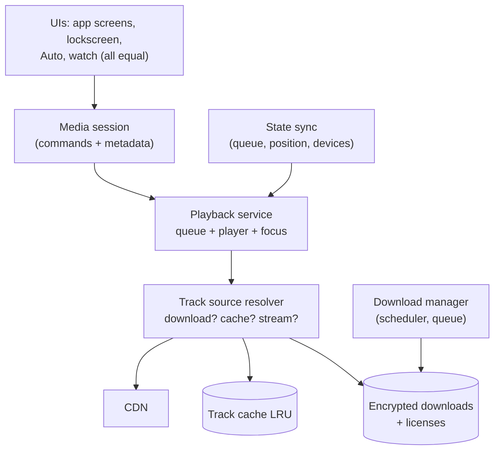

# Mobile 26 — Design Spotify (Offline-First Music Streaming)

> **Sources:** Spotify engineering-blog folklore (client architecture, offline sync) · platform media-session docs (the lifecycle half of this question).
> **Prerequisites:** [01 — The Framework](01-framework.md) · [11 — YouTube](11-youtube.md) (streaming basics — then note how audio's small files change everything) · [23 — Google Drive](23-google-drive.md) (downloads are a sync-engine problem).

## What you'll master

- Why audio ≠ video: **small files invert the streaming design** — full-track caching, whole-playlist downloads, simple ladders.
- The **playback service + media session** — the OS-integrated, UI-independent core that defines every music app.
- **Offline as a licensed feature**: encrypted downloads, license expiry, the phone-home clock.
- **Cross-device state sync** (Spotify Connect) — the remote-control model.
- The **Staff/EM layer**: label contracts shaping architecture, battery for 8-hour sessions, the downloads-honesty UX.

## In the Room

| Decision | Default position | Justification | Revisit trigger |
|---|---|---|---|
| Streaming unit | **Whole tracks (3–8 MB); progressive fetch, cache complete files** | At audio sizes, segment/ABR machinery is overkill | Podcasts (100 MB+) → ranged/segmented fetch |
| Quality | **Per-network-class fixed rung (96/160/320 kbps), user-overridable** | Mid-track quality switching is audible and unnecessary | — |
| Playback core | **Background service owning player + queue; UIs bind to it** | Music outlives every screen; lockscreen/watch/auto are equal clients | — |
| Downloads | **Encrypted files + offline license with expiry; scheduler-managed** | Offline is a *licensed right*, not a file copy | DRM-free content (own uploads) |
| Cross-device | **Server-brokered remote control: devices report state, others render + command** | Streaming audio between phones is the wrong problem | Offline multi-device → don't; one active session |

**Experience hooks:** *"Our SDK's voice-message pipeline is this in miniature — download-then-play with encrypted-at-rest files. The genuinely new muscle here is the media-session citizenship: being controlled by lockscreens, cars, and watches you don't render."*

## 1. Requirements (~5 min)

- **Functional:** browse/search, play with queue management, playlists, **download playlists/albums for offline**, gapless playback, lockscreen/auto/watch control, cross-device handoff.
- **Non-functional:** play-tap-to-audio < 300 ms (cached) / < 1 s (network) · zero audible glitches during network churn · 8-hour session ≤ ~5–8 % battery (screen off) · offline mode fully functional for downloaded content · downloads encrypted at rest.
- **Out of scope:** recommendation/radio, royalty accounting, the CDN itself.
- **Scope:** client + API/licensing contract.

## 2. High-Level — the Service Is the App

The **playback service** is the app: it owns the queue, the player, audio focus, and survives every screen. UIs — in-app, lockscreen, Android Auto, watch — are *equal clients* speaking through the media session (play/pause/skip + metadata). Design it as [14](14-ride-hailing.md)'s rule transposed: **every surface renders service state; none owns it.**

The **track source resolver** is the offline-first seam: given a track, prefer download → cache → network, transparently. Playback code never knows which; "offline mode" is just the resolver refusing the third option.

> **Staff-level insight:** audio files being ~5 MB is the load-bearing fact. Whole files cache atomically, a playlist download is ~300 MB not 30 GB, prefetching the *entire next track* is trivial (gapless comes almost free), and ABR collapses to a startup choice. Name the number early — the design follows from it, and it's the cleanest demonstration that constraints generate architecture.

## 3. Deep Dive 1 — Downloads, Encryption & Licenses

- **Download = content + right.** Files land AES-encrypted (keys in Keystore/Keychain), paired with an **offline license** carrying expiry. The app must **phone home within ~30 days** to re-validate subscriptions — the offline clock is a *contractual* device, not a technical one ([11 §4](11-youtube.md#4-deep-dive-2--downloads--drm)'s DRM story, subscription-flavored).
- **Download manager:** persisted queue over the OS scheduler ([23 §4](23-google-drive.md#4-deep-dive-2--transfers--conflicts) — whole-file, so simpler: per-track completion, no chunk bookkeeping), constraints Wi-Fi + charging by default, playlist downloads as track-set diffs (playlist edits download/remove deltas, not re-downloads).
- **Two storage pools, never confused:** explicit downloads (user-owned, never auto-evicted, honest byte counts) vs the streaming cache (LRU, silently managed). [23 §5](23-google-drive.md#5-the-staffem-layer)'s pin rule verbatim — auto-deleting a road-trip playlist is the support-ticket generator.
- **Quality choice at download time** is a real UX decision (160 vs 320 kbps doubles the bytes) — default per settings, surfaced at playlist-download time with a size estimate.

## 4. Deep Dive 2 — Playback & Cross-Device

- **Gapless/crossfade:** resolver pre-fetches the next queue item fully during the current track; player pre-buffers its head; the seam is decoder-level, not fetch-level. Trivially cheap with audio sizes — which is why users notice *immediately* when an app fails at it.
- **Audio focus & interruptions:** calls duck/pause, navigation prompts duck, unplugged headphones pause (never blast the speaker) — a state machine of platform citizenship; listing its three canonical cases signals shipped-it.
- **Battery for 8-hour sessions:** decode is cheap; the killers are radio wakeups (batch: whole-track prefetch means the radio sleeps between tracks) and wakelock leaks. Screen-off audio should hold *partial* wakelocks only while actually decoding.
- **Cross-device (Connect):** devices report presence + playback state to the server; any device can render the session and send commands; **exactly one renders audio.** Handoff = command ("play on speaker X from position T") — content re-streams *to the target from the CDN*, never phone-to-speaker. Offline complicates honestly: no server broker → no Connect; local playback only.
- **Position/queue sync** rides the [08 §4](08-chat-app.md#4-deep-dive-2--sync--the-reconnect-story) delta machinery: queue edits and positions as synced state with last-writer-wins per field (a queue conflict is an annoyance, not data loss — cheap resolution is correct here; contrast with [23](23-google-drive.md), and *say* you're choosing differently because stakes differ).

## 5. The Staff/EM Layer

- **Label contracts shape the architecture (EM):** offline windows, per-tier quality caps, skip limits on free tier, regional catalogs — all *contract terms* that must be enforced client-side via server config. The licensing clock (§3) is the clearest case in the track of legal requirements compiling into architecture; frame it that way.
- **Free tier as a design dimension (EM):** ads insertion in the queue, skip counting (enforced offline too — counters sync later), quality caps — the playback service carries a *policy engine* whose rules ship from the server. Two products, one binary.
- **The pager metrics (Staff):** playback-failure rate per source (download/cache/stream tells you *where* it broke), time-to-audio p95, battery per listening-hour, download-completion rate, and license-refresh failure rate (the silent killer — users discover it on a plane).
- **Podcast strategy (Staff):** long files flip the physics back toward [11](11-youtube.md) — ranged fetch, position sync as the crown jewel (cross-device resume mid-episode), speed controls in the decode path. One service, two content physics; the resolver and player abstractions must have left room.

## Follow-Ups — the Interviewer Escalates

- **"User boards a 12-hour flight; license check was due hour 3 — does music stop?"** — No: grace periods are designed into the expiry (validate-by dates with slack, staggered per-license), and the refresh runs opportunistically *days* early via the scheduler. Hard mid-flight cutoffs are a contract-implementation choice you negotiate *for* the user — an EM answer about how engineering pushes back on naive legal encoding.
- **"Skip happens the instant before the next track finished prefetching — glitch?"** — Skip cancels the current prefetch, resolver serves the *new* next track (cache-first), player rebuffers its head — worst case ~200 ms of silence on network, zero if cached. The queue's prefetch pointer follows *user intent*, not queue order alone (recently-skipped-into tracks are prefetch candidates too).
- **"Storage full mid-playlist-download?"** — Pre-flight size check, pause at threshold, surface "14 of 40 downloaded — need 120 MB" ([11](11-youtube.md)'s rule) — and *never* evict the streaming cache below its floor to squeeze downloads in silently; the pools stay honest.
- **"Two devices offline edit the same playlist — reconcile."** — Op-based sync ([23](23-google-drive.md)'s queue): adds/removes/moves as idempotent ops with base versions; playlist merge applies both sides (add+add = both, remove+move = remove wins with tombstone). Field-level merge is fine here because no outcome loses *content* — the stakes-based conflict-policy choice again.
- **"Why does the app get killed during long background playback, and what do you do?"** — OS memory pressure + OEM battery managers; mitigation: proper foreground-service and media-session registration, minimal service heap (UI process can die freely — *design* for split), instant state persistence (queue + position on every change), so resurrection is seamless. The user should never know.
- **"Design the 'played in car, resume on phone' handoff to feel magical."** — Continuous position beacons while playing, presence detection (device list), on-open contextual resume prompt keyed to recency. The magic is honest engineering: high-frequency position sync *while active* + a UX decision about when to surface it — split the two in the answer.

## When NOT / Variants

- **Podcast-first app:** ranged fetch, aggressive position sync, speed/silence-trimming in the decode path; downloads dominate streaming.
- **Audiobooks:** podcasts + DRM-per-purchase + chapter semantics; offline expiry usually *per purchase* not subscription — licensing model changes the license design.
- **Local-files player:** the resolver's first tier as the whole product; no licenses, no sync — don't drag the machinery in.

---

## Interview Cheat-Sheet

**30-second architecture:** background playback service + media session, all UIs equal clients · source resolver: download → cache → stream · whole-track model (audio is small) → trivial full-next-track prefetch, gapless free · encrypted downloads + offline licenses with phone-home expiry · two storage pools (user downloads vs LRU cache) · Connect = server-brokered remote control, one audio renderer.

| Probe | Answer |
|---|---|
| "Gapless playback how?" | Next track fully prefetched during current (it's 5 MB); seam handled at decoder level — audio sizes make this cheap, which is why failing at it is unforgivable |
| "Downloads are just files?" | Files + *rights*: encrypted at rest, license with expiry, phone-home window — offline is a licensed feature, the clock is contractual |
| "App killed overnight during playback?" | Service designed for death: state persisted on every change, media session re-registers, resurrection is invisible |
| "Cross-device streaming?" | Remote control, not relay: state via server, commands to the one audio-rendering device, content re-streams from CDN |

**Say-verbatim:**
- *"Audio files are five megabytes — that number generates the whole design: whole-file caching, free gapless, playlist downloads that fit."*
- *"Every surface renders the service's state; none owns it."*
- *"Downloads are two pools: what the user chose (sacred) and what we cached (disposable)."*
- *"The offline-expiry clock is a legal contract compiled into architecture."*
