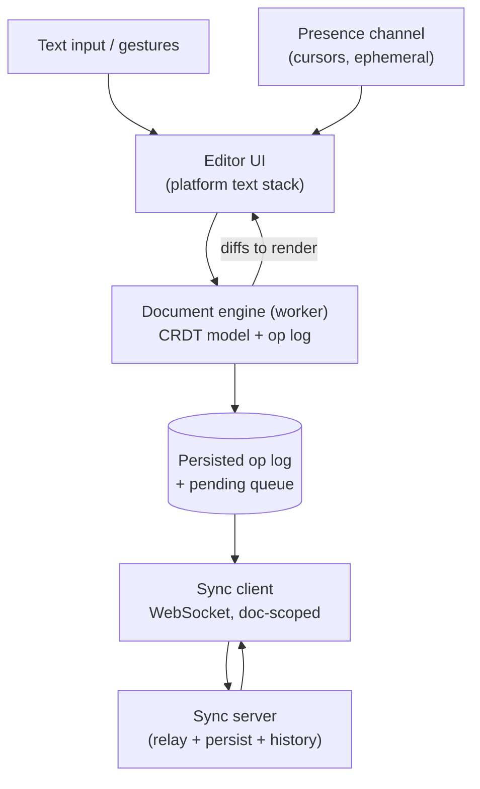

# Mobile 27 — Design a Collaborative Editor (Google Docs / Notion Mobile)

> **Sources:** OT vs CRDT literature distilled (Ellis-Gibbs → Google Wave post-mortems → Yjs/Automerge docs) · Notion/Figma engineering-blog folklore.
> **Prerequisites:** [01 — The Framework](01-framework.md) · [23 — Google Drive](23-google-drive.md) (file-level sync; this note is what happens when you sync *inside* the file) · Deep Dives [14 — Contention](../Deep%20Dives/14-pattern-contention.md) for the "why not just lock?" reflex.

## What you'll master

- The **local-echo principle**: every keystroke applies locally instantly; convergence is the sync layer's job, never the typist's.
- **OT vs CRDT** at interview altitude: what each actually trades, and why mobile's offline bias tilts toward CRDT.
- The **document engine**: ops, not strings — and keeping a busy document off the main thread.
- **Collaborative undo, cursors/presence, and offline-for-a-week merges** — the three follow-ups that always come.
- The **Staff/EM layer**: build-on-Yjs vs proprietary, the "offline editing" product promise's true cost.

## In the Room

| Decision | Default position | Justification | Revisit trigger |
|---|---|---|---|
| Convergence | **CRDT for offline-heavy mobile; OT if you own a mandatory central server** | CRDTs merge without a sequencer — offline is their home turf | Google-Docs-scale text with server anyway → OT is proven + leaner metadata |
| Edit granularity | **Operations (insert/delete at position, format span) — never document snapshots** | Ops merge, compress, and sync incrementally; snapshots conflict as blobs | — |
| Local echo | **Apply to local model in ≤ 1 frame, sync asynchronously** | Typing latency is the product; network can never be in the keystroke path | — |
| Doc structure | **Block tree (paragraphs/blocks) with rich-text sequences inside** | Blocks give natural merge/permission/lazy-load boundaries (the Notion model) | Pure plain-text → one sequence is fine |
| Presence | **Ephemeral channel — cursors/selections, never persisted** | [08](08-chat-app.md)'s typing-indicator split: durable ops vs disposable presence | — |

**Experience hooks:** *"Chat taught me op-based sync with idempotent replay — a collaborative doc is that queue where ops *interleave inside one object*, so the merge function is the product. I'll spend my depth there."*

## 1. Requirements (~5 min)

- **Functional:** rich-text editing (text, formatting, blocks, images), multi-user live editing with cursors, full offline editing, comments, version history.
- **Non-functional:** keystroke-to-glass < 16 ms regardless of doc size or peer count · **all concurrent edits converge to the same document** (the correctness bar) · offline edits for days merge without data loss · 100+ page docs stay scrollable on 2 GB devices · edit latency peer-to-peer p95 < 500 ms online.
- **Out of scope (say it):** permissions/sharing UX, server persistence details, real-time voice/video presence.
- **Scope:** client + sync protocol contract.

## 2. High-Level

The flow, one breath: keystroke → editor emits an *intent* → document engine (off-main) applies it to the CRDT model, appends to the persisted op log, returns a minimal diff → UI applies the diff within the frame. Remote ops arrive on the socket → engine merges → diffs to UI, with **local cursor position transformed** through the remote change (your cursor must not jump when a collaborator inserts a paragraph above).

Offline is *free by construction*: the op log accumulates locally and syncs later — the whole reconnect story is [08 §4](08-chat-app.md#4-deep-dive-2--sync--the-reconnect-story) (cursor into the server's op stream + drain local pending), it just ends in a merge instead of an append.

> **Staff-level insight:** *"the editor never edits the document — it proposes ops; the engine owns truth"* is this note's screen-renders-state rule ([14](14-ride-hailing.md)). Every haunted-document bug (ghost characters, jumping cursors) traces to a UI that mutated text directly and drifted from the model.

## 3. Deep Dive 1 — OT vs CRDT (give the real trade, fast)

- **OT (operational transformation):** ops are simple (`insert(5, "a")`); concurrency is handled by *transforming* ops against each other, which in practice requires a **central server to sequence** them. Proven at Google-Docs scale; metadata-lean. Cost: transform-function correctness is notoriously subtle, and offline periods mean long transform chains through the server on reconnect.
- **CRDT:** every character/element gets a **unique stable ID** (site + counter); insert says "after ID X," delete *tombstones*. Any two replicas merge **commutatively — no sequencer**, hence peer-friendly and offline-native. Cost: per-character metadata and tombstone growth (mitigations are table stakes: run-length blocks for typing bursts, periodic compaction snapshots, GC of tombstones past a version horizon).
- **The pick, argued not asserted:** mobile's defining requirement here is *days-offline merge*; CRDTs make that the default path rather than the scary path, and mature libraries (Yjs, Automerge) have paid down the metadata costs. If the interviewer's product guarantees a central server and web-first usage, argue OT with equal comfort — **the leveling signal is knowing what each costs**, not the letter you pick.
- Either way: **rich text is spans over the sequence** (bold as a range mark that stretches with edits) and **blocks merge structurally** (two people editing different paragraphs never conflict — the block tree localizes the hard case to same-span edits).

## 4. Deep Dive 2 — the Engine on a Phone

- **Off-main, always:** the CRDT model + merge work lives on a worker; the UI thread holds only render state. Platform text stacks are main-thread — so the boundary is *diff-shaped*: engine emits "replace range, apply span," never "here's the new document."
- **Data structure:** rope/piece-table-style sequence with the CRDT IDs on chunks, `O(log n)` edits — a 200-page doc must insert as fast as a memo. **Lazy block loading:** open renders the viewport's blocks; the rest hydrates behind scroll ([19](19-pagination-library.md)'s windowing, applied to one document).
- **Collaborative undo is *your-ops-only*:** undo reverts **my** last op (as a new inverse op), never the collaborator's latest — the universal convention, and it's why undo is an op-log feature, not a UI stack: inverse ops merge like any other.
- **Comments anchor to CRDT IDs**, not offsets — they survive every concurrent edit; an anchor whose range was deleted degrades to an orphaned comment (kept, flagged) rather than silently vanishing.
- **Images/attachments = pointer pattern** ([08 §3](08-chat-app.md#3-deep-dive-1--the-send-pipeline-the-crux)): block holds an upload-ref; bytes ride the [23 §4](23-google-drive.md#4-deep-dive-2--transfers--conflicts) resumable pipeline; placeholder renders meanwhile.
- **Persistence:** op log + periodic model snapshots (open = load snapshot + replay tail — bounded startup); snapshots also serve version history.

## 5. The Staff/EM Layer

- **Build on Yjs/Automerge vs proprietary (EM):** the merge core is *years* of correctness edge cases; buy it unless the document model is your moat (Figma built proprietary because design-tool semantics demanded it; most text products shouldn't). The build case must name what the libraries can't do for you — otherwise it's NIH with a whiteboard.
- **The offline promise's real bill (EM):** "edit offline" sounds like a checkbox; it actually prices in CRDT metadata forever, merge QA across staleness windows, orphaned-comment UX, permission-revocation-while-offline policy, and support load from "my merge looks weird." Scope it deliberately — read-only offline + queued *appends* (comments) is a legitimate cheaper rung on the ladder; naming that rung is the EM move.
- **Convergence is the pager metric (Staff):** replica divergence detected (checksum exchange per sync round) per million doc-sessions — the [23 §5](23-google-drive.md#5-the-staffem-layer) divergence discipline, one level deeper. Also: keystroke-latency p99 by doc size, merge-time p95 by offline-age.
- **Version history as a product boundary (Staff):** snapshots + op ranges give "restore to Tuesday" — but restore is itself *an op* (a new state that merges), never a history rewrite; concurrent editors must converge through a restore too. Easy to say, easy to ship wrong.

## Follow-Ups — the Interviewer Escalates

- **"Two users type in the same word simultaneously — walk me through convergence."** — Both echo locally; ops carry stable neighbor IDs; each side merges the other's insert deterministically (ID-order tiebreak for same-position inserts). Both replicas converge to the same interleaving — possibly `"helwolrld"`-ugly, but *identical*. CRDTs guarantee convergence, not semantic beauty; humans fix the word, and saying that distinction is the depth marker.
- **"User returns after a week offline with 2,000 edits against a heavily-edited doc."** — Sync = fetch server ops since cursor, merge (commutative — order-free), push pending 2,000. Engineering concerns are practical, not theoretical: merge runs off-main with progress UI, memory for the op sets is bounded via snapshot-based deltas, and the *product* concern — the user should get a "review what changed" affordance, because a technically-perfect merge can still surprise a human.
- **"Permission revoked while the user was editing offline."** — Local edits applied against now-revoked access: server rejects the push (auth is server truth, [DD-14](../Deep%20Dives/14-pattern-contention.md)); client preserves the work as an exportable local copy rather than deleting it. Policy decision with legal flavor — the *data* is theirs, the *destination* isn't; flag who owns that call.
- **"The cursor jumps while a collaborator edits above — why, and the fix?"** — UI holding offset-based cursor state while the document shifts under it. Cursors (and scroll anchors, and selection) must live as **positions in CRDT-ID space**, transformed to offsets at render — the same reason comments anchor to IDs. One principle, three symptoms.
- **"Doc gets slower over months of editing — diagnose."** — Tombstone/metadata accumulation (compact past the version horizon), op-log replay length at open (snapshot cadence), and orphaned marks/anchors. The engine needs *maintenance jobs* — a document is a little database, and databases without vacuuming rot ([DD-03](../Deep%20Dives/03-postgresql.md)'s lesson, transposed).
- **"Why not just lock paragraphs like 2005?"** — Give it its honest due: block-level locking is *vastly* simpler and right for some products (CMS workflows). It dies on the flagship UX — two cursors in one paragraph — and offline (locks can't be held or granted sanely). Locking isn't wrong; it's a different product. Answering with the decision boundary instead of a sneer is the Staff tone.

## When NOT / Variants

- **Single-user notes app with sync (Keep):** no live collaboration → [23](23-google-drive.md)'s op-sync with field merges; don't pay the CRDT tax.
- **Whiteboard/design canvas (Figma-like):** objects not text — last-writer-wins *per property* is usually enough (position, color); the text problem returns only inside text boxes. Simpler merge, harder rendering.
- **Code editors with live share:** OT/CRDT applies, but sessions are short-lived and server-anchored → OT's costs shrink; presence and follow-mode dominate the UX.

---

## Interview Cheat-Sheet

**30-second architecture:** editor proposes ops → off-main engine owns a CRDT block-tree model → local echo in a frame, persisted op log, socket sync with cursor → commutative merge on reconnect → diffs to UI with ID-space cursor transforms · presence ephemeral · undo = inverse of own ops · snapshots bound startup and serve history.

| Probe | Answer |
|---|---|
| "Guarantee both users see the same doc?" | Op-based CRDT: commutative merges converge regardless of order; verified in production by per-sync checksums (divergence is the pager metric) |
| "Typing lags on a 100-page doc?" | Engine off-main with `O(log n)` sequence ops + lazy block hydration — keystroke path touches viewport-local state only |
| "Undo undoes my collaborator's edit?" | Never: undo = inverse of *my* last op, emitted as a new op that merges normally |
| "OT or CRDT?" | Offline-heavy mobile → CRDT (no sequencer needed); central-server web product → OT is proven and leaner. The trade is metadata-and-tombstones vs transform-correctness-and-server-dependence |

**Say-verbatim:**
- *"The editor never edits the document — it proposes ops; the engine owns truth."*
- *"CRDTs guarantee convergence, not semantic beauty — both users see the same ugly word, and a human fixes it."*
- *"Cursors, comments, and selections live in ID-space, not offsets — that one decision kills three bug families."*
- *"The merge core is a decade of edge cases — I'd build on Yjs and spend my engineers on the document model we're actually differentiated by."*
