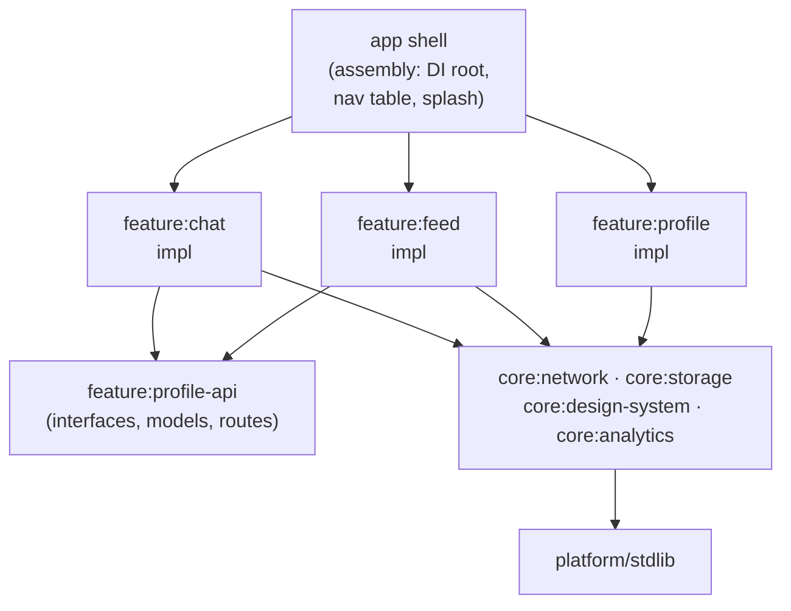

# Mobile 28 — Design a Large-Scale App Modularisation Strategy

> **Sources:** Android "Guide to app modularization" + iOS SPM folklore · engineering blogs from apps that lived it (Uber's RIBs-era build-time posts, Airbnb, Square) · this is the **purest EM/Staff question in the track** — no user-visible feature, all architecture-as-organization.
> **Prerequisites:** [01 — The Framework](01-framework.md) §7 (the altitude ladder — this whole question lives on its top rungs).

## What you'll master

- Why this question is really **"design the org's ability to ship"**: build times, ownership, and boundaries as the requirements.
- The **module taxonomy** — app shell / feature / api-impl split / core — and the dependency rules that keep the graph a DAG.
- **Navigation and DI across boundaries** — the two places modularisation actually hurts.
- The **migration strategy**: strangler-pattern extraction from a monolith while 200 engineers keep shipping.
- The metrics an EM runs this program on.

## In the Room

| Decision | Default position | Justification | Revisit trigger |
|---|---|---|---|
| Unit of modularity | **Feature modules aligned to team ownership** | Conway's law is a tool: module boundary = code-review boundary = on-call boundary | Features too small → group by domain |
| Feature-to-feature deps | **Forbidden. Features depend on `api` modules only** | One transitive feature dep and the graph re-tangles in a quarter | — |
| api/impl split | **For shared surfaces yes; leaf features skip it** | Interfaces compile fast and decouple builds; ceremony everywhere is its own disease | Build graph shows impl leaking into many consumers |
| Navigation | **URI/route-based indirection (deep-link table), no class refs** | Feature A must launch Feature B without compiling against it | Single-team small app → direct refs are honest |
| Migration | **Strangler: extract leaves first, core last, never a big-bang** | The rewrite freeze kills roadmaps; extraction must be incremental | — |

**Experience hooks:** *"Our SDK is consumed as a module inside customer apps — I live on the other side of this boundary: versioned api surface, no knowledge of the host's DI or navigation. Designing a modular app is designing every feature team to treat each other the way our customers treat us."*

## 1. Requirements — Yes, This Question Has Them

Ask what hurts; modularisation is a *treatment*, and the drug should match the disease:

- **Build times:** incremental build > 5 min, CI > 40 min → parallelism + caching are the goal.
- **Ownership:** 200 engineers, 15 teams, one `app/` directory → boundaries and CODEOWNERS are the goal.
- **Merge conflicts / coupling:** feature A's refactor breaks feature B weekly → enforced APIs are the goal.
- **Launch flexibility:** need to ship a feature to another app / as an SDK / via dynamic delivery → reuse is the goal.

Non-functional: migration happens **while shipping** (no feature freeze); the rules must be **machine-enforced** (CI, not culture); app startup and binary size must not regress (modularisation adds indirection — measure it).

> **Staff-level insight:** open with the disease-before-treatment framing: *"modularisation programs fail when they're architecture-astronomy; I'd anchor every split to one of four pains — build time, ownership, coupling, reuse — and sequence by which pain is worst here."* You've just turned a buzzword question into an engineering-leadership answer.

## 2. The Target Shape

- **App shell** owns assembly only: DI graph root, navigation registry, app lifecycle. It depends on everything; nothing depends on it. It should be nearly empty — a fat `app/` module is the monolith wearing a costume.
- **Feature modules** own screens + logic for one product area, matched to a team. They see `core:*` and other features' `api` modules — never their `impl`.
- **api/impl split** where features interact: `profile-api` holds interfaces, models, and route constants; `profile` implements them; consumers compile against the api. Compile-time firewall = parallel builds + parallel teams.
- **Core modules** are the paved road: networking, storage, design system, analytics ([20](20-analytics-sdk.md)) — owned by a platform team, versioned like internal products.
- **The graph is a DAG with depth ~3–4.** Enforce with build-system dependency rules in CI (module graph lint) — rules that aren't executable are wishes; culture decays, CI doesn't.

## 3. The Two Hard Seams

**Navigation:** Feature A launching Feature B by class reference re-couples everything. Indirection: a route registry — features register `"app://profile/{id}"` handlers at startup; callers navigate by URI + args. Bonus: external deep links and internal navigation become the same mechanism ([24 §3](24-hotel-reservation.md#3-deep-dive-1--search--browse-the-cheap-staleness-zone) demanded exactly this), and the route table is testable.

**Dependency injection:** each feature exposes its bindings; the app shell composes the graph. Two failure smells: a god-component every feature reaches into (monolith by DI), and per-feature containers so isolated that cross-feature contracts get hand-wired (stringly-typed chaos). The rule: **features declare needs against `api` interfaces; only the shell knows the wiring.**

Also real, mention in one breath: resource/namespace collisions (prefix per module), string/theme ownership (design-system module owns tokens), and test fixtures as their own modules so test code doesn't recreate the coupling you just removed.

## 4. Migration — the Program Design

1. **Instrument first:** build-time dashboards per module, dependency-graph snapshot, ownership map. You can't run a two-year program on anecdotes.
2. **Stop the bleeding:** all *new* features are born modular from week one. The monolith stops growing before it starts shrinking.
3. **Extract leaves:** self-contained features (settings, onboarding) move out first — cheap wins that harden the tooling (route registry, DI seams, module templates).
4. **Split the core:** the entangled heart (models, "utils", the god-`Session`) is *last* — carve api-first (interfaces extracted, impl stays put), then relocate impl module by module.
5. **Ratchet, don't rely on virtue:** CI blocks new dependencies *into* the monolith (allowlist that only shrinks), module-graph lint blocks feature→feature edges, dashboards celebrate build-time wins.

**A module template** (one command: scaffold + DI + routes + CI wiring) matters more than any diagram — the marginal cost of doing it right must be lower than doing it wrong, or entropy wins.

## 5. The Staff/EM Layer

- **This is Conway's law used deliberately (EM):** the module graph you design *is* the team-interaction design. Draw the org chart next to the module graph; where they disagree, one of them will change — decide which, on purpose.
- **The metrics the program runs on (EM):** local incremental build p50, CI wall-time, cross-team PRs %, change-failure blast radius, time-to-first-PR for a new hire (module boundaries are onboarding docs). Report these quarterly like product KPIs — the program's funding depends on them.
- **The costs, stated honestly (Staff):** api/impl ceremony taxes small changes; route indirection hides callers from IDE navigation; DI composition grows in the shell; dynamic-feature packaging adds QA matrix. Over-modularisation (500 micro-modules) recreates the pain as build-system overhead and version-catalog hell. The answer to "how many modules?" is *"as few as ownership and build-parallelism require — module count is a cost, not a score."*
- **Build infrastructure (Staff):** past ~50 modules the wins come from remote build caching and CI test-impact analysis (run only affected modules' tests) — the modular graph is what *makes* those possible; say the pair together.
- **When NOT to run this program (EM):** < ~15 engineers or an app that's mostly one feature — a disciplined package structure and fast CI beat a modularisation program you'll maintain forever. Recommending *against* the program in the wrong context is the strongest EM signal available in this question.

## Follow-Ups — the Interviewer Escalates

- **"Two features need the same new capability mid-migration — where does it go?"** — Default into the owning feature's `api` if one team clearly owns the domain; into a new `core` module only if the platform team commits to owning it. The anti-pattern is `core:common` — the junk drawer that becomes monolith 2.0; capabilities need owners, not buckets.
- **"A team keeps breaking the dependency rules to hit deadlines."** — Ratchet is CI-enforced, so "breaking" means an approved exception: make exceptions visible (allowlist file with expiry + owner), review monthly, and treat repeated exceptions as a signal the boundary is drawn wrong — sometimes the *rule* is the bug. Process answer, not police answer.
- **"Design system module: every change triggers a full rebuild of everything."** — It's the highest-fan-in node, so: split tokens (stable, tiny) from components (churning), keep component APIs additive, and lean on remote cache so consumers rebuild only on ABI change. High-fan-in modules earn stricter API discipline than leaves — stability requirements scale with fan-in.
- **"Dynamic feature delivery — worth it?"** — Only for genuinely optional heavy features (AR, high-res asset packs): real download-size wins, real cost (install-time complexity, QA matrix, iOS has no true equivalent — cross-platform parity breaks). Decide per feature on size-saved × adoption, not as an architecture aesthetic.
- **"Monorepo or multi-repo for these modules?"** — Monorepo while the app ships as one binary: atomic cross-module refactors and one CI beat repo-level isolation theater. Multi-repo only for things with independent release cycles (the SDK you sell, a true shared library). Repo boundaries are *release* boundaries, not ownership boundaries — CODEOWNERS handles ownership.
- **"Prove the program worked."** — Before/after on the instrumented metrics: incremental build p50 down (say 6 min → 90 s), CI wall-time down via affected-module testing, cross-team PR conflicts down, and — the one leadership cares about — feature lead time down. If lead time didn't move, the program optimized engineers' comfort, not the business; own that possibility upfront.

## When NOT / Variants

- **Small team / young app:** package discipline + CI speed; revisit at the pain thresholds in §1.
- **KMP / cross-platform core:** modularisation gains a second axis (shared vs platform modules) — the api/impl split becomes the *platform boundary*; same rules, higher stakes.
- **"Design a super-app platform" (WeChat-style):** this note plus a mini-app runtime, sandboxing, and a third-party developer contract — the module boundary becomes a public product.

---

## Interview Cheat-Sheet

**30-second architecture:** anchor to the pain (build/ownership/coupling/reuse) · DAG of app-shell → feature modules (team-aligned) → api/impl seams → core paved-road modules · route-registry navigation + shell-composed DI · strangler migration with CI ratchet · run on build-time and lead-time dashboards.

| Probe | Answer |
|---|---|
| "Feature A needs Feature B's screen?" | Route registry by URI — navigate without compiling against impl; deep links ride the same table |
| "What stops re-tangling?" | Machine enforcement: module-graph lint, no feature→feature edges, shrink-only allowlist into the monolith — culture decays, CI doesn't |
| "How many modules?" | As few as ownership + build parallelism require — module count is a cost, not a score |
| "Big-bang rewrite instead?" | No: new-code-modular + leaf extraction + ratchet, while shipping — the freeze kills the roadmap and the rewrite never lands |

**Say-verbatim:**
- *"Modularisation is Conway's law used on purpose — I'm designing team interactions and letting the build graph follow."*
- *"Rules that aren't CI-enforced are wishes."*
- *"`core:common` is the junk drawer that becomes monolith 2.0 — capabilities need owners, not buckets."*
- *"If feature lead time didn't improve, we optimized comfort, not the business."*
