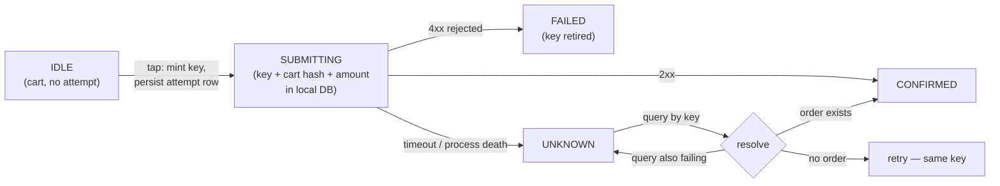
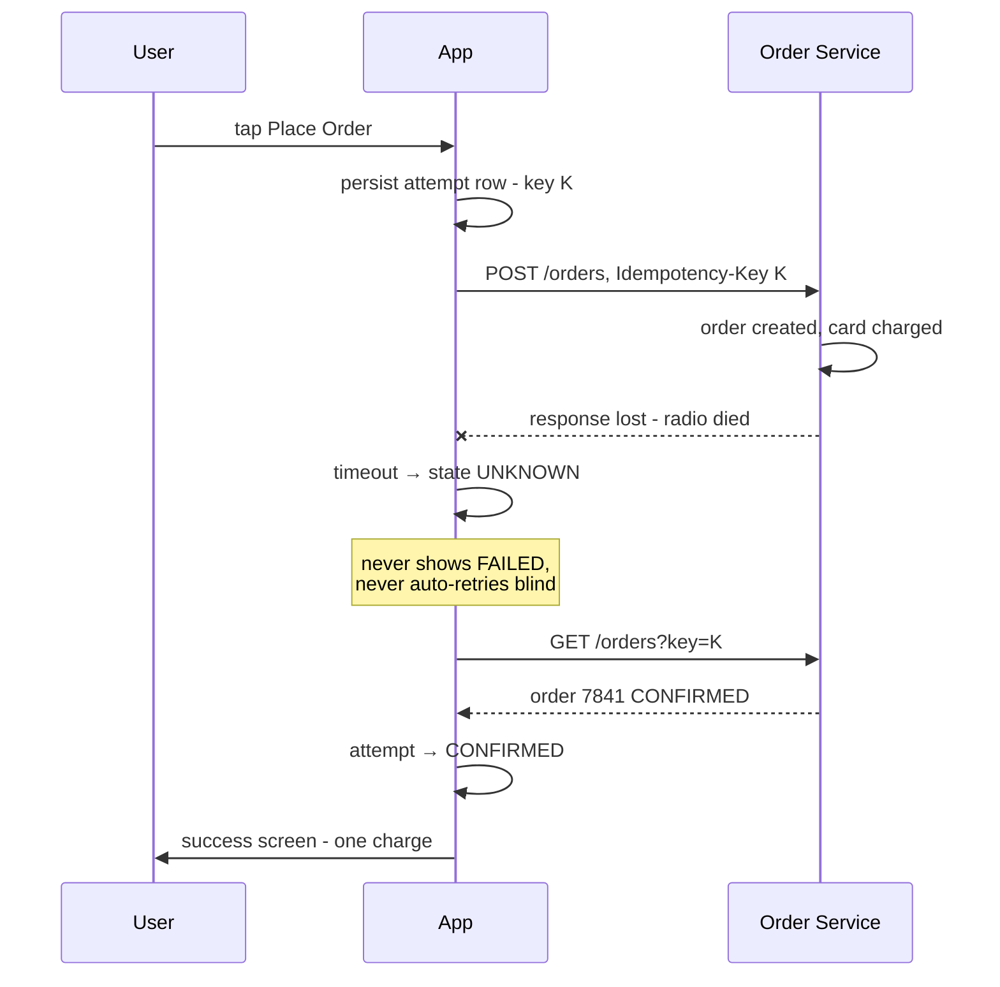

# Mobile 29 — E-commerce Checkout: The Double-Purchase Problem (Amazon/Flipkart)

> **Sources:** Stripe idempotency docs (the industry-standard contract) · weeeBox framework · Educative Grokking Mobile SD (payments chapter outline).
> **Prerequisites:** [01 — The Framework](01-framework.md) · [15 — Stock Trading §4](15-stock-trading-app.md) (the orders plane — this is its retail sibling) · [24 — Hotel Reservation](24-hotel-reservation.md) (the funnel around this note's crux). Backend twins: Deep Dives [14 — Contention](../Deep%20Dives/14-pattern-contention.md), [15 — Multi-Step Processes](../Deep%20Dives/15-pattern-multi-step-processes.md).

## What you'll master

- The **taxonomy of duplicate purchases** — six distinct ways one intent becomes two charges, spanning six orders of magnitude of time.
- Why **every client-side defense reduces frequency but only server-side idempotency eliminates the class** — and how to say that in one sentence.
- The **idempotency key lifecycle**: when it's minted, what it's scoped to, where it lives, when it's allowed to rotate.
- The **unknown-outcome protocol**: timeout ≠ failure; the resolution ladder that makes retry safe.
- The **server side of the contract** you'd negotiate as Staff: dedup table semantics, key TTL, response replay, and the PSP layer beneath.
- The **Staff/EM layer**: zero-tolerance metrics, refund economics, and why the money path gets one hardened lane.

## In the Room

| Decision | Default position | Justification | Revisit trigger |
|---|---|---|---|
| Core defense | **Client-minted idempotency key, persisted before the first network byte; server dedups** | Debounce, retries-off, and single-flight all *reduce* duplicates; only server dedup makes them impossible | — |
| Key scope | **Per order attempt, bound to cart-content hash + amount** | Same cart retried = same key = one order; changed cart = new key = legitimately new purchase | Multi-cart / split-shipment models |
| Timeout handling | **UNKNOWN state → resolve by query, never blind retry, never blind error** | The response can be lost after the charge landed — "failed" is a lie you can't afford | — |
| Retry transport | **No auto-replay queue for purchases; resolution-gated retry only** | The chat outbox retries blindly because messages are cheap to duplicate-and-dedup; purchase retries have a price attached | — |
| Button state | **Derived from the persisted attempt row, not view state** | View state dies with the process; the attempt row is what makes "submitting…" survive a relaunch | — |
| Payment UI | **PSP SDK / platform wallets (Google Pay, Apple Pay)** | PCI scope and 3-DS belong to specialists; you own the order, they own the card | Provider gaps in target markets |

**Experience hooks:** *"Structurally identical to our chat outbox — client-minted ID, persist before network — with one inversion: the outbox retries blindly because a duplicate message costs nothing after dedup, but a duplicate charge costs a refund and a customer. So the purchase path inserts a resolution step before any retry. Same skeleton, opposite reflex."*

## 1. Requirements (~5 min)

- **Functional:** cart → order review → place order → payment (cards + wallets + 3-DS) → confirmation; order history; the review screen shows the exact amount that will be charged.
- **Non-functional:** **exactly-one order per purchase intent — a duplicate charge is a sev-1, not a bug** · order placement survives process death, flaky radio, and impatient users · honest states only (never "failed" when the truth is "unknown").
- **Out of scope:** catalog/search/browse (that's [09](09-news-feed.md)'s skeleton), inventory and pricing engines, fraud/risk scoring (name them).
- **Scope:** client + the API contract the client needs — the contract *is* half this design.

## 2. High-Level — Where Duplicates Are Born

One tap on "Place Order" can become two charges in six distinct ways, spread across six orders of magnitude of time:

| # | Cause | Time scale | Client-side mitigation | Sufficient? |
|---|---|---|---|---|
| 1 | Double-tap on the button | ~100 ms | Single-flight state machine on the attempt | No — fixes milliseconds only |
| 2 | HTTP stack auto-retry (connection died after send) | ~1 s | Disable transport retries for the order POST | No — you don't control every proxy |
| 3 | User retries after a timeout ("error, try again") | 10–60 s | UNKNOWN state + resolution before retry | No — depends on the query answering |
| 4 | Process death mid-submit, user relaunches and re-taps | minutes | Persisted attempt row rebuilds "submitting…" | No — user can still force a fresh try |
| 5 | Two devices / phone + web, same account, same cart | hours | Nothing — the client can't see the other client | **No — client is blind here** |
| 6 | A persisted queue replaying an old purchase | days | Never put purchases in an auto-replay outbox | Only avoids self-inflicted duplicates |

Every row's mitigation is worth doing — each removes real incidents — but **no client-side defense closes the class**, because rows 2, 3, and 5 are invisible to the client. The only complete answer is one layer down: the server treats two requests with the same **idempotency key** as one. Everything above becomes UX polish on top of a correctness guarantee, instead of the guarantee itself.

> **Staff-level insight:** the interviewer is testing whether you reach for the debounce or the invariant. Lead with: *"Debounce reduces incidence; idempotency eliminates the class. I'll do both, but only one of them is the design."* Then spend the deep dive on the key and the resolution protocol, not the button.

## 3. Deep Dive 1 — The Idempotency Key Lifecycle

- **Minted at tap, not at screen entry:** the key represents *this purchase intent*. It's a client-generated UUID written to the local DB in the same transaction as the attempt row — `attempt(key, cart_hash, amount, state=SUBMITTING)` — **before** the first network byte. If the process dies one millisecond later, the relaunch finds the row and knows a purchase may be in flight.
- **Scoped to intent, not to session:** the attempt row stores a hash of cart contents + amount. Same cart retried → same row, same key → the server collapses it to one order. User edits the cart → hash changes → that's a *new intent*, new key. This is the line between "duplicate" (one intent, two requests — must dedup) and "repeat purchase" (two intents — must **not** dedup; buying two of something twice on purpose is allowed).
- **Retired only on terminal state:** the key dies when the attempt reaches CONFIRMED or a *server-acknowledged* FAILED (card declined). A timeout retires nothing — that's UNKNOWN, and UNKNOWN keeps the key alive precisely so the retry is collapsible.
- **The button is a projection of the row:** the ViewModel renders "Place Order" enabled/spinner/disabled from the persisted attempt state. Second taps while SUBMITTING don't debounce-race anything — they hit a state machine that has no transition for them. And because the row is in the DB, relaunching mid-submit shows "confirming your order…" instead of a fresh, dangerous button.

## 4. Deep Dive 2 — The Unknown-Outcome Protocol

The defining scenario — the response is lost *after* the charge landed:

- **Timeout is not failure.** After a send, three truths are possible: never arrived, arrived-and-failed, arrived-and-succeeded. The client cannot distinguish them, so the UI must not claim to: render *"Confirming your order…"*, not an error with a retry button — that error screen is the #1 producer of user-initiated duplicates.
- **The resolution ladder:** query order status by key with backoff → if found, adopt its state; if definitively not found, retry the POST *with the same key* (safe by construction — worst case the original arrives late and the server collapses them); if the query itself keeps failing, stay honestly in UNKNOWN ("we'll notify you") and let push/next-launch resolve it. Escape hatches never include "give up and let the user start over with a fresh key" — that's the duplicate machine.
- **Process death and 3-DS re-entry ride the same rail:** cold start checks for non-terminal attempt rows before rendering checkout; a 3-DS return deep-link does the same. There is exactly one recovery path, so it's the one path you harden and test — the [24 §4](24-hotel-reservation.md#4-deep-dive-2--checkout-holds--payment-the-zero-staleness-zone) discipline, generalized.
- **Transport hygiene underneath:** the order POST runs with transport auto-retries disabled and a generous timeout — you want *your* state machine making retry decisions, not OkHttp's connection-failure heuristic silently double-sending beneath you. (And if a proxy retries anyway — the key has it covered. That's the point of defense-in-depth ordering: the invariant below, the hygiene above.)

## 5. Deep Dive 3 — The Server Side of the Contract (what Staff negotiates)

The client design only works if the API contract holds; as the Staff engineer you drive this contract with the backend team, so know its shape:

- **Dedup semantics:** first request with key K executes and stores `(user, K) → response snapshot`; every subsequent K **replays the stored response** — "replay the receipt, not the side effect." Same key with a *different* payload returns 409/422: that's a client bug (hash collision or scope error) and must be loud, never silently honored.
- **Concurrent duplicates:** two requests with key K in flight simultaneously (row 2 and row 5 of the taxonomy) — the server serializes on the key: second waits or gets 409-in-progress; it never executes twice. This is a uniqueness constraint on the dedup table doing the real work.
- **Key TTL ≥ the client's retry horizon:** if the client may resolve an UNKNOWN attempt 48 hours later (dead battery, airplane), the dedup record must outlive that. Order lookup *by key* should work even longer — dedup TTL bounds double-execution protection; queryability bounds resolution.
- **Two dedup layers, not one:** your order service passes its own idempotency key down to the PSP (Stripe et al. accept one per charge). Order-level dedup stops duplicate *orders*; PSP-level stops duplicate *charges* if your own order service retries internally. Charged-but-order-failed is then a server-side saga/compensation problem ([DD-15](../Deep%20Dives/15-pattern-multi-step-processes.md)) — the client's only job is rendering PENDING honestly and never re-minting the key while the saga settles.
- **Contention is a different problem:** two *different* users (or the same user with two genuine intents) racing for the last unit is [DD-14](../Deep%20Dives/14-pattern-contention.md) — inventory reservation decides, one gets an honest "sold out." Don't let the interviewer blur them: **duplication is one intent twice (dedup by key); contention is two intents, one item (serialize on inventory).** Naming that distinction unprompted is a Staff signal.

## 6. The Staff/EM Layer

- **Zero-tolerance metric (EM):** duplicate-charge rate isn't a KPI to trend, it's an alarm — page on *any* nonzero count. Each duplicate costs a refund, a support ticket, chargeback risk, and a one-star review; trust damage is superlinear in incident count. Pair it with the leading indicator: attempts stuck in UNKNOWN > N minutes.
- **Backstop, but never quietly (EM):** run a server-side detector for same-user-same-amount-same-minute charges that auto-refunds — then treat every firing as a sev-2 on the *prevention* layer. A backstop that silently mops up teaches the system to keep leaking.
- **One hardened lane (EM):** same rule as [24](24-hotel-reservation.md#5-the-staffem-layer) — checkout UI/copy/layout are the paint, experiment freely; the attempt state machine, key lifecycle, and resolution protocol are the plumbing — one path, no flags, changed only with staged rollout gated on payment-success and duplicate-rate dashboards. You can't roll back an APK, so the order POST also carries a server-side kill switch (fail-closed: "checkout is briefly unavailable").
- **The contract is cross-team property (Staff):** key scope, TTL, replay semantics, and the 409 rules live in a written API contract co-owned with backend — because the failure mode of an *informal* idempotency agreement is a backend "cleanup" job that expires dedup rows at 1 hour and reintroduces duplicates for every airplane-mode user. Version it, test it in CI with a replay suite.
- **Build-vs-buy (EM):** card entry, vaulting, 3-DS via PSP SDK and platform wallets — owning PAN handling is PCI-DSS scope for negative differentiation. You own intent and order state; they own the card. One-tap wallets also *shrink the duplicate window* — fewer seconds in checkout, fewer chances to be interrupted.

## Follow-Ups — the Interviewer Escalates

- **"So debounce the button and you're done, right?"** — Debounce fixes the 100-millisecond cause and nothing else. Lost responses, process death, second devices, and transport retries all live at seconds-to-days, invisible to the button. Client defenses lower the incident rate; the server's key-based dedup is what makes the double charge *impossible*. Both, but only one is the guarantee.
- **"User double-taps faster than you can persist the attempt row?"** — The taps are serialized through the ViewModel's state machine on the main thread: tap one transitions IDLE→SUBMITTING (the DB write rides that transition); tap two arrives in SUBMITTING, which has no transition for it. And if some path slips through anyway, both requests carry the same minted key — the server collapses them. Belt, then suspenders.
- **"The HTTP client auto-retried the POST and both copies landed. Walk me through it."** — Both carry key K. The server serializes on K: one executes, the other replays the stored response or gets 409-in-progress and is retried into the replay. One order. Then I'd still disable transport-level retries on this call — the invariant makes duplicates harmless, but hygiene keeps the dedup table from doing routine work.
- **"48 hours later the app comes back online and finds an UNKNOWN attempt. The dedup TTL was 24 h. What happens?"** — This is why I negotiate TTL against the retry horizon, not pick it independently. Resolution queries by key must work past dedup expiry (order lookup, not just dedup lookup). If the order exists → CONFIRMED. If not and the dedup record is gone, a retry is no longer collapse-safe — so the client re-validates the cart and asks the user to confirm *as a new intent* with a new key, explicitly, showing current price and stock. Never silently fire an expired key.
- **"Charge succeeded at the PSP but your order service crashed before writing the order. User sees what?"** — Server-side: a saga with the PSP charge and order write reconciled by a sweeper — charge with no order → void/refund or complete the order, within minutes ([DD-15](../Deep%20Dives/15-pattern-multi-step-processes.md)). Client-side: the resolution query returns PENDING, the UI says "confirming your order — we'll notify you," and push delivers the outcome. The client's contribution to this failure is refusing to invent a fresh attempt while one is unresolved.
- **"Same user on phone and laptop, both hit Buy on the same cart within a second."** — If both clients derived the key from the same server-side cart version, same key → one order, the second device renders the replayed confirmation. If keys differ (independent carts, different hashes), these are two intents — and then it's deliberately *not* deduped; inventory contention rules decide ([DD-14](../Deep%20Dives/14-pattern-contention.md)). The design question the interviewer is really asking: *what defines "same purchase"?* — and my answer is: same cart version + amount, hashed into the key scope.
- **"What do you page on?"** — Any nonzero duplicate-charge count (alarm, not trend), attempts stuck UNKNOWN beyond the resolution SLA, 409-payload-mismatch rate (a client bug shipping), and order-success rate by app version during rollouts — the money path's four vital signs.
- **"Isn't this just two-phase commit? Why not use 2PC?"** — Different problem: 2PC solves *"many parties, one decision"* (atomic commit among cooperative, always-available participants holding locks); this note solves *"one decision, many deliveries"* (the same request arriving twice). A phone can't be a 2PC participant — it can vanish for 48 hours mid-vote — and the PSP won't join your transaction. What I *keep* from 2PC is its recovery discipline: the UNKNOWN state is exactly the in-doubt participant, and resolve-by-query is its recovery protocol — in doubt, ask; never guess. The "many parties" half of checkout (order + charge + inventory) is handled server-side by a saga, which is [30](30-banking-money-transfer.md)'s whole story.

## When NOT / Variants

- **Digital goods / in-app purchase:** StoreKit and Play Billing own the dedup (transaction IDs, acknowledge/consume semantics) — your job shrinks to idempotent *entitlement grant* on your server keyed by their transaction ID. Same invariant, rented implementation.
- **One-click ordering (Amazon's patent-famous flow):** no review screen to absorb hesitation, so the attempt machine gains an **undo window** — order enters a cancellable 10–30 s server-side hold state; the key mechanics underneath are unchanged.
- **Subscriptions:** the duplicate risk moves to *renewal* and is the PSP's problem; the client's problem becomes entitlement caching and grace periods — a different note.
- **Cash-on-delivery / pay-later markets:** no charge at order time, so the cost of a duplicate drops from money to ops (two boxes shipped) — same design, softer pager.

---

## Interview Cheat-Sheet

**30-second architecture:** one purchase intent = one client-minted idempotency key, persisted with a cart-hash-scoped attempt row *before* the first network byte · button state projects the row, so double-taps and process death hit a state machine, not a fresh screen · timeout → UNKNOWN → resolve-by-query, retry only with the same key · server contract: dedup on key, replay the receipt, serialize concurrent duplicates, TTL ≥ retry horizon, PSP key beneath · duplicates page at count = 1.

| Probe | Answer |
|---|---|
| "Why isn't debounce enough?" | It fixes milliseconds; lost responses, relaunches, and second devices live at seconds-to-days — only server dedup closes the class |
| "Timeout on the order POST?" | UNKNOWN, not failed: query by key → adopt the truth; retry same key only if definitively absent; never a fresh key on an unresolved attempt |
| "Duplicate vs. buying twice on purpose?" | Key is scoped to cart-hash + amount: same intent collapses, edited cart is a new intent — dedup must not eat legitimate repeat purchases |
| "Two requests, same key, in flight at once?" | Server serializes on the key — one executes, one replays; a uniqueness constraint does the work, the client just benefits |

**Say-verbatim:**
- *"Debounce reduces incidence; idempotency eliminates the class."*
- *"Persist the key before the first network byte — the attempt must outlive the process that started it."*
- *"Timeout isn't failure — it's UNKNOWN, and UNKNOWN resolves by query, never by guess."*
- *"Replay the receipt, not the side effect."*
- *"Duplication is one intent twice; contention is two intents, one item — different problems, different machinery."*
