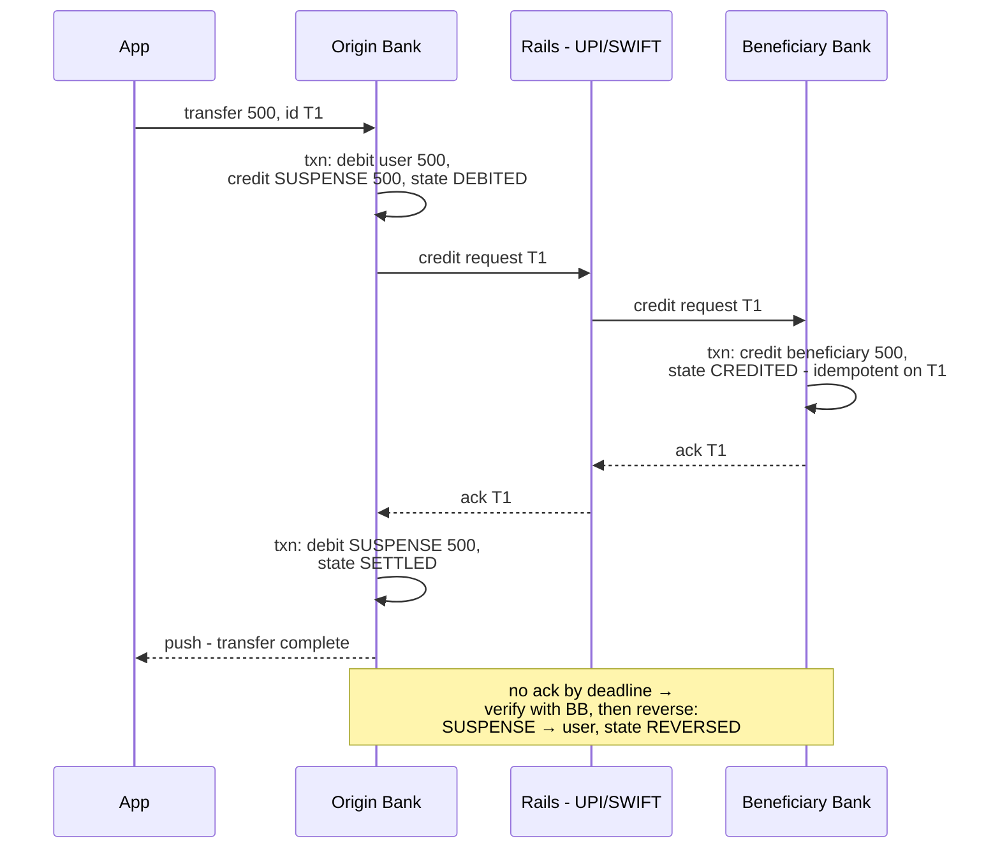

# Mobile 30 — Banking: The Debit–Credit Problem (Money Transfer / UPI / PayPal)

> **Sources:** classic ledger/accounting systems literature (double-entry, DDIA ch. 7/9) · UPI & SWIFT settlement architecture (public docs) · Educative Grokking payment-system chapters (outline).
> **Prerequisites:** [29 — E-commerce Checkout](29-ecommerce-checkout.md) (this note opens up the server side of that one) · [15 — Stock Trading](15-stock-trading-app.md) (fail-closed money). Backend twins: Deep Dives [14 — Contention](../Deep%20Dives/14-pattern-contention.md), [15 — Multi-Step Processes](../Deep%20Dives/15-pattern-multi-step-processes.md), [03 — PostgreSQL](../Deep%20Dives/03-postgresql.md) (the ACID machinery this note leans on).

## What you'll master

- The **conservation invariant** — money is never created or destroyed, only moved — and how the double-entry ledger encodes it structurally instead of procedurally.
- The **two regimes**: one trust boundary → a single ACID transaction; two boundaries → a saga with a suspense account. Knowing *which regime you're in* is most of the answer.
- Why **debit-first is a law, not a preference** — the failure modes of each ordering are not symmetric.
- How this pairs with [29](29-ecommerce-checkout.md): *idempotency solves "one decision, many deliveries"; atomic commit/sagas solve "many parties, one decision."* A real transfer needs both.
- **Reconciliation as a first-class subsystem** — the books must not just balance, they must be *provably* balanced, continuously.
- The **Staff/EM layer**: ledger immutability as a compliance artifact, the sev-0 that is an unbalanced ledger, and why the suspense account gets a pager.

## In the Room

| Decision | Default position | Justification | Revisit trigger |
|---|---|---|---|
| Data model | **Append-only double-entry ledger; balance is a derived (cached) aggregate** | Every move is two entries that sum to zero — imbalance becomes structurally impossible, and the audit trail is the data | — |
| Corrections | **Reversing entries, never UPDATE/DELETE** | Auditors and regulators read the journal; mutating history is a compliance finding, not a refactor | — |
| Same-bank transfer | **One ACID transaction: lock both accounts (ordered), check funds, write both entries** | One trust boundary = the DB's serialization machinery is exactly the right tool | Accounts sharded apart → saga regime |
| Cross-boundary transfer | **Saga: debit into suspense → message → credit → ack; timeout → reverse** | The other bank won't join your transaction ([2PC needs cooperative participants](#5-deep-dive-3--cross-boundary-the-saga-and-the-suspense-account)) | — |
| Ordering | **Debit before credit, always** | Failed-after-debit = held money (recoverable); failed-after-credit = created money (a gift) | — |
| Duplicate delivery | **Client-minted transfer ID, dedup by unique constraint — the [29](29-ecommerce-checkout.md) spine verbatim** | Same radio, same relaunches, same second devices | — |
| Hot accounts | **Serialize debits per account; credits may append async** | Debits need the overdraft check (order matters); credits are commutative (order doesn't) | Overdraft-capable products |

**Experience hooks:** *"The client half is literally my note-29 machine — persisted attempt, UNKNOWN, resolve-by-query. What changes is behind the API: the single write fans out into a debit and a credit that must move together, so idempotency alone stops being sufficient and the transaction-or-saga question becomes the design."*

## 1. Requirements (~5 min)

- **Functional:** P2P transfer (same bank + other banks/UPI), balance + transaction history, transfer status tracking, scheduled/recurring out of scope but named.
- **Non-functional:** **no money created, destroyed, double-debited, or double-credited — ever, under any failure** · every transfer reaches a terminal state (completed or fully reversed) in bounded time · every anomaly is *detectable* by reconciliation, not just hopefully absent · status shown to the user is honest (PENDING is a real state, not an apology).
- **Scope:** the transfer path end-to-end — client attempt machine (briefly; it's [29](29-ecommerce-checkout.md)) and the server's ledger + transaction/saga machinery (the new material).

## 2. High-Level — One Invariant, Two Regimes

The whole domain reduces to one invariant: **the sum of all ledger entries is zero.** A transfer is a debit entry and a credit entry that must move *together* — and how you make them move together depends entirely on whether one database can see both accounts:

| | Regime A — one trust boundary | Regime B — two boundaries |
|---|---|---|
| Example | Both accounts in one bank, one DB | Cross-bank, UPI, cross-shard, PSP involved |
| Tool | **Single ACID transaction** | **Saga + suspense account + reconciliation** |
| Atomicity | The database's — free, real, isolated | Manufactured — compensations, visible intermediate states |
| Failure feel | All-or-nothing, invisible | PENDING states the user can see; sweepers finish the job |
| 2PC's place | Happily *inside* the DB's own machinery | Rejected across the boundary — the other side won't hold your locks |

> **Staff-level insight:** interviewers watch whether you ask *"same database or not?"* before designing. Answering with a saga when both accounts share a Postgres instance is over-engineering; answering with `BEGIN…COMMIT` across two banks is fantasy. Say it explicitly: *"Atomicity is free inside one trust boundary and manufactured across two — so my first question is where the boundary is."*

## 3. Deep Dive 1 — The Double-Entry Ledger (the data model is the invariant)

- **Entries, not balances, are the truth.** The journal is append-only: `entry(txn_id, account, amount, direction, created_at)`, written in pairs (or legs) that sum to zero per transaction. The account balance is a *derived* value — a cached aggregate (materialized running total), rebuildable from the journal. `UPDATE accounts SET balance = balance - 500` as the primary record is the bug factory: no history, no audit, lost updates under concurrency, and no way to *prove* correctness after the fact.
- **Corrections are reversing entries.** Sent to the wrong account? You don't delete — you append the inverse pair. The journal only grows; what auditors and regulators certify is precisely that history cannot be rewritten. This is compliance encoded as a schema property.
- **The overdraft check is why debits serialize.** `balance ≥ amount` must be evaluated and acted on atomically per account — two concurrent ₹800 debits on a ₹1,000 balance must not both pass the check. So debits per account are serialized: a row lock (`SELECT … FOR UPDATE` on the balance row) or a single-writer queue per account. **Credits need no such check — they're commutative** — which is the escape valve for hot accounts: a merchant receiving thousands of credits per second appends them async in any order, while its (rare) debits briefly serialize. Say that asymmetry out loud; it's a Staff signal.
- **Idempotency plugs in as a unique constraint:** the transfer row carries the client-minted transfer ID (the [29 §3](29-ecommerce-checkout.md#3-deep-dive-1--the-idempotency-key-lifecycle) key); `INSERT … ON CONFLICT` makes duplicate delivery collapse *inside the same transaction* that moves the money. Dedup and atomicity land in one place.

## 4. Deep Dive 2 — Regime A: Same Boundary, One Transaction

The happy case, and worth doing crisply because interviewers probe it for concurrency literacy:

```sql
BEGIN;
  -- lock in ACCOUNT-ID ORDER, not transfer order: prevents deadlock
  SELECT balance FROM accounts WHERE id IN (:low_id, :high_id) FOR UPDATE;
  -- check funds; insert transfer row (UNIQUE on transfer_id → dedup);
  -- append debit entry + credit entry; update both cached balances
COMMIT;
```

- **Lock ordering:** transfer A→B and transfer B→A arriving simultaneously each lock "their" debit account first → deadlock. Always acquire locks in a global order (ascending account ID); the transfer direction is irrelevant to lock order. This one sentence is a classic probe.
- **Everything inside one envelope:** funds check, dedup insert, both entries, both balance updates — commit is all-or-nothing, and crash-at-any-point leaves either a complete transfer or nothing. This is the regime where the ACID machinery ([DD-03](../Deep%20Dives/03-postgresql.md)) earns its keep, and where 2PC-style coordination legitimately lives — *inside* the database's own commit protocol, invisible to you.
- **The client still can't tell commit-then-lost-response from failure** — same UNKNOWN as ever; the resolve query reads the transfer row. Atomicity fixed the server's books, not the radio.

## 5. Deep Dive 3 — Regime B: Cross-Boundary — the Saga and the Suspense Account

The other bank will not `BEGIN` a transaction with you. So atomicity is manufactured as a **saga**: an ordered sequence of local transactions, each idempotent, with compensations — and the money in flight lives in a **suspense (settlement) account** so the books balance at every instant:



- **Debit-first is a law.** Compare the failure modes: debit-then-crash leaves money *held* in suspense — the user is briefly short ₹500, and a sweeper reverses it (annoying, recoverable, apologizable). Credit-then-crash leaves money *created* — the beneficiary has ₹500 the sender still also has (unrecoverable without clawback, and clawback from an external account is a legal process, not an API call). **When a step must fail, fail toward holding money, never toward minting it.** This is fail-closed ([15](15-stock-trading-app.md)) applied to ordering.
- **The suspense account keeps the invariant continuously true.** Without it, "debited but not yet credited" is money that exists nowhere — the ledger sums to −500 and reconciliation screams. With it, in-flight money has an address, its *age* is measurable, and "suspense balance older than SLA" becomes the pager line that catches every stuck transfer mechanically.
- **Every step idempotent, every message retried.** The rails deliver at-least-once; the beneficiary bank credits idempotently on T1 (their side of the [29 §5](29-ecommerce-checkout.md#5-deep-dive-3--the-server-side-of-the-contract-what-staff-negotiates) contract). The saga's sweeper re-drives stuck states: no ack → *query* the beneficiary ("did T1 land?") **before** compensating — reversing a transfer that actually credited is how you create money's evil twin, a double-*credit*. Resolve-don't-guess, one level up.
- **Why not 2PC across the banks?** Two-phase commit needs participants that vote, hold locks while in doubt, and reliably return. The counterparty is another company on rails that batch and retry; a blocking protocol across that boundary would let one slow bank freeze rows in yours. So the industry answer everywhere real money crosses boundaries — UPI, card networks, SWIFT — is exactly this shape: **asynchronous messages + idempotent application + suspense accounting + reconciliation + periodic net settlement.** What survives from 2PC is its recovery *discipline*: in doubt, ask; never guess.
- **The client renders the saga honestly:** DEBITED shows as "processing — money has left your account," with the balance reflecting the hold immediately (users check!). Terminal states arrive by push; the attempt machine is [29 §4](29-ecommerce-checkout.md#4-deep-dive-2--the-unknown-outcome-protocol) unchanged.

## 6. The Staff/EM Layer

- **Reconciliation is a subsystem, not a script (Staff):** continuous invariant checks — journal sums to zero, cached balances match recomputed aggregates, suspense entries young — plus daily cross-institution file matching against the rails. Design principle: *every* failure mode must be reconciliation-visible. A bug you can detect and repair by day's end is an incident; one you can't detect is a solvency question.
- **The sev-0 taxonomy (EM):** unbalanced ledger = sev-0, stop-the-line. Suspense entry past SLA = page. Saga stuck-state count, reversal rate, and duplicate-collapse rate = dashboards. Note what's *absent*: latency. A transfer that takes an hour and lands exactly once beats one that's instant and ambiguous — say that priority order in the room.
- **Immutability is a compliance artifact (EM):** the append-only journal *is* the audit deliverable; retention, tamper-evidence (hash-chaining if pushed), and "corrections as reversing entries" are what the regulator certifies. Schema decisions here are legal decisions — the EM owns knowing that.
- **Fail-closed, with honesty (EM):** rails degraded → refuse new transfers ("transfers are temporarily unavailable — your money is safe") rather than queue ambiguity. Same posture as [15](15-stock-trading-app.md): for money, availability is the feature you sacrifice first.
- **Limits as blast-radius control (EM):** per-transaction and daily caps, velocity checks, step-up auth over thresholds — they bound the cost of *any* bug or fraud to a known ceiling. Limits are not (just) a fraud feature; they're the error budget of the money path.
- **Build-vs-buy (EM):** you join rails (UPI, ACH, SWIFT, card networks) — you don't rebuild them. The buildable, differentiating layer is your ledger, your saga orchestration, your reconciliation, and your client experience. Own the books; rent the rails.

## Follow-Ups — the Interviewer Escalates

- **"Why not just UPDATE both balances in one transaction and skip the ledger ceremony?"** — It moves the money but destroys the proof: no history, corrections become mutations, and when (not if) a bug hits, you can't establish what the balance *should* be. The ledger isn't bookkeeping nostalgia — it's the property that makes every later question ("is the system correct *right now*?") answerable by a query.
- **"Two ₹800 debits race on a ₹1,000 balance."** — Both must pass through the per-account serialization point — row lock or single-writer queue — so the second sees ₹200 and fails the funds check. The subtle half of the answer: only *debits* need this; credits are commutative and can append concurrently — that asymmetry is what keeps hot merchant accounts fast.
- **"Debit committed, then the beneficiary bank is down for six hours."** — Money sits in suspense, state DEBITED; the user sees "processing" and a balance that already reflects it. The sweeper retries; past the SLA it first *queries* the beneficiary (never blind-reverses), then compensates: suspense → user, state REVERSED, push notification. Bounded, visible, apologizable — and the suspense-age alarm caught it long before support tickets did.
- **"Why is credit-first wrong if compensations exist either way?"** — The compensations are not symmetric. Reversing a debit is moving *your held* money back — an internal transaction you can always execute. Clawing back a credit is retrieving money from *someone else's* account, possibly at another bank, possibly already spent — an interbank dispute process with a failure mode of simply losing. Fail toward holding, never toward minting.
- **"The ack from the beneficiary was lost — your sweeper wants to reverse, but the credit actually landed."** — This is why the compensation path *starts with a query*, not a reversal: ask the beneficiary bank for T1's status (their idempotency record answers). Only a confirmed-absent credit is safe to reverse. Blind compensation on timeout is the saga equivalent of blind retry on timeout — [29](29-ecommerce-checkout.md)'s sin, mirrored.
- **"Same user fires the transfer twice — app relaunch, both requests land."** — Client-minted transfer ID → unique constraint on the transfer row → second insert collapses into reading the first's state, inside the same transaction that moves money. One debit, one credit, one receipt replayed. Idempotency and atomicity answering *together* is the whole point of the pairing with note 29.
- **"Where would you actually accept two-phase commit?"** — Inside one trust domain: across my own shards with an XA-capable store, or implicitly inside a distributed database's own commit protocol. The moment a participant is another company, a mobile client, or anything that can vanish while holding my locks, I switch to saga + suspense + reconciliation — and keep only 2PC's recovery discipline: in doubt, ask.

## When NOT / Variants

- **Card payments:** two-phase by *product design* — authorize (hold) at purchase, capture at fulfillment — a business-level hold-then-commit that maps neatly onto the suspense idea; voids and refunds are the compensations.
- **Wallet top-up / withdrawal:** one leg is external rails (regime B), the internal wallet leg is regime A — most fintechs are exactly this hybrid, one saga wrapping one clean transaction.
- **Cross-currency:** an FX conversion leg joins the saga with a *rate quote TTL* — the [24](24-hotel-reservation.md) hold pattern applied to a price instead of a room.
- **Crypto/on-chain:** the chain gives you atomicity and the ledger, but finality is probabilistic and compensations don't exist — the suspense state becomes "confirmations," and irreversibility moves your entire risk budget to *before* submission.

---

## Interview Cheat-Sheet

**30-second architecture:** append-only double-entry ledger, balances derived, corrections are reversing entries · same boundary → one ACID transaction (ordered locks, funds check + dedup + both entries in one commit) · cross-boundary → saga: debit into suspense → idempotent credit message → ack → settle; timeout → query-then-reverse · debit-first always · client is the note-29 attempt machine; PENDING is honest · reconciliation runs continuously; unbalanced ledger is sev-0.

| Probe | Answer |
|---|---|
| "Atomicity across two banks?" | You don't get it — you manufacture it: saga + suspense account + idempotent steps + reconciliation; 2PC dies at the trust boundary |
| "Deadlock on A→B and B→A?" | Lock in global account-ID order, not transfer order — direction never dictates lock order |
| "Crash between debit and credit?" | Money is in suspense, not gone: sweeper queries the far side, then completes or reverses; suspense-age alarm catches it mechanically |
| "Hot merchant account?" | Serialize only the debits (overdraft check needs order); credits are commutative — append them async |

**Say-verbatim:**
- *"Atomicity is free inside one trust boundary and manufactured across two — my first question is where the boundary is."*
- *"Debit-first is a law: fail toward holding money, never toward minting it."*
- *"The suspense account gives in-flight money an address — and its age is my best alarm."*
- *"Idempotency solves 'one decision, many deliveries'; the saga solves 'many parties, one decision' — a transfer needs both."*
- *"For money, latency is the first thing I sacrifice: slow-and-exactly-once beats instant-and-ambiguous."*
