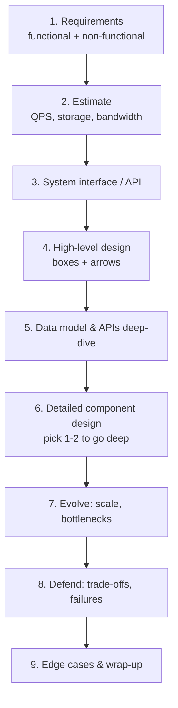

# System Design Mastery — Staff Engineer / Senior EM / Head of Engineering

> Your single-source study course. Built to be read over days and months until the concepts are reflexes.
> Every module is self-contained, diagram-driven (mermaid), and written for the **interview**, not just theory.

---

## How to use this course

This is **not** a skim. Treat each module as a 2–4 hour deep session. The goal is that you can:

1. **Explain** any concept on a whiteboard with a diagram, in 2 minutes.
2. **Compare** alternatives with a crisp trade-off ("I'd pick X over Y here because…").
3. **Design** any of the 30+ classic systems end-to-end in 35–45 minutes.
4. **Lead** the architecture conversation — talk cost, org impact, build-vs-buy, and risk like a Staff Engineer / Director.

### The three passes

| Pass | Goal | How |
|------|------|-----|
| **Pass 1 — Breadth** | Understand every concept once | Read modules 01–17 in order. Don't memorize; build the mental map. |
| **Pass 2 — Depth** | Internalize trade-offs & numbers | Re-read the "Staff-level insight" callouts + cheat-sheets. Redraw the diagrams from memory. |
| **Pass 3 — Application** | Design under time pressure | Do module 18 problems. Time yourself. Speak aloud. |

---

## How this repo is organized

| Folder | What's inside |
|---|---|
| **Core Course/** | The 70 numbered modules (01–58 incl. the 02b/13b/17b/19b L6 companions and the 41 multiplayer / 42 cluster-scheduler / 43 calendar / 44 news aggregator / 45 live comments / 46 online judge / 47 Yelp / 48 online auction / 49 Strava / 50 price tracker / 51 post search / 52 chess / 53 ChatGPT / 54 Tinder / 55 code assistant / 56 ML data platform / 57 Quora / 58 TikTok archetypes) — the main curriculum mapped below |
| **[Deep Dives/](Deep%20Dives/00-INDEX.md)** | Technology deep dives (Redis→ClickHouse), the patterns series, and the applied case studies (CS-23–33: money path + analytics/ranking/typeahead + the journey walkthrough + quick commerce + the message-queue build + the messaging mastery bar) |
| **[Mobile System Design/](Mobile%20System%20Design/00-INDEX.md)** | The Google EM/Staff client-side track: framework + foundations + 19 case studies |

---

## Course map

### Foundations
- **[01 — System Design Fundamentals](Core%20Course/01-fundamentals.md)** — scalability, networking, APIs, storage taxonomy, schema/index/shard/replicate
- **[02 — Distributed Systems](Core%20Course/02-distributed-systems.md)** — consistency models, CAP/PACELC, consensus (Raft/Paxos), transactions (2PC/Saga), fault tolerance
- **[02b — Multi-Region Deployment & Static Stability](Core%20Course/02b-multi-region-resilience.md)** 🟩 — the write-topology ladder (home entities, don't merge), LWW/CRDT/consensus by conflict surface, anycast + edge PoPs, static stability (N+1 capacity, no control-plane on the failover path), the fiber-cut drill
- **[03 — Caching](Core%20Course/03-caching.md)** — cache layers, patterns (aside/through/back), invalidation, stampede, hot keys, Redis vs Memcached
- **[04 — Messaging & Event-Driven Systems](Core%20Course/04-messaging-event-driven.md)** — queues, pub/sub, event sourcing, CQRS, Kafka/Pulsar/Kinesis, delivery & ordering guarantees
- **[05 — Load Balancing](Core%20Course/05-load-balancing.md)** — L4 vs L7, algorithms, consistent hashing, global LB, anycast, traffic steering

### Data layer
- **[06 — Database Deep Dive](Core%20Course/06-databases.md)** — Postgres/MySQL/Mongo/Cassandra/DynamoDB, replicas, sharding, query optimization, SQL-vs-NoSQL framework
- **[07 — Search Systems](Core%20Course/07-search.md)** — inverted index, ranking/relevance, Elasticsearch/OpenSearch/Solr, autocomplete, fuzzy
- **[08 — Storage Systems](Core%20Course/08-storage.md)** — object/block/file, S3 internals, HDFS/GFS, durability vs availability vs cost

### Systems behaviors
- **[09 — Real-Time Systems](Core%20Course/09-realtime-systems.md)** — WebSockets/MQTT/long-poll, presence, typing/read-receipts, push (APNS/FCM), chat delivery *(real-time systems)*
- **[10 — Microservices](Core%20Course/10-microservices.md)** — DDD, bounded contexts, service mesh, sidecars, discovery, distributed tracing
- **[11 — Reliability Engineering](Core%20Course/11-reliability.md)** — SLA/SLO/SLI, MTBF/MTTR, RTO/RPO, circuit breakers, rate limiting, chaos
- **[12 — Observability](Core%20Course/12-observability.md)** — metrics/logs/traces, Prometheus/Grafana/OTel, error budgets, on-call
- **[13 — Security](Core%20Course/13-security.md)** — OAuth/OIDC/JWT, RBAC/ABAC, encryption, secrets, OWASP, DDoS
- **[13b — Data Compliance, Erasure & Regional Storage](Core%20Course/13b-data-compliance-privacy.md)** 🟩 — GDPR erasure mechanics (crypto-shredding vs physical purge, Kafka/LSM tombstones + compaction SLAs), deletion as an audited workflow, residency tags + geo-fenced replication, the global-feature menu

### Strategy & modern
- **[14 — Cloud Architecture](Core%20Course/14-cloud.md)** — AWS/GCP/Azure building blocks, multi-cloud, hybrid
- **[15 — Architecture Patterns](Core%20Course/15-architecture-patterns.md)** — monolith → modular monolith → microservices, EDA, serverless, hexagonal, CQRS, event sourcing
- **[16 — Data Processing](Core%20Course/16-data-processing.md)** — batch vs stream, Spark/Flink/Kafka Streams, ETL/ELT, lambda/kappa
- **[17 — AI Systems Design](Core%20Course/17-ai-systems.md)** — RAG, vector DBs, embeddings, agents, tool calling, memory, evals, LLM caching & cost
- **[17b — Practical ML & Serving Infrastructure at Scale](Core%20Course/17b-ml-serving-infrastructure.md)** 🟩 — the recsys serving round: feature stores + point-in-time correctness (training-serving skew), dynamic batching + SLA fallback cascades, HNSW vs IVF-PQ and embedding updates as versioned artifacts, canary-by-metric

### The interview itself
- **[20 — Staff-Level Execution: how to *perform* in the room](Core%20Course/20-staff-execution.md)** ⭐ — the meta-skill layer: altitude control, decisiveness over option-listing, earmarking the risk crux, YAGNI, leveraging experience, the anti-patterns that cap you at senior. **Read this early and re-read before every mock.**
- **[18a — Design Problems: Chat & Social](Core%20Course/18a-design-chat-social.md)** — WhatsApp, Slack, Instagram, Twitter/X, Facebook Feed, LinkedIn
- **[18b — Design Problems: Media & Productivity](Core%20Course/18b-design-media-productivity.md)** — YouTube, Netflix, Spotify, Zoom, Google Docs, Dropbox, Gmail
- **[18c — Design Problems: Marketplaces & Money](Core%20Course/18c-design-marketplace-money.md)** — Uber/Ola, food delivery, hotel booking, e-commerce, payments, ads, recommendations
- **[18d — Design Problems: Infra Primitives](Core%20Course/18d-design-infra-primitives.md)** — URL shortener, Pastebin, rate limiter, notifications, distributed cache, API gateway, search engine, logging/monitoring
- **[19 — Engineering Leadership & Trade-offs](Core%20Course/19-leadership-tradeoffs.md)** — Conway's law, team topologies, platform eng, build-vs-buy, multi-tenancy, tech-debt, cost-vs-everything
- **[19b — Engineering Operations, Unit Economics & API Contracts](Core%20Course/19b-engineering-operations-economics.md)** 🟩 — $/QPS at the whiteboard, storage lifecycle + egress levers, spot/reserved ladder, team-to-team gRPC/SLO contracts (dependency-SLO arithmetic, retry budgets), on-call math, cells + shuffle sharding, the toil ladder

### Build-from-scratch, foundations & the Google EM track 🟦
> Added for the **Google Engineering Manager** loop. Google's SD round explicitly rewards *building primitives from scratch* (their #1 rule: avoid "use a standard database and query it"), reasoning like their own papers, distributing a computation over many machines, and OS/networking depth — plus they sometimes ask low-level/OOD design. Valuable for any senior interview; **essential for Google**.
- **[21 — Build From Scratch](Core%20Course/21-build-from-scratch.md)** — design a KV store, storage index, replicated log, queue, cache, blob store, ID generator, lock service from first principles. *Google's single biggest differentiator.*
- **[22 — Google Foundational Papers](Core%20Course/22-google-papers.md)** — GFS, Bigtable, MapReduce, Spanner/TrueTime, Chubby, Dynamo, Dapper, Borg — what each invented and how to invoke it live.
- **[23 — Distributing a Computation](Core%20Course/23-distributed-computation.md)** — MapReduce from scratch: partition, coordinate, stragglers, the shuffle, aggregation.
- **[24 — OS & Concurrency](Core%20Course/24-os-concurrency.md)** — processes/threads, mutex/semaphore/monitor, deadlock, scheduling, epoll/C10M, lock-free — the CS layer pure SD prep skips.
- **[25 — How the Internet Really Works](Core%20Course/25-internet-networking.md)** — BGP/anycast, DNS path, TCP/TLS/QUIC, HTTP/2-3, the edge, cross-DC fabric, packet-to-PoP.
- **[26 — Google SD Playbook](Core%20Course/26-google-sd-playbook.md)** ⭐ — Google's exact rubric operationalized: clarify ambiguity → build-from-scratch → deep-dive 2 components → detect-and-defend failure → coherent design beats "correct" tradeoff, with the full NFR checklist (incl. cross-DC/privacy/legal/geographic). **Read 30 min before a Google SD round.**
- **[27 — Low-Level / OOD Design](Core%20Course/27-low-level-design.md)** — SOLID, design patterns, class/interface design, worked LLD (parking lot, elevator, ticket booking, rate limiter).

### Staff-depth supplements (gap-fillers) 🟩
> Built to close the highest-signal gaps that even strong, popular system-design courses tend to under-teach.
- **[28 — Designing for Failure](Core%20Course/28-designing-for-failure.md)** — metastable failure, retry storms, control-plane/data-plane static stability, cell-based architecture + shuffle sharding, graceful degradation, chaos, blameless postmortems.
- **[29 — Geospatial Systems](Core%20Course/29-geospatial-systems.md)** — geohash vs S2 vs QuadTree vs R-tree, proximity/kNN, Contraction-Hierarchies routing, real-time location ingestion, dispatch/matching + surge (Maps/Yelp/Uber).
- **[30 — Capacity Estimation Masterclass](Core%20Course/30-capacity-estimation.md)** — the corrected BOTEC method (kills the DAU-as-RPS error), read:write split, peak factor, Little's Law, cache hit-ratio, replication/headroom, egress cost — with worked drills.

### Advanced design playbooks 🟪
> Hard Staff/Principal problems most courses skip — added after a gap analysis of the major prep resources.
- **[31 — Matching Engine / Stock Exchange](Core%20Course/31-design-matching-engine.md)** — the limit order book, price-time priority, single-writer determinism (LMAX Disruptor), event-sourced recovery, microsecond latency, market-data fan-out. The classic low-latency problem.
- **[32 — Large-Scale Migrations](Core%20Course/32-migrations.md)** — expand→migrate→contract, dual-write + backfill + verify + cutover, online schema change (gh-ost), live resharding, CDC migration, strangler fig — reversible at every step.
- **[33 — Code Deployment System](Core%20Course/33-design-deployment-system.md)** — deployment strategies, automated canary analysis, ring rollout + blast radius, rollback-with-migrations, supply-chain integrity (SLSA), P2P binary distribution, statically-stable control plane.
- **[34 — Real-Time Analytics / Ad-Click Aggregation](Core%20Course/34-design-realtime-analytics.md)** — ingestion firehose, windowed stream aggregation, exactly-once-*effect* counting (HLL/Count-Min), lambda vs kappa, OLAP serving (Druid/Pinot/ClickHouse).
- **[35 — Distributed Job Scheduler / Cron at Scale](Core%20Course/35-design-scheduler.md)** — due-time index, exactly-once *execution* (idempotency + fencing), leader election, cron thundering herd, DAG workflows (Temporal/Airflow).
- **[36 — Live Streaming](Core%20Course/36-design-live-streaming.md)** — RTMP/SRT/WebRTC ingest, real-time transcode, LL-HLS vs WebRTC latency, millions-of-viewers fan-out (contrast with VOD).
- **[37 — Feature Flags & Experimentation](Core%20Course/37-design-feature-flags.md)** — edge/in-SDK flag eval (fail-static), consistent bucketing, the A/B stats engine, kill switches.
- **[38 — Collaborative Whiteboard](Core%20Course/38-design-collaborative-whiteboard.md)** — CRDT (SEC), server-authoritative vs local-first, presence/cursors, infinite-canvas spatial scaling.
- **[39 — IoT / Telemetry Ingestion](Core%20Course/39-design-iot-ingestion.md)** — C10M MQTT connectivity, write firehose, time-series storage + cardinality, device management.
- **[41 — Multiplayer Game Backend](Core%20Course/41-design-multiplayer-game.md)** — server-authoritative tick loop; the four netcode techniques (prediction/reconciliation/interpolation/lag-compensation); UDP + interest management; dedicated ephemeral game-server fleet from a warm pool.
- **[42 — Cluster Scheduler (Kubernetes/Borg)](Core%20Course/42-design-cluster-scheduler.md)** — declarative desired state + level-triggered reconciliation; the scheduler's filter→score→bind with bin-pack-vs-spread; preemption/priority/quotas; etcd as the brain and the cluster-size ceiling; static stability.
- **[43 — Calendar System (Google Calendar/Outlook)](Core%20Course/43-design-calendar.md)** — store the recurrence rule not the instances (expand on read); timezone + DST correctness (local + IANA zone); free/busy interval-overlap; invitation fan-out + RSVP; rooms as contended resources.
- **[44 — News Aggregator (Google News)](Core%20Course/44-design-news-aggregator.md)** — not a social feed: precompute per topic × region segment + thin per-user re-rank; adaptive polling + WebSub; SimHash dedupe + embedding/entity story clustering with batch merge/split; freshness × authority × velocity ranking; CDN-served segment pages.
- **[45 — Live Comments (Facebook Live)](Core%20Course/45-design-live-comments.md)** — tiny writes, huge fan-out: per-video pub/sub, SSE gateways consistent-hashed by video onto a popularity-scaled subset, per-viewer sampling/ranking cap (~10/s), best-effort delivery, reactions as aggregated counters.
- **[46 — Online Judge (LeetCode)](Core%20Course/46-design-online-judge.md)** — async judge (202 → priority lanes → workers); per-job Firecracker/gVisor sandbox with every control mapped to an attack; CPU-time on pinned cores for fair verdicts; calendar-driven contest pre-scaling; sorted-set leaderboard.
- **[47 — Yelp (Local Search & Reviews)](Core%20Course/47-design-yelp.md)** — static entities so no location firehose: one ES query for geo + text + filters, ranked by BM25 × distance decay × Bayesian rating; one-review-per-user unique constraint; atomic rating_sum/review_count in the review txn; geohash-cell query cache.
- **[48 — Online Auction (eBay)](Core%20Course/48-design-online-auction.md)** — bid log is the truth: conditional-write bids by default, single-writer Kafka partition per hot auction; proxy bidding as top-two maxima; server-receipt-time close rule, fenced idempotent close, soft close; payment saga with second-chance offer.
- **[49 — Strava (Fitness Tracking)](Core%20Course/49-design-strava.md)** — not a location firehose: offline on-device recording + one presigned file upload (local outbox, idempotency key); async pipeline (clean → stats → segment match → leaderboards → feed); segment matching as S2-cell inverted index + ordered alignment; per-(segment, bucket) sorted sets; privacy zones trimmed on read.
- **[50 — Price Tracker (camelcamelcamel)](Core%20Course/50-design-price-tracker.md)** — the fetch budget is the constraint: priority scheduler (watchers × volatility × staleness, tiered SLOs); change-only price history + precomputed charts; alerts as a per-product range query by target price, fire-on-crossing with hysteresis; confirmation fetch before large-drop alerts.
- **[51 — Facebook Post Search](Core%20Course/51-design-post-search.md)** — build the index yourself: Kafka-fed term-sharded posting lists (time + likes-bucket), like coalescing with log-threshold index updates + exact re-rank of candidates, rarest-term-first intersection, capped hot lists + cold tier.
- **[52 — Online Chess](Core%20Course/52-design-online-chess.md)** — one owning server per game, moves appended to a durable log before ack (replay on failover under a fenced lease), server-side clocks with bounded lag compensation, rating-window matchmaking with atomic pair-claim, idempotent Glicko-2 updates.
- **[53 — ChatGPT-style LLM Chat](Core%20Course/53-design-chatgpt.md)** — GPU tokens/s as the budget: context-window prompt building, token-bucket admission + priority with deadlines + degradation ladder, prefix-cache-affine routing, continuous batching + paged KV cache, resumable SSE via a per-message token buffer, message tree for regenerate/edit.
- **[54 — Tinder](Core%20Course/54-design-tinder.md)** — one row per unordered pair makes mutual-swipe matches exact under any race; precomputed ranked stacks from geo + mutual-preference queries, Bloom-filter seen-filtering, async refill; coarsened distances against trilateration.
- **[55 — AI Code Assistant (Copilot-style)](Core%20Course/55-design-code-assistant.md)** — two paths: a 300 ms inline-completion path (client debounce/cancel/cache, fill-in-the-middle context, small model, prefix caching) and a retrieval-backed chat path (per-tenant repo index); quality by acceptance + retained code; tenant isolation.
- **[56 — Data Platform for AI/ML](Core%20Course/56-design-ml-data-platform.md)** — raw → cleaned → curated zones in an open table format; one feature definition materialized offline + online; point-in-time joins against leakage; catalog, lineage and quality gates; deletion vs reproducibility.
- **[57 — Quora (Q&A Platform)](Core%20Course/57-design-quora.md)** — long-tail, search-driven reads served from cache/CDN; answer ranking by evidence-adjusted quality (Wilson bound, exposure, voter credibility); duplicate-question detection and merge; pull-based topic feed; vertical partitioning before sharding.
- **[58 — TikTok (Short-Video Backend)](Core%20Course/58-design-tiktok.md)** — no fan-out: a per-request recall → filter → pre-rank → rank → re-rank funnel with a budget per stage; seconds-fresh feedback loop; staged exploration for cold start; prefetch for instant playback.

### Deep Dives — technology-specific mastery 🟨
> One technology per note, at the depth interviewers probe when you name-drop it. Sourced from the best deep-dive videos/articles, distilled into the course format. See the **[Deep Dives index](Deep%20Dives/00-INDEX.md)**.
- **[DD-01 — Redis](Deep%20Dives/01-redis.md)** — single-threaded atomicity, durability contract (RDB/AOF), cluster hash slots + hash tags, the 7 use cases (cache, lock, leaderboard, rate limiter, geo, streams, pub/sub), hot keys.
- **[DD-02 — Kafka](Deep%20Dives/02-kafka.md)** — the partitioned-log mental model, partition-key choice (ordering vs parallelism vs hot spots), ISR/acks durability, consumer groups & commit timing, retry topics + DLQ, exactly-once honesty, Kafka vs SQS/RabbitMQ/Kinesis.
- **[DD-03 — PostgreSQL](Deep%20Dives/03-postgresql.md)** — heap + MVCC + WAL mental model, the index menu (B-tree/GIN/GiST/BRIN/partial/covering), concurrency toolbox (`FOR UPDATE`, `SKIP LOCKED`, constraints-as-backstop), replication lag semantics, the scaling ladder (shard-last), "Postgres until proven otherwise."
- **[DD-04 — Cassandra](Deep%20Dives/04-cassandra.md)** — masterless ring (consistent hashing, vnodes, gossip), query-first modeling with `((entity, bucket), clustering DESC)`, LSM write/read paths, tunable consistency (R+W>N, LOCAL_QUORUM), partition-size BOTEC, the anti-patterns (queues, read-before-write, unbounded partitions).
- **[DD-05 — DynamoDB](Deep%20Dives/05-dynamodb.md)** — Cassandra's model on per-partition Paxos leaders, contractual limits (400 KB, 3k RCU/1k WCU per key), LSI vs GSI + the GSI throttling trap, conditional writes as the concurrency story, cost-as-design-input BOTEC, Streams/DAX/Global Tables/TTL.
- **[DD-06 — Elasticsearch](Deep%20Dives/06-elasticsearch.md)** — segments-all-the-way-down (immutability explains everything), inverted index vs doc values, `text` vs `keyword`, refresh/translog/merge clocks, `search_after` + PIT pagination, shard sizing (10–50 GB), the CDC sync pipeline and its consistency contract.
- **[DD-07 — Flink](Deep%20Dives/07-flink.md)** — the batch-first gate question, naive-consumer → three hard problems (state recovery, state rescaling, disorder), checkpoint barriers binding state to Kafka offsets, event time vs processing time + watermarks, window menu, exactly-once honesty at the sink.
- **[DD-08 — ZooKeeper & etcd](Deep%20Dives/08-zookeeper.md)** — consensus-replicated tree + liveness (ephemeral/sequential znodes, watches, sessions), ZAB/quorum sizing, the four recipes (election, locks, membership, config), fencing tokens as the lock story done right, KRaft and the etcd-first modern landscape, when the answer is no coordinator at all.
- **[DD-09 — API Gateway](Deep%20Dives/09-api-gateway.md)** — the one-sentence treatment (and why that's the skill), request lifecycle, gateway vs LB vs reverse proxy, where "stateless" middleware state actually lives (Redis counters), the edge stack, keep-it-thin discipline.
- **[DD-10 — Time Series Databases](Deep%20Dives/10-time-series-databases.md)** — six workload assumptions cashed into 10–100× (LSM + time partitions, Gorilla compression: ~1-bit timestamps / ~1.4-byte floats), the retention ladder, tags-vs-fields and the cardinality detonation, Prometheus/Timescale/Influx/ClickHouse script.
- **[DD-11 — Vector Databases](Deep%20Dives/11-vector-databases.md)** — similarity-is-geometry, why exact kNN dies (61 GB per query BOTEC), HNSW/IVF/PQ one sentence each, recall as an SLO, the two production traps (filtered search, embedding freshness), hybrid search + RAG placement, pgvector-first escalation.
- **[DD-12 — Data Structures for Big Data](Deep%20Dives/12-big-data-structures.md)** — Bloom (10 bits/elem @1% FP), HyperLogLog (12 KB, ±0.8%, mergeable), Count-Min + heap for top-K, t-digest for percentiles ("merge, never average") — one-sided error as the design lever, and the do-the-exact-BOTEC-first discipline.
- **[DD-13 — Realtime Updates](Deep%20Dives/13-realtime-updates.md)** — the two-hop decomposition, protocol menu with the SSE-unless-client-streams-back rule, stateful connection fleets (L4, heartbeats, jitter + drain), Redis pub/sub fan-out + whale rooms, "the socket is a hint, the database is the truth." **Playlist track complete ✅**

**Patterns sub-series** (Hello Interview's cross-cutting design moves — tight decision-ladder notes that lean on the deep dives above):
- **[P-14 — Dealing with Contention](Deep%20Dives/14-pattern-contention.md)** — the mechanism ladder: conditional write + constraint → row lock → OCC → serializable → distributed lock w/ fencing → single-writer queue; deadlock and ABA probe-traps.
- **[P-15 — Multi-step Processes](Deep%20Dives/15-pattern-multi-step-processes.md)** — where workflow state lives (choreography vs orchestration vs durable execution), sagas + compensation rules, idempotency keys, the outbox pattern, what Temporal actually does.
- **[P-16 — Scaling Reads](Deep%20Dives/16-pattern-scaling-reads.md)** — the three-tier funnel (do less work → more copies → don't hit the DB), staleness contracts per tier.
- **[P-17 — Scaling Writes](Deep%20Dives/17-pattern-scaling-writes.md)** — right engine → batch/coalesce → queue the burst + shed → shard by key → salt the whales; the client-contract changes each rung introduces.
- **[P-18 — Handling Large Blobs](Deep%20Dives/18-pattern-large-blobs.md)** — presigned URLs both ways, multipart/resumable, pending→ready via storage events, "servers move pointers, never bytes."
- **[P-19 — Long-Running Tasks](Deep%20Dives/19-pattern-long-running-tasks.md)** — 202 + job id, workers scaled on queue depth, retries/DLQ/stuck-job machinery, poll vs SSE vs webhook results. **Patterns series complete ✅**
- **[DD-20 — ClickHouse & Columnar OLAP](Deep%20Dives/20-clickhouse.md)** — the 100× derived (column pruning × compression × vectorized), MergeTree as LSM+TSDB+ES recombined, batch-or-die ingestion + the dedup story, materialized-view rollups, vs Druid/Pinot/warehouse/TSDB.
- **[CS-23 — Exactly-Once Purchase: Backend Idempotency](Deep%20Dives/23-exactly-once-purchase.md)** — at-least-once delivery is a law: atomic key claim + order + response snapshot in one transaction, replay the receipt, 409/422 discipline, PSP-layer keys; what idempotency does *not* solve (contention, sagas).
- **[CS-24 — Banking Ledger & Money Transfer](Deep%20Dives/24-banking-ledger.md)** — double-entry append-only journal, balances derived; one trust boundary = one ACID transaction (ordered locks), across = saga + suspense account, debit-first as law; serialize debits, credits commute; reconciliation as the proving subsystem.
- **[CS-25 — Limited Stock: Inventory Contention & Flash Sales](Deep%20Dives/25-flash-sale-inventory.md)** — N buyers, S units: atomic conditional decrement (never oversell) + TTL holds and release-by-reservation (never undersell); the hot-row escalation ladder (Redis gate → single-writer queue → pre-minted tokens); cart ≠ reservation, authorize-allocate-capture, sold-out bit pushed to the edge.
- **[CS-26 — "Design an E-commerce Platform," at Staff/EM](Deep%20Dives/26-ecommerce-platform-interview.md)** — the money-path capstone: how to compose CS-23/24/25 into the 45-minute answer — scope cut, the three-hard-problems taxonomy, the Senior→Staff→EM altitude table per probe, and the failure drills to volunteer unprompted.
- **⚡ [CHEATSHEET](Deep%20Dives/CHEATSHEET.md)** — the cheat sheet of cheat sheets: seven themes, every one-liner, the numbers, the four universal probes, say-verbatim greatest hits. **The 10-minute day-of-interview read.**

### Mobile System Design — Google EM/Staff 🟨
> Client-side system design is a different physics problem: flaky radio, process death, battery budgets, releases you can't roll back. Separate track for Google mobile EM/Staff rounds. See the **[Mobile System Design index](Mobile%20System%20Design/00-INDEX.md)**.
- **[M-01 — The Framework & the Google Altitude](Mobile%20System%20Design/01-framework.md)** — the five physics differences, the 5-step loop (+ SCADET), the standard client anatomy, the seven recurring cruxes, and the Senior→Staff→EM altitude ladder with say-verbatim lines.
- **Foundations 02–07 — the deep-dive menu, complete ✅:** [M-02 — Client Architecture](Mobile%20System%20Design/02-client-architecture.md) · [M-03 — Networking & Real-Time](Mobile%20System%20Design/03-networking-realtime.md) · [M-04 — Data, Caching & Offline Sync](Mobile%20System%20Design/04-data-caching-sync.md) · [M-05 — Performance, Battery & Startup](Mobile%20System%20Design/05-performance-battery-startup.md) · [M-06 — Security & Privacy](Mobile%20System%20Design/06-security-privacy.md) · [M-07 — Release Engineering](Mobile%20System%20Design/07-release-engineering.md).
- **23 case studies written — the track is complete ✅ — each with deep dives + escalating Follow-Ups + a Staff/EM layer.** Apps: [M-12 — Google Photos](Mobile%20System%20Design/12-google-photos.md) · [M-13 — Stories](Mobile%20System%20Design/13-stories.md) · [M-08 — Chat](Mobile%20System%20Design/08-chat-app.md) · [M-09 — News Feed](Mobile%20System%20Design/09-news-feed.md) · [M-10 — Google Maps](Mobile%20System%20Design/10-google-maps.md) · [M-11 — YouTube](Mobile%20System%20Design/11-youtube.md) · [M-14 — Ride-Hailing](Mobile%20System%20Design/14-ride-hailing.md) · [M-15 — Stock Trading](Mobile%20System%20Design/15-stock-trading-app.md) · [M-23 — Google Drive](Mobile%20System%20Design/23-google-drive.md) · [M-24 — Hotel Reservation](Mobile%20System%20Design/24-hotel-reservation.md) · [M-25 — TikTok/Shorts](Mobile%20System%20Design/25-tiktok-short-video.md) · [M-26 — Spotify](Mobile%20System%20Design/26-spotify-music.md) · [M-27 — Collaborative Editor](Mobile%20System%20Design/27-collaborative-editor.md) · [M-29 — E-commerce Checkout: Double-Purchase](Mobile%20System%20Design/29-ecommerce-checkout.md) · [M-30 — Banking: Debit–Credit](Mobile%20System%20Design/30-banking-money-transfer.md). SDK/architecture: [M-16 — Image Loading Library](Mobile%20System%20Design/16-image-loading-library.md) · [M-19 — Pagination Library](Mobile%20System%20Design/19-pagination-library.md) · [M-17 — File Downloader Library](Mobile%20System%20Design/17-file-downloader.md) · [M-18 — Caching Library](Mobile%20System%20Design/18-caching-library.md) · [M-20 — Analytics SDK](Mobile%20System%20Design/20-analytics-sdk.md) · [M-21 — A/B / Feature-Flag SDK](Mobile%20System%20Design/21-ab-feature-flag-sdk.md) · [M-22 — Push Notification System](Mobile%20System%20Design/22-push-notification-system.md) · [M-28 — Modularisation Strategy](Mobile%20System%20Design/28-modularisation.md).
- The full track: framework + 6 foundations + 23 case studies. Next step is reps: timed 35-minute self-interviews checked against each note's Follow-Ups.

### Practice & mock interviews 🟥
> The material above makes you *know* system design; this makes you *able to perform it.* Reading ≠ readiness — do timed, spoken, scored reps.
- **[40 — Mock Interviews: how to practice](Core%20Course/40-mock-interviews.md)** — the solo-mock harness, the Staff scoring rubric (1/3/5), and a practice plan.
- **[40a — Mock Bank: Chat, Social & Media](Core%20Course/40a-mock-chat-media.md)** · **[40b — Marketplaces, Money & Infra](Core%20Course/40b-mock-marketplace-infra.md)** · **[40c — Advanced & Google-Style](Core%20Course/40c-mock-advanced-google.md)** — interviewer-side prompts: opening, scope curveballs, the crux, escalating probes, strong-vs-weak rubric, common traps.

---

## The universal design framework — "R.E.S.H.A.D.E.D."

Use this on **every** design problem so you never freeze. Spend the suggested % of a 45-min interview.

| Step | Time | What an interviewer is grading |
|------|------|-------------------------------|
| 1. **R**equirements | 5 min | Do you scope, or boil the ocean? Ask: who, what, scale, consistency needs, read/write ratio. |
| 2. **E**stimate | 3 min | Back-of-envelope: DAU → QPS → storage/yr → bandwidth. Round aggressively. |
| 3. **S**ystem interface | 2 min | Clean API signatures. Reveals data flow. |
| 4. **H**igh-level | 5 min | Client → LB → service → cache → DB → queue. The "boxes." |
| 5. **A**PI + data model | 5 min | Schema, key choice, indexing. The make-or-break for scale. |
| 6. **D**eep-dive | 10 min | Pick the **hard** part (the feed ranker, the matching engine, the dedup) and go deep. |
| 7. **E**volve / scale | 5 min | Sharding, caching, CDN, read replicas, async. |
| 8. **D**efend | 5 min | "What breaks at 10×? What if this node dies?" Failure modes. |
| 9. **E**dge cases | 5 min | Hot keys, thundering herd, abuse, GDPR, idempotency. |

> **Staff-level tell:** Juniors jump straight to boxes. Seniors **drive the requirements and the deep-dive**, name trade-offs unprompted, and quantify ("this is ~50K QPS, so a single Postgres won't cut it — here's why and what I'd shard on").
>
> R.E.S.H.A.D.E.D. is *what* you do in the room. **[Module 20 — Staff-Level Execution](Core%20Course/20-staff-execution.md)** is *how* to do each step at staff altitude (decide don't enumerate, earmark the risk crux, control altitude, cite experience). Read it before you start timed reps.
>
> **Interviewing at Google?** Their SD round grades a specific rubric (build-from-scratch, detect-and-defend failure, coherent design > "correct" tradeoff). Run the same framework but through **[Module 26 — Google SD Playbook](Core%20Course/26-google-sd-playbook.md)**, and lean on **[21 Build From Scratch](Core%20Course/21-build-from-scratch.md)** + **[22 Google Papers](Core%20Course/22-google-papers.md)**.

---

## Back-of-the-envelope toolkit (memorize)

**Latency numbers every engineer should know (2020s-adjusted):**

| Operation | Time | Mnemonic |
|-----------|------|----------|
| L1 cache reference | 1 ns | — |
| Branch mispredict | 3 ns | — |
| L2 cache reference | 4 ns | — |
| Mutex lock/unlock | 17 ns | — |
| Main memory reference | 100 ns | RAM is 100× L1 |
| Compress 1 KB (Zippy/Snappy) | 2 µs | — |
| Read 1 MB sequentially from memory | 3 µs | — |
| SSD random read (4K) | ~50-100 µs | tens of µs |
| Read 1 MB sequentially from SSD | ~250 µs | sub-ms |
| Round trip within same datacenter | 0.5 ms | — |
| Read 1 MB sequentially from disk (HDD) | ~10 ms | ms |
| Disk seek (HDD) | 2 ms | — |
| Send packet CA → Netherlands → CA | 150 ms | speed of light tax |

**Powers of two / capacity:** 2^10 ≈ 1 Thousand (KB), 2^20 ≈ 1 Million (MB), 2^30 ≈ 1 Billion (GB), 2^40 ≈ 1 Trillion (TB).

**Time:** 1 day ≈ 86,400 s ≈ **~10^5 s**. So **1M requests/day ≈ ~12 QPS**. (Handy: 1 QPS sustained = ~2.6M/month.)

**Availability "nines":**

| Nines | Downtime / year | Downtime / day |
|-------|-----------------|----------------|
| 99% | 3.65 days | 14.4 min |
| 99.9% | 8.76 hours | 1.44 min |
| 99.99% | 52.6 min | 8.6 s |
| 99.999% | 5.26 min | 0.86 s |

---

## Priority order (if time is short)

Per the source list, prioritize in this order — these cover ~80% of interviews at your level:

1. Scalability fundamentals → **[01](Core%20Course/01-fundamentals.md)**
2. Load balancing → **[05](Core%20Course/05-load-balancing.md)**
3. Database design → **[01](Core%20Course/01-fundamentals.md)** + **[06](Core%20Course/06-databases.md)**
4. Caching → **[03](Core%20Course/03-caching.md)**
5. Distributed systems → **[02](Core%20Course/02-distributed-systems.md)**
6. Kafka & event-driven → **[04](Core%20Course/04-messaging-event-driven.md)**
7. Microservices → **[10](Core%20Course/10-microservices.md)**
8. Reliability & observability → **[11](Core%20Course/11-reliability.md)** + **[12](Core%20Course/12-observability.md)**
9. Security → **[13](Core%20Course/13-security.md)**
10. Chat / messaging → **[09](Core%20Course/09-realtime-systems.md)** + **[18a](Core%20Course/18a-design-chat-social.md)**
11. Multi-tenant architecture → **[19](Core%20Course/19-leadership-tradeoffs.md)**
12. AI system design → **[17](Core%20Course/17-ai-systems.md)**
13. Leadership trade-offs → **[19](Core%20Course/19-leadership-tradeoffs.md)**

---

